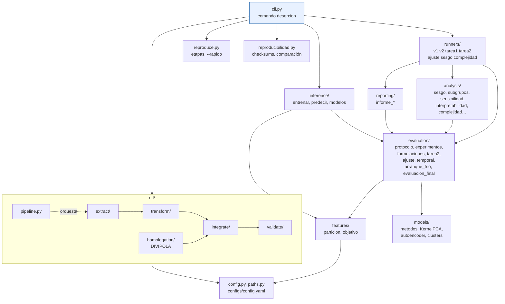
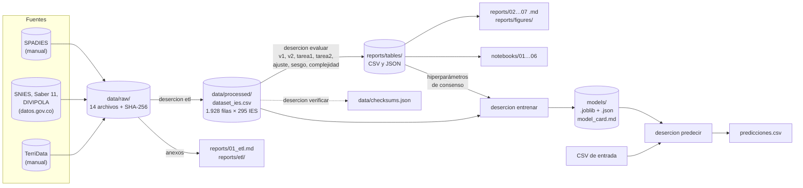
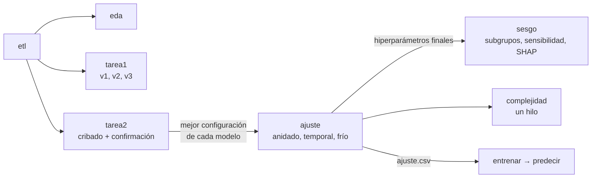
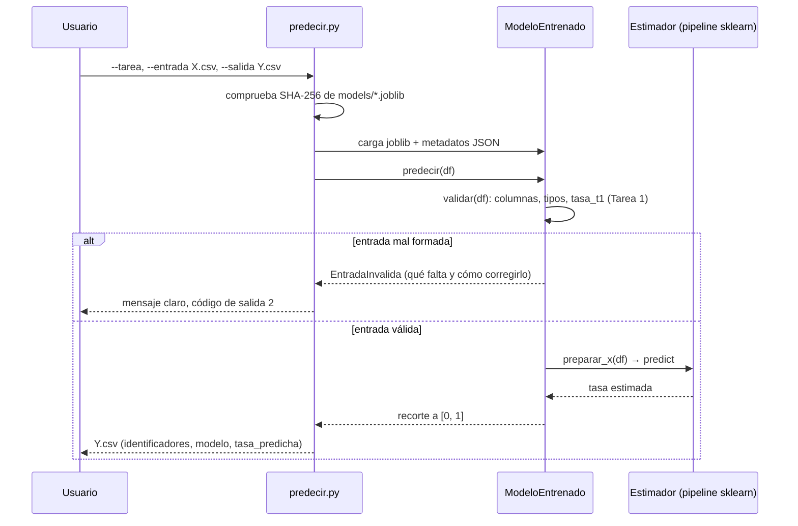

# Arquitectura

Paquete `desercion_ies` (src layout) y comando `desercion`. Los diagramas están en [Mermaid](https://mermaid.js.org/) y se ven en GitHub. Los nombres de módulos son los de `src/desercion_ies/`; el traductor desde la estructura anterior está en [`MIGRACION.md`](MIGRACION.md).

## 1. Módulos y dependencias
Las flechas van de quien usa a quien es usado. `cli` solo importa la biblioteca estándar: carga cada etapa al usarla (para fijar los hilos de BLAS antes de importar numpy en `evaluar complejidad`).

## 2. Flujo de datos
Los archivos crudos no se versionan; el dataset procesado sí. Cada etapa de modelado parte de `data/processed/dataset_ies.csv` y deja tablas, figuras e informes numerados en `reports/`.

## 3. Etapas de evaluación y su dependencia
`desercion reproducir` encadena las etapas en este orden; cada una necesita la salida de la anterior (en `--rapido`, si falta, se copia de lo publicado).

## 4. Camino de una predicción
`predecir` usa el mismo camino que la evaluación (`ajuste.preparar` → `evaluacion_final.construir_final` → recorte a [0, 1]), de modo que una fila predicha por el modelo guardado y por el pipeline de evaluación da el mismo valor (hay una prueba que lo exige).

## 5. Decisiones de diseño
- **Una configuración, muchas etapas:** `configs/config.yaml` fija datos, filtros, grillas, semillas y rutas de salida; el modo `--rapido` solo la reescribe (menos semillas y grillas más chicas) y redirige las salidas a `reproduccion/`.
- **Sin cambios de lógica al reorganizar:** la estructura se movió con `git mv` y los resultados se comprobaron byte a byte (ver `REPRODUCIBILIDAD.md`).
- **Raíz del proyecto sin depender del directorio actual:** `paths.py` la detecta desde el propio paquete (o `DESERCION_ROOT`); el comando cambia a esa raíz porque las rutas de la configuración son relativas a ella.
- **Informes generados desde las tablas:** cada `reporting/informe_*` lee los CSV de `reports/tables/` y escribe el informe; por eso `--solo-informe` regenera un informe sin repetir los cálculos.
- **Modelos guardados con integridad:** cada `.joblib` lleva el SHA-256 en su JSON, que `predecir` verifica antes de cargarlo (joblib es pickle).
