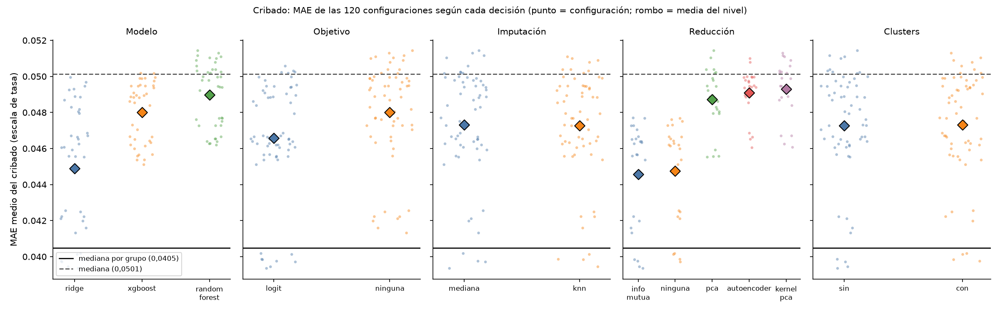
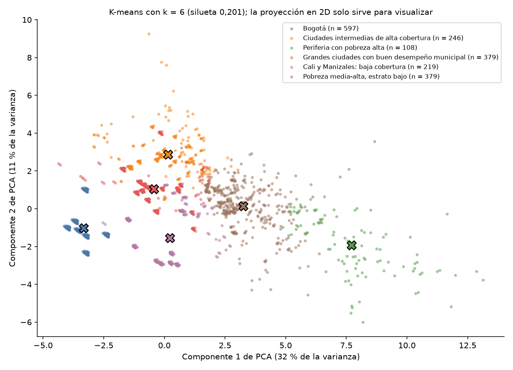

# Resultados de la Tarea 2: estimación sin historia («arranque en frío»)

Generado por `desercion evaluar tarea2` (motor en `src/desercion_ies/evaluation/tarea2.py`). Todas las cifras salen de la corrida; no se editan a mano (salvo el nombre corto de cada cluster, una interpretación documentada abajo).

**Tarea.** Estimar la tasa de deserción de una IES solo con su contexto institucional y territorial (formulación A: sin ninguna variable de historia ni de `NUNCA_EXPLICATIVAS`). La validación agrupa por IES, así que cada IES de prueba es nueva para el modelo, como una institución sin historia. El paper tiene dos tareas: la Tarea 1 (pronóstico con historia) está en `reports/02_tarea1.md`.

## Diseño

- **Datos:** `data/processed/dataset_ies.csv` sin cambios, 1.928 filas y 295 IES; 33 variables numéricas (con los indicadores `falta_*`) y 2 categóricas (sector y carácter).
- **Líneas base:** `base_mediana` (mediana de la tasa del entrenamiento) y `base_mediana_grupo` (mediana por carácter × sector del entrenamiento; si un grupo no existe en el entrenamiento, la mediana global). Las predicciones de los modelos se recortan a [0, 1].
- **Metodologías.** Objetivo: ninguna o logit. Imputación: mediana o KNN (k = 5). Reducción (metodología 3): ninguna; información mutua (k = 15); PCA (90 % de varianza, 16 componentes en el conjunto completo); **KernelPCA** (RBF, mismo número de componentes que PCA en cada pliegue, gamma = 1 / n_variables); **autoencoder** (n → 16 → 8 → 16 → n, activación tanh, parada temprana con validación interna del 15 %, semilla fija, devuelve el cuello de botella; construido con `MLPRegressor` de scikit-learn para no agregar una dependencia como PyTorch o Keras). **Clusters** (opción independiente, sí/no): K-means sobre las variables territoriales e institucionales imputadas y escaladas (sin los indicadores `falta_*`), con k elegido por silueta entre 3 y 8 dentro de cada pliegue; agrega el cluster (one-hot) y las distancias a los centroides como variables **nuevas** (no reemplazan ni se reducen). Modelos: ridge, random forest y xgboost con los hiperparámetros por defecto de la v1.
- **Todos los transformers** (imputación, escalado, selección, PCA, KernelPCA, autoencoder y clusters) se ajustan solo con el entrenamiento de cada pliegue.
- **Protocolo en dos etapas** (para no seleccionar sobre los mismos pliegues). **a) Cribado:** GroupKFold por IES, 5 pliegues, una semilla (11), sobre las 120 configuraciones de la grilla (2 × 2 × 5 × 2 × 3), en paralelo. **b) Confirmación:** protocolo de la v3 (GroupKFold repetido 5 × 5, 25 ajustes por configuración) con semillas distintas ([201, 202, 203, 204, 205]); incluye las dos líneas base, la mejor configuración de cada modelo y la mejor de cada método de reducción según el cribado (7 configuraciones sin repetir). El IC 95 % de la media y la «p t corregida» usan la varianza corregida de Nadeau y Bengio con `n_prueba/n_entrenamiento` = 0,250; el Wilcoxon se aplica a las 25 diferencias pareadas y no corrige la dependencia (más optimista).
- **Tiempo de la corrida:** cribado 827 s, confirmación 42 s, total 879 s (14,7 min), con `n_jobs=-1`. scikit-learn 1.9.0, xgboost 3.4.1.

## Conclusión

- **¿Alguna configuración supera a la línea base por carácter × sector?** De 7 configuraciones confirmadas, 0 tienen menor error con significancia en las dos pruebas (Wilcoxon y t corregida < 0,05), 2 tienen menor error medio sin esa significancia y 5 no mejoran a la base. La de menor MAE es `ridge | logit | mediana | info_mutua | sin clusters`: 0,0396 [0,0353; 0,0440] frente a 0,0405 [0,0356; 0,0454] de la mediana por grupo (+2,2 %; p Wilcoxon 0,019, p t corregida 0,349, gana en 76 % de los pliegues); mejora; significativa solo en Wilcoxon, que no corrige la dependencia. Sin ajustar por comparaciones múltiples; con Bonferroni (7 comparaciones) la p t corregida de esa configuración sería 1,000. Frente a la mediana global la mejor mejora +20,9 % (p Wilcoxon < 0,001). La mediana por grupo mejora a la global en +19,1 % de MAE (0,0405 frente a 0,0501).
- **¿Qué método de reducción ayuda?** En el cribado, efecto de cada reducción frente a no reducir con las demás decisiones iguales (diferencia de MAE; negativa = ayuda):
  - `info_mutua`: -0,0002 en promedio (24 pares; reduce el error en 67 % de ellos).
  - `pca`: 0,0040 en promedio (24 pares; reduce el error en 0 % de ellos).
  - `autoencoder`: 0,0043 en promedio (24 pares; reduce el error en 0 % de ellos).
  - `kernel_pca`: 0,0045 en promedio (24 pares; reduce el error en 0 % de ellos).
  En la confirmación, la mejor configuración de cada reducción frente a la mejor sin reducción (`ridge | logit | mediana | ninguna | sin clusters`) (diferencia = MAE sin reducir − MAE con reducción; positiva = la reducción ayuda):
  - `ridge | logit | mediana | info_mutua | sin clusters`: 0,0003 [-0,0005; 0,0011] (mejora; significativa solo en Wilcoxon, que no corrige la dependencia; p Wilcoxon 0,042, p t corregida 0,453).
  - `ridge | logit | mediana | pca | sin clusters`: -0,0055 [-0,0104; -0,0005] (empeora, significativa en ambas pruebas; p Wilcoxon < 0,001, p t corregida 0,032).
  - `ridge | logit | mediana | kernel_pca | sin clusters`: -0,0062 [-0,0106; -0,0017] (empeora, significativa en ambas pruebas; p Wilcoxon < 0,001, p t corregida 0,009).
  - `ridge | logit | knn | autoencoder | sin clusters`: -0,0059 [-0,0109; -0,0009] (empeora, significativa en ambas pruebas; p Wilcoxon < 0,001, p t corregida 0,023).
- **¿PCA sigue empeorando y las alternativas no lineales lo corrigen?** PCA sigue empeorando (diferencia media 0,0040 frente a no reducir, en el cribado). KernelPCA: 0,0045; autoencoder: 0,0043. Ninguna alternativa no lineal reduce el daño de PCA.
- **¿Ayudan los clusters como variables nuevas?** En el cribado, con clusters frente a sin clusters (demás decisiones iguales): diferencia media de MAE 0,0000 (60 pares; reduce el error en 45 % de ellos).
- **Modelos** (MAE medio de sus configuraciones en el cribado): ridge (0,0449), xgboost (0,0480), random_forest (0,0490).

**Sobre LDA.** No se implementa LDA: es un método lineal y supervisado para **clases** (busca las direcciones que mejor separan categorías), y aquí el objetivo es una tasa continua. Solo aplicaría discretizando la tasa (por ejemplo, en terciles), lo que descarta información del objetivo y convierte la regresión en una clasificación, con otro problema y otras métricas.

## Cribado (120 configuraciones, una semilla)

### Las diez mejores configuraciones

| # | Configuración (modelo \| objetivo \| imputación \| reducción \| clusters) | MAE medio ± desv. | Mejora vs. mediana por grupo |
|---|---|---|---|
| — | **base_mediana_grupo** | 0,0405 ± 0,0058 | +0,0 % |
| — | **base_mediana** | 0,0501 ± 0,0075 | -23,8 % |
| 1 | ridge \| logit \| mediana \| info_mutua \| sin clusters | 0,0394 ± 0,0054 | +2,8 % |
| 2 | ridge \| logit \| knn \| info_mutua \| sin clusters | 0,0394 ± 0,0055 | +2,6 % |
| 3 | ridge \| logit \| mediana \| ninguna \| sin clusters | 0,0397 ± 0,0055 | +1,9 % |
| 4 | ridge \| logit \| mediana \| info_mutua \| con clusters | 0,0397 ± 0,0050 | +1,8 % |
| 5 | ridge \| logit \| knn \| info_mutua \| con clusters | 0,0398 ± 0,0051 | +1,6 % |
| 6 | ridge \| logit \| knn \| ninguna \| sin clusters | 0,0399 ± 0,0057 | +1,6 % |
| 7 | ridge \| logit \| knn \| ninguna \| con clusters | 0,0401 ± 0,0054 | +0,9 % |
| 8 | ridge \| logit \| mediana \| ninguna \| con clusters | 0,0402 ± 0,0050 | +0,8 % |
| 9 | ridge \| ninguna \| mediana \| info_mutua \| sin clusters | 0,0413 ± 0,0055 | -2,0 % |
| 10 | ridge \| ninguna \| knn \| info_mutua \| sin clusters | 0,0416 ± 0,0058 | -2,7 % |

### Efecto medio de cada metodología y de cada modelo

MAE medio (y mediano) de las configuraciones que usan cada nivel, promediando sobre las demás decisiones, y el mejor MAE de ese nivel.

| Decisión | Nivel | Configuraciones | MAE medio | MAE mediano | Mejor MAE |
|---|---|---|---|---|---|
| Modelo | ridge | 40 | 0,0449 | 0,0460 | 0,0394 |
| Modelo | xgboost | 40 | 0,0480 | 0,0487 | 0,0451 |
| Modelo | random_forest | 40 | 0,0490 | 0,0496 | 0,0462 |
| Objetivo | logit | 60 | 0,0466 | 0,0465 | 0,0394 |
| Objetivo | ninguna | 60 | 0,0480 | 0,0489 | 0,0413 |
| Imputación | knn | 60 | 0,0473 | 0,0478 | 0,0394 |
| Imputación | mediana | 60 | 0,0473 | 0,0479 | 0,0394 |
| Reducción | info_mutua | 24 | 0,0446 | 0,0460 | 0,0394 |
| Reducción | ninguna | 24 | 0,0448 | 0,0462 | 0,0397 |
| Reducción | pca | 24 | 0,0487 | 0,0489 | 0,0455 |
| Reducción | autoencoder | 24 | 0,0491 | 0,0494 | 0,0460 |
| Reducción | kernel_pca | 24 | 0,0493 | 0,0495 | 0,0461 |
| Clusters | sin | 60 | 0,0473 | 0,0478 | 0,0394 |
| Clusters | con | 60 | 0,0473 | 0,0478 | 0,0397 |

### Contrastes pareados (demás decisiones iguales)

Cada fila compara un nivel con el de referencia en cada par de configuraciones que solo difieren en esa decisión. Diferencia negativa = el nivel reduce el MAE.

| Decisión | Nivel | Frente a | Pares | Diferencia media de MAE | Diferencia mediana | % de pares en que reduce el error |
|---|---|---|---|---|---|---|
| Modelo | xgboost | ridge | 40 | 0,0031 | 0,0029 | 5 % |
| Modelo | random_forest | ridge | 40 | 0,0041 | 0,0039 | 2 % |
| Objetivo | logit | ninguna | 60 | -0,0014 | -0,0012 | 100 % |
| Imputación | knn | mediana | 60 | 0,0000 | 0,0000 | 48 % |
| Reducción | info_mutua | ninguna | 24 | -0,0002 | -0,0003 | 67 % |
| Reducción | pca | ninguna | 24 | 0,0040 | 0,0036 | 0 % |
| Reducción | autoencoder | ninguna | 24 | 0,0043 | 0,0034 | 0 % |
| Reducción | kernel_pca | ninguna | 24 | 0,0045 | 0,0040 | 0 % |
| Clusters | con | sin | 60 | 0,0000 | 0,0001 | 45 % |

## Confirmación (GroupKFold repetido 5 × 5, semillas distintas a las del cribado)

Configuraciones elegidas en el cribado: la mejor de cada modelo y la mejor de cada método de reducción. La referencia es la mediana por carácter × sector; «Diferencia» y «Mejora» son positivas cuando la configuración tiene menos error.

| Configuración | MAE media [IC 95 %] | R² medio | Diferencia vs. mediana por grupo [IC 95 %] | Mejora | p Wilcoxon | p t corregida | Gana en | Mejora vs. mediana | p Wilcoxon vs. mediana |
|---|---|---|---|---|---|---|---|---|---|
| **base_mediana_grupo** | 0,0405 [0,0356; 0,0454] | 0,270 | — | — | — | — | — | +19,1 % | < 0,001 |
| **base_mediana** | 0,0501 [0,0425; 0,0577] | -0,072 | -0,0096 [-0,0140; -0,0052] | -23,6 % | < 0,001 | < 0,001 | 0 % | — | — |
| ridge \| logit \| mediana \| info_mutua \| sin clusters | 0,0396 [0,0353; 0,0440] | 0,315 | 0,0009 [-0,0010; 0,0028] | +2,2 % | 0,019 | 0,349 | 76 % | +20,9 % | < 0,001 |
| ridge \| logit \| mediana \| ninguna \| sin clusters | 0,0399 [0,0356; 0,0443] | 0,312 | 0,0006 [-0,0015; 0,0027] | +1,5 % | 0,113 | 0,562 | 60 % | +20,3 % | < 0,001 |
| xgboost \| logit \| mediana \| ninguna \| con clusters | 0,0453 [0,0395; 0,0512] | 0,015 | -0,0048 [-0,0099; 0,0004] | -11,8 % | < 0,001 | 0,066 | 20 % | +9,5 % | 0,002 |
| ridge \| logit \| mediana \| pca \| sin clusters | 0,0454 [0,0380; 0,0528] | 0,144 | -0,0049 [-0,0089; -0,0009] | -12,0 % | < 0,001 | 0,020 | 4 % | +9,4 % | < 0,001 |
| ridge \| logit \| knn \| autoencoder \| sin clusters | 0,0458 [0,0382; 0,0535] | 0,127 | -0,0053 [-0,0094; -0,0012] | -13,1 % | < 0,001 | 0,014 | 4 % | +8,5 % | < 0,001 |
| ridge \| logit \| mediana \| kernel_pca \| sin clusters | 0,0461 [0,0389; 0,0533] | 0,123 | -0,0056 [-0,0093; -0,0019] | -13,8 % | < 0,001 | 0,005 | 4 % | +8,0 % | < 0,001 |
| random_forest \| logit \| mediana \| ninguna \| con clusters | 0,0478 [0,0428; 0,0528] | -0,071 | -0,0073 [-0,0128; -0,0018] | -17,9 % | < 0,001 | 0,012 | 4 % | +4,6 % | 0,156 |

## Clusters (k = 6)

K-means ajustado con **todas** las filas (solo para describirlos; la evaluación ajusta los clusters dentro de cada pliegue). k por silueta entre 3 y 8: k = 3: 0,177, k = 4: 0,176, k = 5: 0,194, k = 6: 0,201, k = 7: 0,178, k = 8: 0,180. Los nombres cortos son una interpretación manual a partir de los municipios sede dominantes y de las medias de abajo.

| Cluster | Filas | IES | Municipios sede dominantes | % oficial | % universidad | Matrícula mediana (t-2) | Tasa mediana | Puntaje Saber 11 medio | % estrato bajo | NBI (%) | IPM censal | Cobertura bruta media | MDM (desempeño municipal) | Matrícula ES del municipio |
|---|---|---|---|---|---|---|---|---|---|---|---|---|---|---|
| **Bogotá** (id 0) | 597 | 93 | Bogotá (100 %) | 11 | 35 | 3.802 | 11,4 % | 272,4 | 55,3 | 7,6 | 20,0 | 90,0 | 77,1 | 750.098 |
| **Ciudades intermedias de alta cobertura** (id 1) | 246 | 74 | Bucaramanga (24 %), Pereira (13 %), Tunja (11 %) | 30 | 54 | 3.337 | 8,5 % | 273,5 | 57,8 | 9,6 | 23,2 | 105,0 | 70,6 | 45.587 |
| **Periferia con pobreza alta** (id 2) | 108 | 25 | Montería (14 %), Quibdó (13 %), Sincelejo (9 %) | 71 | 60 | 1.323 | 10,8 % | 242,6 | 89,9 | 46,1 | 63,6 | 86,2 | 50,8 | 9.593 |
| **Grandes ciudades con buen desempeño municipal** (id 3) | 379 | 70 | Medellín (55 %), Barranquilla (28 %), Bucaramanga (7 %) | 22 | 40 | 4.052 | 9,5 % | 257,8 | 59,5 | 11,8 | 27,8 | 97,2 | 78,3 | 178.374 |
| **Cali y Manizales: baja cobertura** (id 4) | 219 | 39 | Cali (63 %), Manizales (16 %), Palmira (8 %) | 29 | 48 | 2.664 | 9,8 % | 259,9 | 56,9 | 9,0 | 25,5 | 79,5 | 75,1 | 89.001 |
| **Pobreza media-alta, estrato bajo** (id 5) | 379 | 86 | Cartagena (18 %), Popayán (7 %), Cúcuta (6 %) | 44 | 47 | 2.703 | 9,5 % | 255,1 | 76,9 | 19,5 | 39,0 | 91,6 | 58,6 | 30.415 |

Medias de todas las variables por cluster en `reports/tables/clusters_tarea2.csv`.

**Lectura.** Los clusters separan sobre todo **ciudades**: cada uno está dominado por uno o dos municipios sede, porque las variables territoriales no cambian entre las IES de un mismo municipio y año. Por eso el cluster funciona casi como un identificador de ciudad y de su perfil socioeconómico. La composición de algunos cambia con los años (por ejemplo, el de ciudades intermedias crece hacia 2021), de modo que también recoge cambios de las fuentes de un año a otro. La silueta es baja (0,201): los grupos se traslapan y no son una partición nítida.

## Supuestos y limitaciones

- **Contexto compartido entre IES:** en la validación por IES, las demás IES de la misma ciudad están en el entrenamiento y comparten todas las variables territoriales; el modelo puede aprender el nivel de cada ciudad. La mediana por carácter × sector no usa la ciudad.
- **Selección de la confirmación:** el cribado elige con una semilla de pliegues y la confirmación usa otras; aun así ambas usan el mismo dataset y la grilla es grande (120 configuraciones), por lo que el cribado sobrestima a los ganadores.
- **Parada temprana del autoencoder:** en los 5 pliegues del cribado el autoencoder paró antes del máximo de 500 iteraciones en 0 de 5 (iteraciones por pliegue: 500, 500, 500, 500, 500). Si llega al máximo, el criterio de parada de scikit-learn (15 iteraciones seguidas sin mejora de la validación interna mayor que 1e-4) no se cumplió: la parada temprana está activa pero no limitó el entrenamiento en esos pliegues, y el autoencoder se entrenó hasta el máximo. Error de reconstrucción medio (unidades estandarizadas): 0,190 en entrenamiento y 0,218 en prueba.
- **Autoencoder:** la validación interna de la parada temprana es una partición aleatoria de las filas de entrenamiento (no agrupa por IES) y solo decide cuándo parar. Los tiempos se midieron con las configuraciones corriendo en paralelo y no son comparables con los de otras corridas.
- **Hiperparámetros por defecto:** no se ajustaron (es una comparación de metodologías). `RidgeCV` elige su alfa con validación interna sin agrupar por IES dentro del entrenamiento.
- **Dependencia entre pliegues:** la corrección de Nadeau y Bengio es una aproximación; con 5 × 5 pliegues, los p de Wilcoxon sobre pares dependientes son optimistas.
- El sesgo de selección, supervivencia y geografía de `reports/05_sesgo_dataset.md` aplica igual a estos resultados.
