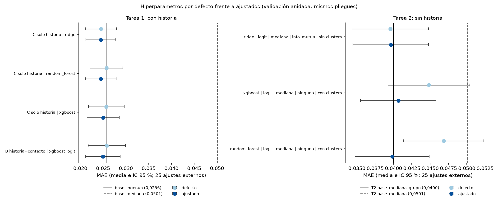
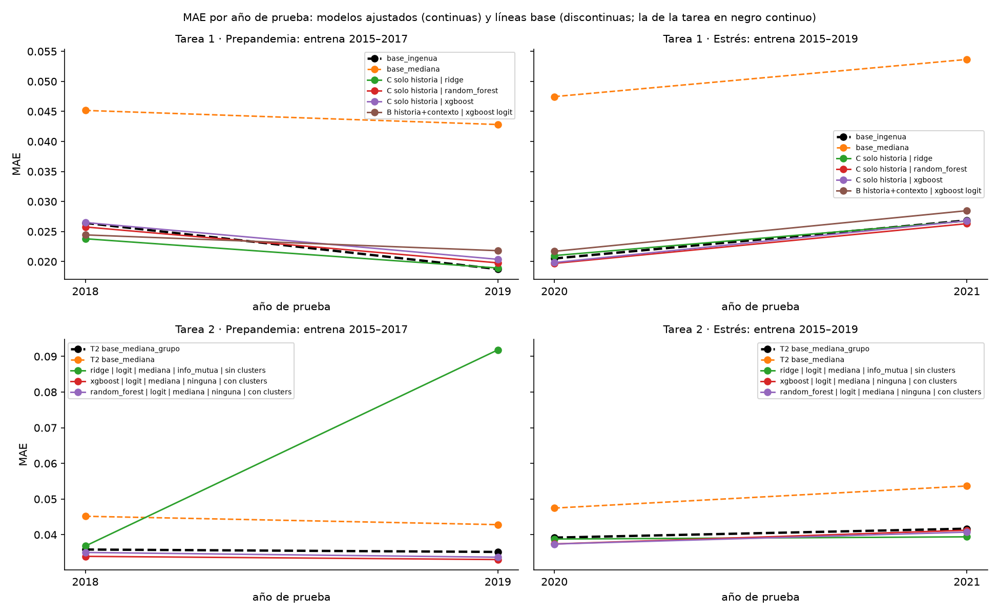

# Ajuste de hiperparámetros, particiones temporales y arranque en frío estricto

Generado por `desercion evaluar ajuste` (módulos `src/desercion_ies/evaluation/ajuste.py`, `temporal.py` y `arranque_frio.py`). Todas las cifras salen de la corrida; no se editan a mano. Continúa `reports/02_tarea1.md` (Tarea 1) y `reports/03_tarea2.md` (Tarea 2).

**Objetivo.** Descartar dos objeciones antes de cerrar la conclusión de que ningún modelo supera con firmeza a su línea base: (1) que los modelos rindan poco por usar hiperparámetros por defecto, y (2) que la validación por IES no represente el uso real (predecir años futuros, o IES en ciudades no vistas).

## Diseño

- **Ajuste con validación anidada (sin fuga).** Externa: GroupKFold por `cod_ies`, 5 pliegues repetidos con las semillas [301, 302, 303, 304, 305] (distintas a las del cribado, la confirmación y la v3), 25 ajustes por configuración. Interna: dentro de cada pliegue externo, `RandomizedSearchCV` de 30 iteraciones, scoring MAE, GroupKFold por IES de 3 pliegues, **solo con el entrenamiento externo** (una prueba lo verifica). El mejor modelo se reajusta con todo el entrenamiento externo y se mide en la prueba externa; la versión por defecto (hiperparámetros de la v1) se mide en los mismos pliegues. Predicciones recortadas a [0, 1].
- **Espacios.** ridge: `alpha` log-uniforme 1e-3–1e3 (se usa `Ridge`; la versión por defecto usa `RidgeCV`). random forest: `n_estimators` {200, 500}, `max_depth` {3, 5, 8, None}, `min_samples_leaf` {1, 5, 10, 20}, `max_features` {0,3, 0,5, sqrt}. xgboost: `n_estimators` {200, 500}, `max_depth` {2, 3, 4, 6}, `learning_rate` log-uniforme 0,01–0,3, `subsample` {0,7, 1,0}, `colsample_bytree` {0,5, 0,8, 1,0}, `min_child_weight` {1, 5, 10}, `reg_lambda` log-uniforme 0,1–10. Si el preprocesamiento incluye información mutua, se ajusta también `k` ([5, 10, 15, 20, 25, 30]).
- **Configuraciones** (fijadas antes de correr). Tarea 1: C solo historia (ridge, random forest, xgboost) y B historia + contexto (xgboost, logit). Tarea 2: la mejor configuración de cada modelo de la confirmación de la Tarea 2. Líneas base: ingenua (tasa de t-1) en la Tarea 1; mediana por carácter × sector en la Tarea 2 (más la mediana global).
- **Inferencia del ajuste:** IC 95 % y «p t corregida» con la varianza corregida de Nadeau y Bengio; el Wilcoxon sobre los 25 pares no corrige la dependencia (más optimista). `n_jobs=-1` se aplica sobre (configuración, pliegue externo) y cada búsqueda interna corre en un hilo, para no sobresuscribir los núcleos.
- **Particiones temporales.** Prepandemia: entrena 2015–2017, prueba 2018–2019. Estrés: entrena 2015–2019, prueba 2020–2021. Para cada partición se re-ajusta con la misma búsqueda interna **solo con los años de entrenamiento** (una prueba verifica que ningún año de prueba entra al entrenamiento ni a la búsqueda). **Tarea 1 es un pronóstico a un paso:** para predecir el año t se usa la tasa observada de t-1 aunque t-1 esté en el período de prueba (en la práctica está disponible cuando se predice t); lo único que se oculta al entrenar son las filas y los objetivos de los años de prueba. IC 95 % por bootstrap sobre IES (1000 réplicas, semilla 2026; se remuestrean IES completas y el mismo remuestreo se usa para todas las configuraciones, así que las diferencias con la línea base son pareadas).
- **Arranque en frío estricto (solo Tarea 2).** Se repite la confirmación (5 × 5, las mismas configuraciones y semillas) con GroupKFold por municipio sede (`cod_divipola_mpio`), de modo que ninguna ciudad de prueba aparece en el entrenamiento.
- **Tiempo de la corrida:** ajuste anidado 1582 s, particiones temporales 222 s, arranque en frío 60 s; total 1864 s (31,1 min).

## Conclusión

**1. ¿El ajuste de hiperparámetros cambia alguna conclusión?** (validación anidada, 25 ajustes por configuración; diferencia positiva = menos error)
- `C solo historia | ridge`: MAE 0,0245 por defecto → 0,0245 ajustado (el ajuste cambia 0,0000 [-0,0003; 0,0004], p t corregida 0,760). Frente a la línea base: por defecto +4,2 % (mejora, significativa en ambas pruebas); ajustado +4,4 % (mejora, significativa en ambas pruebas; p Wilcoxon < 0,001, p t corregida 0,011). No cambia la conclusión («supera»).
- `C solo historia | random_forest`: MAE 0,0257 por defecto → 0,0245 ajustado (el ajuste cambia 0,0012 [-0,0002; 0,0026], p t corregida 0,082). Frente a la línea base: por defecto -0,4 % (no mejora, sin significancia); ajustado +4,3 % (mejora; significativa solo en Wilcoxon, que no corrige la dependencia; p Wilcoxon < 0,001, p t corregida 0,057). No cambia la conclusión («sin diferencia firme»).
- `C solo historia | xgboost`: MAE 0,0257 por defecto → 0,0250 ajustado (el ajuste cambia 0,0007 [-0,0007; 0,0021], p t corregida 0,333). Frente a la línea base: por defecto -0,3 % (no mejora, sin significancia); ajustado +2,3 % (mejora; significativa solo en Wilcoxon, que no corrige la dependencia; p Wilcoxon 0,020, p t corregida 0,359). No cambia la conclusión («sin diferencia firme»).
- `B historia+contexto | xgboost logit`: MAE 0,0258 por defecto → 0,0250 ajustado (el ajuste cambia 0,0009 [-0,0004; 0,0022], p t corregida 0,184). Frente a la línea base: por defecto -0,8 % (no mejora, sin significancia); ajustado +2,6 % (mejora, sin significancia; p Wilcoxon 0,080, p t corregida 0,496). No cambia la conclusión («sin diferencia firme»).
- `ridge | logit | mediana | info_mutua | sin clusters`: MAE 0,0396 por defecto → 0,0396 ajustado (el ajuste cambia -0,0001 [-0,0004; 0,0003], p t corregida 0,709). Frente a la línea base: por defecto +1,1 % (mejora, sin significancia); ajustado +0,9 % (mejora, sin significancia; p Wilcoxon 0,127, p t corregida 0,596). No cambia la conclusión («sin diferencia firme»).
- `xgboost | logit | mediana | ninguna | con clusters`: MAE 0,0448 por defecto → 0,0407 ajustado (el ajuste cambia 0,0042 [0,0025; 0,0058], p t corregida < 0,001). Frente a la línea base: por defecto -12,1 % (empeora, significativa en ambas pruebas); ajustado -1,7 % (no mejora, sin significancia; p Wilcoxon 0,096, p t corregida 0,522). **Cambia la conclusión** (de «empeora» a «sin diferencia firme»).
- `random_forest | logit | mediana | ninguna | con clusters`: MAE 0,0469 por defecto → 0,0398 ajustado (el ajuste cambia 0,0070 [0,0038; 0,0103], p t corregida < 0,001). Frente a la línea base: por defecto -17,1 % (empeora, significativa en ambas pruebas); ajustado +0,4 % (mejora, sin significancia; p Wilcoxon 0,474, p t corregida 0,804). **Cambia la conclusión** (de «empeora» a «sin diferencia firme»).
  El ajuste mejora de forma significativa (t corregida < 0,05) a su versión por defecto en 2 de 7 configuraciones: `xgboost | logit | mediana | ninguna | con clusters`, `random_forest | logit | mediana | ninguna | con clusters`.
  «Cambia la conclusión» significa que cambia la clase frente a la línea base (`supera`, `empeora` o `sin diferencia firme`, exigiendo significancia en las dos pruebas): ocurre en 2 de 7 configuraciones; superan a su línea base con significancia en las dos pruebas: `C solo historia | ridge`.

**2. ¿La ventaja de la naive se mantiene en años futuros y en pandemia?** (Tarea 1, pronóstico a un paso con la tasa observada de t-1; bootstrap sobre IES, diferencia = MAE de la naive − MAE del modelo ajustado; positiva = gana el modelo)
- **Prepandemia (entrena 2015–2017, prueba 2018–2019):** la naive tiene MAE 0,0226 [0,0188; 0,0269].
  - `C solo historia | ridge`: MAE 0,0214; diferencia 0,0012 [-0,0002; 0,0026]: no distinguible (el IC incluye 0).
  - `C solo historia | random_forest`: MAE 0,0228; diferencia -0,0002 [-0,0019; 0,0015]: no distinguible (el IC incluye 0).
  - `C solo historia | xgboost`: MAE 0,0235; diferencia -0,0008 [-0,0023; 0,0006]: no distinguible (el IC incluye 0).
  - `B historia+contexto | xgboost logit`: MAE 0,0231; diferencia -0,0005 [-0,0028; 0,0018]: no distinguible (el IC incluye 0).
- **Estrés (entrena 2015–2019, prueba 2020–2021):** la naive tiene MAE 0,0237 [0,0194; 0,0289].
  - `C solo historia | ridge`: MAE 0,0239; diferencia -0,0002 [-0,0019; 0,0014]: no distinguible (el IC incluye 0).
  - `C solo historia | random_forest`: MAE 0,0230; diferencia 0,0007 [-0,0006; 0,0021]: no distinguible (el IC incluye 0).
  - `C solo historia | xgboost`: MAE 0,0233; diferencia 0,0004 [-0,0008; 0,0016]: no distinguible (el IC incluye 0).
  - `B historia+contexto | xgboost logit`: MAE 0,0251; diferencia -0,0014 [-0,0032; 0,0005]: no distinguible (el IC incluye 0).
- **Resumen:** en 8 de 8 comparaciones (modelo ajustado frente a la naive, por partición) el IC 95 % de la diferencia incluye 0: ningún modelo ajustado se distingue de la naive ni antes ni durante la pandemia. La naive misma pasa de MAE 0,0226 a 0,0237 en pandemia, es decir, se mantiene competitiva en años futuros y en pandemia.

**3. ¿En 2020–2021 alguna línea base o modelo se degrada más?** (razón entre el MAE del estrés y el de la prepandemia, con el entrenamiento ajustado en cada partición; los entrenamientos son distintos)
- **Tarea 1:** la mayor degradación es la de `base_mediana` (×1,15; MAE 0,0440 → 0,0506). Entre las líneas base, la que más se degrada es `base_mediana` (×1,15); entre los modelos, `C solo historia | ridge` (×1,12). Los modelos se degradan entre ×0,99 y ×1,12; las líneas base, entre ×1,05 y ×1,15.
- **Tarea 2:** la mayor degradación es la de `xgboost | logit | mediana | ninguna | con clusters` (×1,17; MAE 0,0335 → 0,0393). Entre las líneas base, la que más se degrada es `T2 base_mediana` (×1,15); entre los modelos, `xgboost | logit | mediana | ninguna | con clusters` (×1,17). Los modelos se degradan entre ×0,61 y ×1,17; las líneas base, entre ×1,14 y ×1,15.
- **Atención, `ridge | logit | mediana | info_mutua | sin clusters`:** su razón ×0,61 no es una mejora en pandemia: su MAE de la prepandemia (0,0642) es muy superior al de su versión por defecto (0,0360), es decir, el ajuste degradó ese modelo al predecir 2018–2019 (ver la tabla de error por subgrupo, con Bogotá aparte, y la nota de diagnóstico).
- MAE de la naive (Tarea 1) por año de prueba: 2018: 0,0264, 2019: 0,0188, 2020: 0,0205, 2021: 0,0269.

**4. ¿Agrupar por municipio cambia la Tarea 2?** (confirmación 5 × 5 con GroupKFold por municipio sede; ninguna ciudad de prueba aparece en el entrenamiento)
- La mediana por carácter × sector pasa de MAE 0,0405 (por IES) a 0,0373 (por municipio). 0 de 7 configuraciones superan a esa línea base con significancia en las dos pruebas. La de menor MAE por municipio es `xgboost | logit | mediana | ninguna | con clusters`: 0,0375 [0,0282; 0,0468] (-0,5 %; p Wilcoxon 0,396, p t corregida 0,902); por IES esa misma configuración tenía -11,8 %.
- **Respuesta:** agrupar por municipio no cambia la conclusión principal de la Tarea 2: ningún modelo supera con firmeza a la mediana por carácter × sector. Mejora frente a la mediana por carácter × sector (la línea base se recalcula con cada agrupación): `ridge | logit | mediana | info_mutua | sin clusters`: +2,2 % por IES → -0,6 % por municipio; `xgboost | logit | mediana | ninguna | con clusters`: -11,8 % por IES → -0,5 % por municipio; `random_forest | logit | mediana | ninguna | con clusters`: -17,9 % por IES → -1,8 % por municipio; `ridge | logit | mediana | ninguna | sin clusters`: +1,5 % por IES → -3,2 % por municipio; `ridge | logit | mediana | pca | sin clusters`: -12,0 % por IES → -14,0 % por municipio; `ridge | logit | knn | autoencoder | sin clusters`: -13,1 % por IES → -19,0 % por municipio; `ridge | logit | mediana | kernel_pca | sin clusters`: -13,8 % por IES → -16,7 % por municipio.
- Bogotá desbalancea los pliegues: el pliegue que la contiene tiene entre 739 y 1250 filas de prueba (38 % a 65 % del total), frente a 133–463 en los demás; cuando Bogotá está en la prueba, el entrenamiento no tiene ninguna fila de Bogotá.

## 1. Por defecto frente a ajustado (validación anidada)

«Mejora por el ajuste» = MAE por defecto − MAE ajustado (positiva = el ajuste ayuda). La línea base es la de la tarea.

### Tarea 1: con historia (línea base: ingenua)

| Configuración | MAE por defecto [IC 95 %] | MAE ajustado [IC 95 %] | Mejora por el ajuste [IC 95 %] | p t corregida (ajuste) | Defecto vs. línea base (mejora; p t) | Ajustado vs. línea base (mejora; p Wilcoxon; p t; gana en) |
|---|---|---|---|---|---|---|
| **T1 base_ingenua** | — | 0,0256 [0,0225; 0,0288] | — | — | — | — |
| **T1 base_mediana** | — | 0,0501 [0,0441; 0,0560] | — | — | — | — |
| C solo historia \| ridge | 0,0245 [0,0211; 0,0279] | 0,0245 [0,0212; 0,0278] | 0,0000 [-0,0003; 0,0004] | 0,760 | +4,2 %; 0,036 | +4,4 %; < 0,001; 0,011; 96 % |
| C solo historia \| random_forest | 0,0257 [0,0221; 0,0293] | 0,0245 [0,0212; 0,0279] | 0,0012 [-0,0002; 0,0026] | 0,082 | -0,4 %; 0,905 | +4,3 %; < 0,001; 0,057; 88 % |
| C solo historia \| xgboost | 0,0257 [0,0218; 0,0296] | 0,0250 [0,0215; 0,0286] | 0,0007 [-0,0007; 0,0021] | 0,333 | -0,3 %; 0,934 | +2,3 %; 0,020; 0,359; 72 % |
| B historia+contexto \| xgboost logit | 0,0258 [0,0218; 0,0299] | 0,0250 [0,0211; 0,0288] | 0,0009 [-0,0004; 0,0022] | 0,184 | -0,8 %; 0,857 | +2,6 %; 0,080; 0,496; 64 % |

### Tarea 2: sin historia (línea base: mediana por carácter × sector)

| Configuración | MAE por defecto [IC 95 %] | MAE ajustado [IC 95 %] | Mejora por el ajuste [IC 95 %] | p t corregida (ajuste) | Defecto vs. línea base (mejora; p t) | Ajustado vs. línea base (mejora; p Wilcoxon; p t; gana en) |
|---|---|---|---|---|---|---|
| **T2 base_mediana_grupo** | — | 0,0400 [0,0345; 0,0455] | — | — | — | — |
| **T2 base_mediana** | — | 0,0501 [0,0441; 0,0560] | — | — | — | — |
| ridge \| logit \| mediana \| info_mutua \| sin clusters | 0,0396 [0,0343; 0,0448] | 0,0396 [0,0345; 0,0448] | -0,0001 [-0,0004; 0,0003] | 0,709 | +1,1 %; 0,562 | +0,9 %; 0,127; 0,596; 68 % |
| xgboost \| logit \| mediana \| ninguna \| con clusters | 0,0448 [0,0393; 0,0504] | 0,0407 [0,0355; 0,0458] | 0,0042 [0,0025; 0,0058] | < 0,001 | -12,1 %; 0,001 | -1,7 %; 0,096; 0,522; 36 % |
| random_forest \| logit \| mediana \| ninguna \| con clusters | 0,0469 [0,0414; 0,0523] | 0,0398 [0,0348; 0,0449] | 0,0070 [0,0038; 0,0103] | < 0,001 | -17,1 %; < 0,001 | +0,4 %; 0,474; 0,804; 60 % |

### Hiperparámetros más elegidos en los 25 pliegues externos

Valor más frecuente (y en cuántos pliegues); para los continuos, la mediana y el rango.

| Configuración | Hiperparámetro | Elegido en los pliegues externos |
|---|---|---|
| C solo historia \| ridge | `alpha` | mediana 157,4 (rango 98,78–506,2) |
| C solo historia \| random_forest | `max_depth` | None (13 de 25) |
| C solo historia \| random_forest | `max_features` | sqrt (13 de 25) |
| C solo historia \| random_forest | `min_samples_leaf` | 10 (15 de 25) |
| C solo historia \| random_forest | `n_estimators` | 500 (21 de 25) |
| C solo historia \| xgboost | `colsample_bytree` | 0,8 (11 de 25) |
| C solo historia \| xgboost | `learning_rate` | mediana 0,02028 (rango 0,01056–0,05426) |
| C solo historia \| xgboost | `max_depth` | 6 (8 de 25) |
| C solo historia \| xgboost | `min_child_weight` | 1 (15 de 25) |
| C solo historia \| xgboost | `n_estimators` | 200 (21 de 25) |
| C solo historia \| xgboost | `reg_lambda` | mediana 5,247 (rango 0,1075–9,896) |
| C solo historia \| xgboost | `subsample` | 1,0 (14 de 25) |
| B historia+contexto \| xgboost logit | `colsample_bytree` | 0,8 (15 de 25) |
| B historia+contexto \| xgboost logit | `learning_rate` | mediana 0,01606 (rango 0,01454–0,05426) |
| B historia+contexto \| xgboost logit | `max_depth` | 2 (16 de 25) |
| B historia+contexto \| xgboost logit | `min_child_weight` | 1 (17 de 25) |
| B historia+contexto \| xgboost logit | `n_estimators` | 200 (17 de 25) |
| B historia+contexto \| xgboost logit | `reg_lambda` | mediana 3,244 (rango 0,1002–9,896) |
| B historia+contexto \| xgboost logit | `subsample` | 0,7 (16 de 25) |
| ridge \| logit \| mediana \| info_mutua \| sin clusters | `alpha` | mediana 4,043 (rango 0,001329–21,48) |
| ridge \| logit \| mediana \| info_mutua \| sin clusters | `k` | 15 (11 de 25) |
| xgboost \| logit \| mediana \| ninguna \| con clusters | `colsample_bytree` | 1,0 (12 de 25) |
| xgboost \| logit \| mediana \| ninguna \| con clusters | `learning_rate` | mediana 0,01803 (rango 0,01056–0,05363) |
| xgboost \| logit \| mediana \| ninguna \| con clusters | `max_depth` | 2 (23 de 25) |
| xgboost \| logit \| mediana \| ninguna \| con clusters | `min_child_weight` | 10 (12 de 25) |
| xgboost \| logit \| mediana \| ninguna \| con clusters | `n_estimators` | 500 (22 de 25) |
| xgboost \| logit \| mediana \| ninguna \| con clusters | `reg_lambda` | mediana 0,1754 (rango 0,1002–3,241) |
| xgboost \| logit \| mediana \| ninguna \| con clusters | `subsample` | 1,0 (14 de 25) |
| random_forest \| logit \| mediana \| ninguna \| con clusters | `max_depth` | 3 (21 de 25) |
| random_forest \| logit \| mediana \| ninguna \| con clusters | `max_features` | 0,5 (15 de 25) |
| random_forest \| logit \| mediana \| ninguna \| con clusters | `min_samples_leaf` | 20 (13 de 25) |
| random_forest \| logit \| mediana \| ninguna \| con clusters | `n_estimators` | 200 (15 de 25) |

### Tiempos de ajuste y de predicción (para el análisis de complejidad)

Medias por pliegue externo, con las configuraciones corriendo en paralelo (no son comparables con corridas sin paralelismo). «Ajuste» de la variante ajustada es el reajuste del mejor modelo; la búsqueda interna completa está en la última columna.

| Configuración | Variante | Ajuste medio (s) | Predicción media (s) | Búsqueda media (s) |
|---|---|---|---|---|
| C solo historia \| ridge | defecto | 0,354 | 0,0093 | — |
| C solo historia \| ridge | ajustado | 0,017 | 0,0063 | 3,1 |
| C solo historia \| random_forest | defecto | 3,673 | 0,1086 | — |
| C solo historia \| random_forest | ajustado | 1,847 | 0,1137 | 115,2 |
| C solo historia \| xgboost | defecto | 0,930 | 0,0159 | — |
| C solo historia \| xgboost | ajustado | 0,227 | 0,0140 | 23,5 |
| B historia+contexto \| xgboost logit | defecto | 1,364 | 0,0347 | — |
| B historia+contexto \| xgboost logit | ajustado | 0,588 | 0,0265 | 97,0 |
| ridge \| logit \| mediana \| info_mutua \| sin clusters | defecto | 0,895 | 0,0250 | — |
| ridge \| logit \| mediana \| info_mutua \| sin clusters | ajustado | 0,800 | 0,0212 | 57,5 |
| xgboost \| logit \| mediana \| ninguna \| con clusters | defecto | 3,495 | 0,0612 | — |
| xgboost \| logit \| mediana \| ninguna \| con clusters | ajustado | 1,780 | 0,0560 | 188,0 |
| random_forest \| logit \| mediana \| ninguna \| con clusters | defecto | 16,919 | 0,1516 | — |
| random_forest \| logit \| mediana \| ninguna \| con clusters | ajustado | 2,970 | 0,0954 | 300,4 |

## 2. Particiones temporales

#### Prepandemia (entrena 2015–2017, prueba 2018–2019) · Tarea 1 (con historia, pronóstico a un paso)

| Configuración | Variante | MAE [IC 95 %] | RMSE [IC 95 %] | R² [IC 95 %] | Diferencia de MAE vs. ingenua (tasa de t-1) [IC 95 %] | Gana en (réplicas) |
|---|---|---|---|---|---|---|
| **base_ingenua** | línea base | 0,0226 [0,0188; 0,0269] | 0,0471 [0,0342; 0,0590] | 0,632 [0,310; 0,783] | — | — |
| **base_mediana** | línea base | 0,0440 [0,0373; 0,0520] | 0,0784 [0,0542; 0,1078] | -0,019 [-0,048; -0,002] | -0,0214 [-0,0271; -0,0161] | 0 % |
| B historia+contexto \| xgboost logit | ajustado | 0,0231 [0,0193; 0,0277] | 0,0475 [0,0313; 0,0638] | 0,625 [0,445; 0,728] | -0,0005 [-0,0028; 0,0018] | 34 % |
| B historia+contexto \| xgboost logit | defecto | 0,0260 [0,0224; 0,0302] | 0,0488 [0,0366; 0,0612] | 0,605 [0,337; 0,734] | -0,0033 [-0,0053; -0,0012] | 0 % |
| C solo historia \| random_forest | ajustado | 0,0228 [0,0193; 0,0268] | 0,0454 [0,0314; 0,0590] | 0,659 [0,439; 0,748] | -0,0002 [-0,0019; 0,0015] | 45 % |
| C solo historia \| random_forest | defecto | 0,0255 [0,0216; 0,0302] | 0,0501 [0,0352; 0,0640] | 0,584 [0,292; 0,708] | -0,0029 [-0,0049; -0,0011] | 0 % |
| C solo historia \| ridge | ajustado | 0,0214 [0,0179; 0,0254] | 0,0425 [0,0294; 0,0551] | 0,700 [0,510; 0,785] | 0,0012 [-0,0002; 0,0026] | 96 % |
| C solo historia \| ridge | defecto | 0,0212 [0,0179; 0,0251] | 0,0420 [0,0290; 0,0550] | 0,708 [0,546; 0,783] | 0,0014 [-0,0005; 0,0032] | 93 % |
| C solo historia \| xgboost | ajustado | 0,0235 [0,0198; 0,0275] | 0,0463 [0,0329; 0,0598] | 0,644 [0,392; 0,750] | -0,0008 [-0,0023; 0,0006] | 14 % |
| C solo historia \| xgboost | defecto | 0,0254 [0,0215; 0,0303] | 0,0522 [0,0375; 0,0672] | 0,549 [0,222; 0,690] | -0,0028 [-0,0052; -0,0006] | 0 % |
#### Prepandemia (entrena 2015–2017, prueba 2018–2019) · Tarea 2 (sin historia)

| Configuración | Variante | MAE [IC 95 %] | RMSE [IC 95 %] | R² [IC 95 %] | Diferencia de MAE vs. mediana por carácter × sector [IC 95 %] | Gana en (réplicas) |
|---|---|---|---|---|---|---|
| **T2 base_mediana_grupo** | línea base | 0,0355 [0,0306; 0,0420] | 0,0643 [0,0422; 0,0918] | 0,316 [0,223; 0,483] | — | — |
| **T2 base_mediana** | línea base | 0,0440 [0,0373; 0,0520] | 0,0784 [0,0542; 0,1078] | -0,019 [-0,048; -0,002] | -0,0085 [-0,0120; -0,0050] | 0 % |
| random_forest \| logit \| mediana \| ninguna \| con clusters | ajustado | 0,0344 [0,0295; 0,0408] | 0,0629 [0,0410; 0,0902] | 0,345 [0,253; 0,504] | 0,0012 [-0,0002; 0,0025] | 95 % |
| random_forest \| logit \| mediana \| ninguna \| con clusters | defecto | 0,0331 [0,0285; 0,0389] | 0,0603 [0,0406; 0,0848] | 0,397 [0,296; 0,554] | 0,0024 [-0,0002; 0,0048] | 96 % |
| ridge \| logit \| mediana \| info_mutua \| sin clusters | ajustado | 0,0642 [0,0573; 0,0723] | 0,1060 [0,0949; 0,1191] | -0,862 [-2,630; -0,131] | -0,0287 [-0,0355; -0,0224] | 0 % |
| ridge \| logit \| mediana \| info_mutua \| sin clusters | defecto | 0,0360 [0,0313; 0,0420] | 0,0628 [0,0429; 0,0884] | 0,347 [0,245; 0,512] | -0,0004 [-0,0022; 0,0012] | 28 % |
| xgboost \| logit \| mediana \| ninguna \| con clusters | ajustado | 0,0335 [0,0289; 0,0395] | 0,0601 [0,0399; 0,0858] | 0,401 [0,305; 0,571] | 0,0020 [0,0002; 0,0040] | 99 % |
| xgboost \| logit \| mediana \| ninguna \| con clusters | defecto | 0,0338 [0,0291; 0,0397] | 0,0611 [0,0421; 0,0855] | 0,381 [0,277; 0,525] | 0,0017 [-0,0008; 0,0041] | 90 % |
#### Estrés (entrena 2015–2019, prueba 2020–2021) · Tarea 1 (con historia, pronóstico a un paso)

| Configuración | Variante | MAE [IC 95 %] | RMSE [IC 95 %] | R² [IC 95 %] | Diferencia de MAE vs. ingenua (tasa de t-1) [IC 95 %] | Gana en (réplicas) |
|---|---|---|---|---|---|---|
| **base_ingenua** | línea base | 0,0237 [0,0194; 0,0289] | 0,0570 [0,0332; 0,0772] | 0,600 [0,402; 0,808] | — | — |
| **base_mediana** | línea base | 0,0506 [0,0435; 0,0586] | 0,0910 [0,0682; 0,1141] | -0,020 [-0,051; -0,003] | -0,0269 [-0,0325; -0,0220] | 0 % |
| B historia+contexto \| xgboost logit | ajustado | 0,0251 [0,0208; 0,0301] | 0,0573 [0,0345; 0,0758] | 0,596 [0,424; 0,789] | -0,0014 [-0,0032; 0,0005] | 7 % |
| B historia+contexto \| xgboost logit | defecto | 0,0252 [0,0206; 0,0302] | 0,0583 [0,0351; 0,0776] | 0,581 [0,396; 0,781] | -0,0015 [-0,0034; 0,0002] | 5 % |
| C solo historia \| random_forest | ajustado | 0,0230 [0,0191; 0,0276] | 0,0540 [0,0320; 0,0724] | 0,641 [0,471; 0,817] | 0,0007 [-0,0006; 0,0021] | 86 % |
| C solo historia \| random_forest | defecto | 0,0251 [0,0209; 0,0302] | 0,0581 [0,0353; 0,0775] | 0,584 [0,380; 0,781] | -0,0015 [-0,0032; 0,0000] | 3 % |
| C solo historia \| ridge | ajustado | 0,0239 [0,0200; 0,0284] | 0,0550 [0,0333; 0,0733] | 0,628 [0,459; 0,803] | -0,0002 [-0,0019; 0,0014] | 40 % |
| C solo historia \| ridge | defecto | 0,0242 [0,0202; 0,0288] | 0,0553 [0,0335; 0,0736] | 0,624 [0,455; 0,798] | -0,0005 [-0,0023; 0,0011] | 26 % |
| C solo historia \| xgboost | ajustado | 0,0233 [0,0192; 0,0280] | 0,0550 [0,0328; 0,0736] | 0,627 [0,447; 0,817] | 0,0004 [-0,0008; 0,0016] | 74 % |
| C solo historia \| xgboost | defecto | 0,0258 [0,0213; 0,0310] | 0,0597 [0,0370; 0,0784] | 0,562 [0,360; 0,762] | -0,0021 [-0,0040; -0,0005] | 0 % |
#### Estrés (entrena 2015–2019, prueba 2020–2021) · Tarea 2 (sin historia)

| Configuración | Variante | MAE [IC 95 %] | RMSE [IC 95 %] | R² [IC 95 %] | Diferencia de MAE vs. mediana por carácter × sector [IC 95 %] | Gana en (réplicas) |
|---|---|---|---|---|---|---|
| **T2 base_mediana_grupo** | línea base | 0,0404 [0,0343; 0,0473] | 0,0766 [0,0539; 0,0992] | 0,278 [0,187; 0,409] | — | — |
| **T2 base_mediana** | línea base | 0,0506 [0,0435; 0,0586] | 0,0910 [0,0682; 0,1141] | -0,020 [-0,051; -0,003] | -0,0101 [-0,0139; -0,0069] | 0 % |
| random_forest \| logit \| mediana \| ninguna \| con clusters | ajustado | 0,0391 [0,0331; 0,0459] | 0,0737 [0,0524; 0,0945] | 0,332 [0,244; 0,442] | 0,0014 [0,0001; 0,0027] | 98 % |
| random_forest \| logit \| mediana \| ninguna \| con clusters | defecto | 0,0377 [0,0325; 0,0438] | 0,0699 [0,0518; 0,0880] | 0,398 [0,198; 0,566] | 0,0027 [-0,0006; 0,0059] | 94 % |
| ridge \| logit \| mediana \| info_mutua \| sin clusters | ajustado | 0,0391 [0,0332; 0,0458] | 0,0736 [0,0518; 0,0950] | 0,333 [0,236; 0,452] | 0,0013 [-0,0001; 0,0029] | 97 % |
| ridge \| logit \| mediana \| info_mutua \| sin clusters | defecto | 0,0391 [0,0333; 0,0459] | 0,0736 [0,0518; 0,0949] | 0,334 [0,235; 0,453] | 0,0013 [-0,0001; 0,0028] | 96 % |
| xgboost \| logit \| mediana \| ninguna \| con clusters | ajustado | 0,0393 [0,0337; 0,0461] | 0,0733 [0,0523; 0,0942] | 0,339 [0,245; 0,454] | 0,0011 [-0,0007; 0,0029] | 88 % |
| xgboost \| logit \| mediana \| ninguna \| con clusters | defecto | 0,0385 [0,0330; 0,0450] | 0,0748 [0,0524; 0,0963] | 0,311 [0,197; 0,466] | 0,0019 [-0,0006; 0,0043] | 94 % |

### Resumen descriptivo con las dos particiones juntas

**Descriptivo: sin intervalos ni pruebas de significancia.** Junta las filas de prueba de prepandemia y de estrés (cada partición con su propio reajuste), por configuración; no sirve para afirmar que un modelo supera a otro. «Precisión 25 % mayor riesgo»: de la cuarta parte con mayor predicción, cuánto está en la cuarta parte con mayor tasa observada (empates repartidos en proporción). Tabla completa: `reports/tables/temporal_descriptivo.csv`.

| Tarea | Configuración | Variante | n | MAE | Error abs. mediano | R² | Error ≤ 0,02 | Error ≤ 0,05 | Spearman | Precisión 25 % mayor riesgo |
|---|---|---|---|---|---|---|---|---|---|---|
| 1 | `base_ingenua` | linea_base | 1095 | 0,0231 | 0,0113 | 0,61 | 68 % | 91 % | 0,87 | 78 % |
| 1 | `base_mediana` | linea_base | 1095 | 0,0473 | 0,0321 | -0,02 | 33 % | 72 % | 0,04 | 25 % |
| 2 | `T2 base_mediana_grupo` | linea_base | 1095 | 0,0380 | 0,0262 | 0,29 | 39 % | 78 % | 0,59 | 59 % |
| 2 | `T2 base_mediana` | linea_base | 1095 | 0,0473 | 0,0321 | -0,02 | 33 % | 72 % | 0,04 | 25 % |
| 1 | `C solo historia \| ridge` | defecto | 1095 | 0,0227 | 0,0124 | 0,66 | 69 % | 91 % | 0,88 | 77 % |
| 1 | `C solo historia \| ridge` | ajustado | 1095 | 0,0226 | 0,0120 | 0,66 | 68 % | 92 % | 0,88 | 77 % |
| 1 | `C solo historia \| random_forest` | defecto | 1095 | 0,0253 | 0,0138 | 0,58 | 65 % | 90 % | 0,87 | 77 % |
| 1 | `C solo historia \| random_forest` | ajustado | 1095 | 0,0229 | 0,0120 | 0,65 | 67 % | 91 % | 0,88 | 78 % |
| 1 | `C solo historia \| xgboost` | defecto | 1095 | 0,0256 | 0,0139 | 0,56 | 65 % | 91 % | 0,87 | 76 % |
| 1 | `C solo historia \| xgboost` | ajustado | 1095 | 0,0234 | 0,0121 | 0,63 | 67 % | 91 % | 0,88 | 79 % |
| 1 | `B historia+contexto \| xgboost logit` | defecto | 1095 | 0,0256 | 0,0140 | 0,59 | 64 % | 89 % | 0,87 | 76 % |
| 1 | `B historia+contexto \| xgboost logit` | ajustado | 1095 | 0,0241 | 0,0133 | 0,61 | 67 % | 91 % | 0,88 | 77 % |
| 2 | `ridge \| logit \| mediana \| info_mutua \| sin clusters` | defecto | 1095 | 0,0375 | 0,0249 | 0,34 | 42 % | 79 % | 0,59 | 62 % |
| 2 | `ridge \| logit \| mediana \| info_mutua \| sin clusters` | ajustado | 1095 | 0,0517 | 0,0279 | -0,18 | 40 % | 73 % | 0,53 | 59 % |
| 2 | `xgboost \| logit \| mediana \| ninguna \| con clusters` | defecto | 1095 | 0,0361 | 0,0224 | 0,34 | 45 % | 80 % | 0,67 | 69 % |
| 2 | `xgboost \| logit \| mediana \| ninguna \| con clusters` | ajustado | 1095 | 0,0364 | 0,0244 | 0,37 | 43 % | 78 % | 0,63 | 66 % |
| 2 | `random_forest \| logit \| mediana \| ninguna \| con clusters` | defecto | 1095 | 0,0354 | 0,0225 | 0,40 | 45 % | 81 % | 0,68 | 69 % |
| 2 | `random_forest \| logit \| mediana \| ninguna \| con clusters` | ajustado | 1095 | 0,0367 | 0,0248 | 0,34 | 43 % | 79 % | 0,62 | 66 % |

### Degradación en 2020–2021 (modelos ajustados y líneas base)

#### Tarea 1

| Configuración | MAE prepandemia (2018–2019) | MAE estrés (2020–2021) | Cambio | Razón estrés / prepandemia |
|---|---|---|---|---|
| base_ingenua | 0,0226 | 0,0237 | 0,0011 | 1,05 |
| base_mediana | 0,0440 | 0,0506 | 0,0065 | 1,15 |
| C solo historia \| ridge | 0,0214 | 0,0239 | 0,0025 | 1,12 |
| C solo historia \| random_forest | 0,0228 | 0,0230 | 0,0002 | 1,01 |
| C solo historia \| xgboost | 0,0235 | 0,0233 | -0,0002 | 0,99 |
| B historia+contexto \| xgboost logit | 0,0231 | 0,0251 | 0,0019 | 1,08 |

#### Tarea 2

| Configuración | MAE prepandemia (2018–2019) | MAE estrés (2020–2021) | Cambio | Razón estrés / prepandemia |
|---|---|---|---|---|
| T2 base_mediana_grupo | 0,0355 | 0,0404 | 0,0049 | 1,14 |
| T2 base_mediana | 0,0440 | 0,0506 | 0,0065 | 1,15 |
| ridge \| logit \| mediana \| info_mutua \| sin clusters | 0,0642 | 0,0391 | -0,0251 | 0,61 |
| xgboost \| logit \| mediana \| ninguna \| con clusters | 0,0335 | 0,0393 | 0,0058 | 1,17 |
| random_forest \| logit \| mediana \| ninguna \| con clusters | 0,0344 | 0,0391 | 0,0047 | 1,14 |

### Nota de diagnóstico: deterioro por el ajuste en una partición temporal

Modelos a los que el ajuste empeoró en más de 0,005 de MAE en una partición temporal (la búsqueda interna agrupa por IES dentro de los años de entrenamiento, así que no puede detectar un desplazamiento temporal de las variables):

- **`ridge | logit | mediana | info_mutua | sin clusters`, partición prepandemia:** el ajuste empeora el MAE de 0,0360 a 0,0642 (por año de prueba, ajustado: 2018: 0,0368, 2019: 0,0918; por defecto: 2018: 0,0364, 2019: 0,0355). De sus 40 filas con mayor error, 39 son de Bogotá (Bogotá es el 31 % de las filas de prueba); hiperparámetros elegidos: `{"alpha": 0.4374364439939078, "k": 20}`. MAE en Bogotá 0,1367 frente a 0,0318 fuera de Bogotá.

### Error por sector, carácter, año de prueba y Bogotá frente al resto (MAE; modelos ajustados y líneas base)

#### Prepandemia · Tarea 1

| Configuración | sector: oficial | sector: privada | caracter: técnica profesional | caracter: tecnológica | caracter: institución universitaria | caracter: universidad | año 2018 | año 2019 | Bogotá | resto |
|---|---|---|---|---|---|---|---|---|---|---|
| *filas de prueba* | 150 | 401 | 34 | 63 | 212 | 242 | 277 | 274 | 170 | 381 |
| **base_ingenua** | 0,0194 | 0,0238 | 0,0449 | 0,0512 | 0,0218 | 0,0127 | 0,0264 | 0,0188 | 0,0281 | 0,0202 |
| **base_mediana** | 0,0394 | 0,0457 | 0,1167 | 0,0943 | 0,0324 | 0,0308 | 0,0452 | 0,0428 | 0,0592 | 0,0372 |
| C solo historia \| ridge | 0,0178 | 0,0227 | 0,0408 | 0,0490 | 0,0204 | 0,0123 | 0,0238 | 0,0189 | 0,0258 | 0,0194 |
| C solo historia \| random_forest | 0,0203 | 0,0237 | 0,0444 | 0,0507 | 0,0214 | 0,0137 | 0,0258 | 0,0198 | 0,0264 | 0,0212 |
| C solo historia \| xgboost | 0,0200 | 0,0247 | 0,0481 | 0,0517 | 0,0223 | 0,0136 | 0,0265 | 0,0204 | 0,0281 | 0,0214 |
| B historia+contexto \| xgboost logit | 0,0197 | 0,0244 | 0,0442 | 0,0568 | 0,0216 | 0,0127 | 0,0244 | 0,0218 | 0,0287 | 0,0207 |
#### Prepandemia · Tarea 2

| Configuración | sector: oficial | sector: privada | caracter: técnica profesional | caracter: tecnológica | caracter: institución universitaria | caracter: universidad | año 2018 | año 2019 | Bogotá | resto |
|---|---|---|---|---|---|---|---|---|---|---|
| *filas de prueba* | 150 | 401 | 34 | 63 | 212 | 242 | 277 | 274 | 170 | 381 |
| **T2 base_mediana_grupo** | 0,0321 | 0,0368 | 0,0799 | 0,0733 | 0,0324 | 0,0222 | 0,0358 | 0,0352 | 0,0488 | 0,0296 |
| **T2 base_mediana** | 0,0394 | 0,0457 | 0,1167 | 0,0943 | 0,0324 | 0,0308 | 0,0452 | 0,0428 | 0,0592 | 0,0372 |
| ridge \| logit \| mediana \| info_mutua \| sin clusters | 0,0384 | 0,0738 | 0,1030 | 0,1182 | 0,0692 | 0,0402 | 0,0368 | 0,0918 | 0,1367 | 0,0318 |
| xgboost \| logit \| mediana \| ninguna \| con clusters | 0,0283 | 0,0354 | 0,0550 | 0,0799 | 0,0302 | 0,0213 | 0,0339 | 0,0330 | 0,0477 | 0,0272 |
| random_forest \| logit \| mediana \| ninguna \| con clusters | 0,0313 | 0,0355 | 0,0671 | 0,0716 | 0,0313 | 0,0227 | 0,0350 | 0,0337 | 0,0478 | 0,0284 |
#### Estrés · Tarea 1

| Configuración | sector: oficial | sector: privada | caracter: técnica profesional | caracter: tecnológica | caracter: institución universitaria | caracter: universidad | año 2020 | año 2021 | Bogotá | resto |
|---|---|---|---|---|---|---|---|---|---|---|
| *filas de prueba* | 147 | 397 | 38 | 57 | 213 | 236 | 273 | 271 | 167 | 377 |
| **base_ingenua** | 0,0234 | 0,0238 | 0,0678 | 0,0474 | 0,0214 | 0,0129 | 0,0205 | 0,0269 | 0,0254 | 0,0229 |
| **base_mediana** | 0,0418 | 0,0538 | 0,1299 | 0,1025 | 0,0389 | 0,0357 | 0,0475 | 0,0537 | 0,0671 | 0,0432 |
| C solo historia \| ridge | 0,0199 | 0,0254 | 0,0657 | 0,0508 | 0,0211 | 0,0131 | 0,0210 | 0,0268 | 0,0263 | 0,0228 |
| C solo historia \| random_forest | 0,0206 | 0,0239 | 0,0632 | 0,0496 | 0,0203 | 0,0125 | 0,0197 | 0,0263 | 0,0248 | 0,0222 |
| C solo historia \| xgboost | 0,0208 | 0,0242 | 0,0668 | 0,0499 | 0,0204 | 0,0125 | 0,0198 | 0,0268 | 0,0249 | 0,0226 |
| B historia+contexto \| xgboost logit | 0,0205 | 0,0268 | 0,0694 | 0,0511 | 0,0230 | 0,0136 | 0,0217 | 0,0285 | 0,0300 | 0,0229 |
#### Estrés · Tarea 2

| Configuración | sector: oficial | sector: privada | caracter: técnica profesional | caracter: tecnológica | caracter: institución universitaria | caracter: universidad | año 2020 | año 2021 | Bogotá | resto |
|---|---|---|---|---|---|---|---|---|---|---|
| *filas de prueba* | 147 | 397 | 38 | 57 | 213 | 236 | 273 | 271 | 167 | 377 |
| **T2 base_mediana_grupo** | 0,0341 | 0,0428 | 0,0895 | 0,0759 | 0,0390 | 0,0253 | 0,0392 | 0,0417 | 0,0536 | 0,0346 |
| **T2 base_mediana** | 0,0418 | 0,0538 | 0,1299 | 0,1025 | 0,0389 | 0,0357 | 0,0475 | 0,0537 | 0,0671 | 0,0432 |
| ridge \| logit \| mediana \| info_mutua \| sin clusters | 0,0314 | 0,0419 | 0,0789 | 0,0758 | 0,0386 | 0,0242 | 0,0388 | 0,0394 | 0,0526 | 0,0331 |
| xgboost \| logit \| mediana \| ninguna \| con clusters | 0,0325 | 0,0419 | 0,0803 | 0,0778 | 0,0383 | 0,0244 | 0,0374 | 0,0413 | 0,0528 | 0,0333 |
| random_forest \| logit \| mediana \| ninguna \| con clusters | 0,0336 | 0,0411 | 0,0813 | 0,0770 | 0,0378 | 0,0242 | 0,0374 | 0,0407 | 0,0524 | 0,0331 |

## 3. Arranque en frío estricto: pliegues por municipio (Tarea 2)

### Tamaño de los pliegues de prueba

| Repetición (semilla) | Filas de prueba por pliegue | % del total | Pliegue con Bogotá (filas de Bogotá) | Municipios por pliegue |
|---|---|---|---|---|
| 0 (201) | 252, 739, 214, 352, 371 | 13, 38, 11, 18, 19 | pliegue 1 (597) | 14, 14, 13, 13, 13 |
| 1 (202) | 313, 364, 755, 212, 284 | 16, 19, 39, 11, 15 | pliegue 2 (597) | 14, 14, 13, 13, 13 |
| 2 (203) | 161, 193, 463, 250, 861 | 8, 10, 24, 13, 45 | pliegue 4 (597) | 14, 14, 13, 13, 13 |
| 3 (204) | 1250, 220, 133, 181, 144 | 65, 11, 7, 9, 7 | pliegue 0 (597) | 14, 14, 13, 13, 13 |
| 4 (205) | 410, 310, 826, 233, 149 | 21, 16, 43, 12, 8 | pliegue 2 (597) | 14, 14, 13, 13, 13 |

### Resultados (confirmación 5 × 5 por municipio, y la confirmación por IES de la Tarea 2 como referencia)

| Configuración | MAE por IES [IC 95 %] | MAE por municipio [IC 95 %] | Mejora vs. mediana por grupo, por municipio | p Wilcoxon | p t corregida | Gana en | Mejora vs. mediana por grupo, por IES |
|---|---|---|---|---|---|---|---|
| **base_mediana_grupo** | 0,0405 [0,0356; 0,0454] | 0,0373 [0,0292; 0,0454] | — | — | — | — | — |
| **base_mediana** | 0,0501 [0,0425; 0,0577] | 0,0468 [0,0363; 0,0572] | -25,3 % | < 0,001 | < 0,001 | 0 % | -23,6 % |
| xgboost \| logit \| mediana \| ninguna \| con clusters | 0,0453 [0,0395; 0,0512] | 0,0375 [0,0282; 0,0468] | -0,5 % | 0,396 | 0,902 | 32 % | -11,8 % |
| ridge \| logit \| mediana \| info_mutua \| sin clusters | 0,0396 [0,0353; 0,0440] | 0,0376 [0,0266; 0,0485] | -0,6 % | 0,979 | 0,918 | 48 % | +2,2 % |
| random_forest \| logit \| mediana \| ninguna \| con clusters | 0,0478 [0,0428; 0,0528] | 0,0380 [0,0289; 0,0471] | -1,8 % | 0,241 | 0,679 | 32 % | -17,9 % |
| ridge \| logit \| mediana \| ninguna \| sin clusters | 0,0399 [0,0356; 0,0443] | 0,0385 [0,0260; 0,0510] | -3,2 % | 0,578 | 0,734 | 44 % | +1,5 % |
| ridge \| logit \| mediana \| pca \| sin clusters | 0,0454 [0,0380; 0,0528] | 0,0425 [0,0293; 0,0557] | -14,0 % | < 0,001 | 0,190 | 12 % | -12,0 % |
| ridge \| logit \| mediana \| kernel_pca \| sin clusters | 0,0461 [0,0389; 0,0533] | 0,0435 [0,0331; 0,0540] | -16,7 % | < 0,001 | 0,004 | 4 % | -13,8 % |
| ridge \| logit \| knn \| autoencoder \| sin clusters | 0,0458 [0,0382; 0,0535] | 0,0444 [0,0335; 0,0553] | -19,0 % | < 0,001 | 0,002 | 4 % | -13,1 % |

## Supuestos y limitaciones

- **Una sola partición temporal por periodo:** el bootstrap sobre IES captura la variabilidad por IES, no la de elegir otro corte de años. Los entrenamientos de las dos particiones difieren (3 y 5 años), así que la comparación entre ellas mezcla el efecto del periodo con el del tamaño del entrenamiento.
- **Tarea 1 a un paso:** usa la tasa observada de t-1 incluso dentro del periodo de prueba; no es un pronóstico a varios pasos. En la práctica supone que la tasa de t-1 está disponible al predecir t (supuesto sin verificar de `reports/01_etl.md`).
- **Tarea 2 en el tiempo:** las IES de prueba también aparecen (en años anteriores) en el entrenamiento; la partición temporal no mide el arranque en frío, solo la deriva en el tiempo del contexto. El arranque en frío se mide con la agrupación por IES y por municipio.
- **Búsqueda interna agrupada por IES** (3 pliegues): en las particiones temporales la validación interna no es temporal, solo evita que una misma IES esté en entrenamiento y validación.
- **Pocos municipios:** con GroupKFold por municipio, Bogotá concentra una parte grande de las filas y se evalúa sin ninguna fila de Bogotá en el entrenamiento; los pliegues quedan desbalanceados (ver la tabla de tamaños).
- El sesgo de selección, supervivencia y geografía de `reports/05_sesgo_dataset.md` aplica igual a estos resultados.
