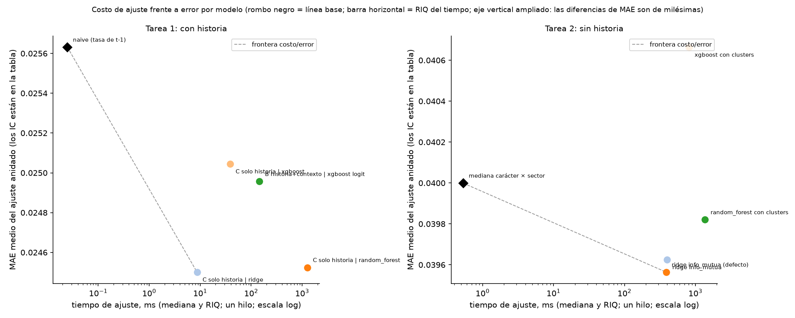
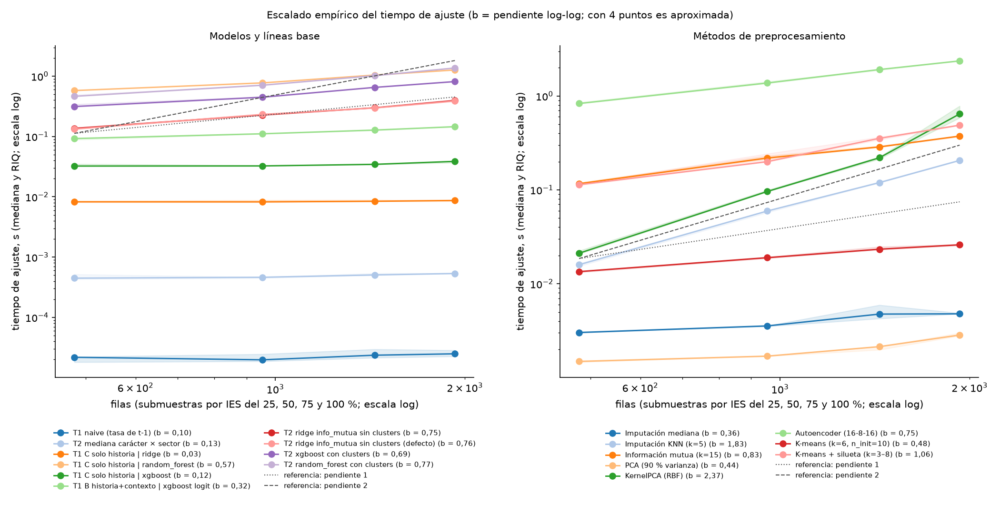

# Complejidad computacional: teórica y medida

Generado por `desercion evaluar complejidad` (módulos `src/desercion_ies/analysis/complejidad.py`, `costo_protocolo.py` e `informe_complejidad.py`). Todas las cifras salen de la corrida y de los resultados anteriores; no se editan a mano. No cambia ningún modelo, dato ni resultado anterior.

## 1. Cómo se midió

- **Un solo hilo y calentamiento.** Todas las mediciones con un hilo (`n_jobs=1`, xgboost `nthread=1`, BLAS y OpenMP limitados a 1 con `threadpoolctl` y con las variables de entorno fijadas antes de importar numpy). Cada medición tiene una ejecución de calentamiento (no se cuenta) y 5 repeticiones; se reporta la **mediana** y el **rango intercuartílico (RIQ)**.
- **Qué se cronometra.** *Ajuste:* `fit` en los modelos y `fit_transform` en los métodos de preprocesamiento (lo que cuesta entrenar). *Predicción:* `predict` o `transform` de todas las filas, expresada por 1.000 filas. Los datos se preparan fuera del cronómetro.
- **Memoria.** Pico de `tracemalloc` durante un ajuste, en una ejecución aparte (tracemalloc enlentece). Ve las asignaciones de Python y numpy pero **no** la memoria nativa de los árboles ni de xgboost, así que es un piso; como medida complementaria se muestrea la memoria residente (RSS) cada 2 ms y se reporta cuánto sube durante el ajuste (aproximada: puede perder picos breves y no baja de inmediato al liberar).
- **Modelos.** Los finales del análisis de sesgo, con sus hiperparámetros finales (consenso de los 25 pliegues del ajuste anidado): naive (tasa de t-1) y mediana por carácter × sector; ridge, random forest y xgboost de la Tarea 1 (C solo historia; B con xgboost) y de la Tarea 2 (con información mutua y con clusters). Los modelos de la Tarea 2 con clusters incluyen el costo de K-means con selección de k por silueta. Cada modelo incluye su preprocesamiento (imputación, escalado, one-hot).
- **Escalado.** Submuestras **por IES** (IES completas, semilla 7, anidadas) del 25 %, 50 %, 75 %, 100 %; el exponente empírico es la pendiente log-log del tiempo de ajuste contra el número de filas.
- **Tiempo de la medición completa:** 3,0 min.

| Característica | Valor |
|---|---|
| CPU | 12th Gen Intel(R) Core(TM) i5-12500H |
| Núcleos físicos / hilos lógicos | 12 / 16 |
| RAM | 31,6 GiB |
| Sistema operativo | Windows-11-10.0.26200-SP0 |
| Python | 3.14.6 |
| scikit-learn | 1.9.0 |
| xgboost | 3.4.1 |
| numpy | 2.4.6 |
| pandas / scipy | 3.0.3 / 1.18.0 |
| Bibliotecas de hilos | mkl 2025.0-Product (1 hilos disponibles); openmp None (1 hilos disponibles) |
| Hilos usados en la medición | 1 (`n_jobs=1`, xgboost `nthread=1`, BLAS y OpenMP limitados a 1) |
| Afinidad | afinidad fija a la CPU lógica 0 |
| Calentamiento y repeticiones | 1 y 5; se reporta la mediana y el rango intercuartílico |

## Conclusión

**1. ¿Qué modelo ofrece la mejor relación costo/error en cada tarea?** (costo = tiempo de ajuste con un hilo sobre las 1.928 filas; error = MAE del ajuste anidado de `04_ajuste_temporal.md`)
- **Tarea 1:** la mejor relación costo/error es `T1 C solo historia | ridge`: MAE 0,0245 (+4,4 % frente a la línea base, con firmeza (p t corregida 0,011)) con un ajuste de 8,69 ms, el más barato que logra al menos 90 % de la mejora del mejor modelo (`T1 C solo historia | ridge`, MAE 0,0245, 8,69 ms). La línea base cuesta 0,025 ms (MAE 0,0256). Cuestan más de 3 veces su ajuste sin tener menos error: `T1 C solo historia | random_forest`, `T1 C solo historia | xgboost`, `T1 B historia+contexto | xgboost logit`. Frontera costo/error: `T1 naive (tasa de t-1)`, `T1 C solo historia | ridge`.
- **Tarea 2:** la mejor relación costo/error es `T2 ridge info_mutua sin clusters (defecto)`: MAE 0,0396 (+1,1 % frente a la línea base, sin firmeza estadística (p t corregida 0,562)) con un ajuste de 387 ms, el más barato que logra al menos 90 % de la mejora del mejor modelo (`T2 ridge info_mutua sin clusters (defecto)`, MAE 0,0396, 387 ms). La línea base cuesta 0,534 ms (MAE 0,0400). Cuestan más de 3 veces su ajuste sin tener menos error: `T2 random_forest con clusters (ajustado)`. Frontera costo/error: `T2 mediana carácter × sector`, `T2 ridge info_mutua sin clusters (defecto)`. Como esa mejora no es firme, la línea base (`T2 mediana carácter × sector`, 0,534 ms) es la alternativa razonable: cuesta 725 veces menos.

**2. ¿Algún método escalaría mal con 10 o 100 veces más filas (por ejemplo, datos por estudiante)?** Con 4 puntos el exponente es aproximado; las extrapolaciones suponen que el exponente medido se mantiene.
- `KernelPCA (RBF)`: exponente empírico 2,37 ± 0,19 (teórico 2,0–3,0): de 644 ms hoy pasaría a 2,5 min con 10× filas y a 10,0 h con 100× y una matriz n × n de 2,8 GiB con 10× filas (277,0 GiB con 100×).
- `Imputación KNN (k=5)`: exponente empírico 1,83 ± 0,03 (teórico 1,8–2,0): de 206 ms hoy pasaría a 14,0 s con 10× filas y a 15,8 min con 100×.
- `K-means + silueta (k=3–8)`: en teoría es de orden n² (1,5–2,0) pero con estos tamaños mide 1,06 ± 0,09, porque todavía domina el costo de K-means; con muchas más filas el término n² (la silueta compara cada fila con todas las demás) pasaría a dominar. Como cota superior teórica, con exponente 2 pasaría de 489 ms a 48,9 s con 10× filas y a 81,5 min con 100×; es teoría, no una medición.
- Los demás escalan aproximadamente de forma lineal o casi lineal; el más caro hoy es `Autoencoder (16-8-16)` (2,4 s; exponente 0,75): con 100× filas serían unos 76,5 s.
- Con datos por estudiante (cientos de miles o millones de filas) los métodos de orden n² (KernelPCA, imputación KNN y la selección de k por silueta) dejarían de ser viables tal como están implementados; las alternativas habituales son aproximar el kernel (Nyström o características aleatorias de Fourier), imputar con un método lineal o por submuestra, K-means por lotes (`MiniBatchKMeans`) y calcular la silueta sobre una submuestra. Esto último es una recomendación general, no se midió aquí.

## 2. Complejidad teórica

n filas, p variables, T árboles, d profundidad, m variables que se prueban por división, k componentes, E épocas, h neuronas, I iteraciones de Lloyd, c clusters, K_c candidatos de k. Son las complejidades estándar de las implementaciones usadas (scikit-learn; xgboost con histogramas). Los modelos de la Tarea 2 con clusters suman el costo de «K-means + silueta».

| Componente | Ajuste | Predicción | Memoria | Exponente teórico en n |
|---|---|---|---|---|
| T1 naive (tasa de t-1) | O(n) | O(1) | O(n) | 1,0 |
| T2 mediana carácter × sector | O(n log n) | O(1) | O(n) | 1,0–1,2 |
| ridge | O(n p² + p³) | O(p) | O(n p + p²) | 1,0 |
| random_forest | O(T · m · n log n) | O(T · d) | O(n p + T · nodos) | 1,0–1,3 |
| xgboost | O(T · d · n · p) (histogramas) | O(T · d) | O(n p + T · 2^d) | 0,9–1,1 |
| Imputación mediana | O(n p) | O(n p) | O(n p) | 1,0 |
| Imputación KNN (k=5) | O(n² p) al imputar el entrenamiento | O(n_nuevas · n · p) | O(n p) (distancias por bloques) | 1,8–2,0 |
| Información mutua (k=15) | O(p · n log n) | O(n k) | O(n p) | 1,0–1,3 |
| PCA (90 % varianza) | O(n p² + p³) | O(n p k) | O(n p + p²) | 1,0 |
| KernelPCA (RBF) | O(n² p + n³) (o O(k n²) con eigensolver parcial) | O(n_nuevas · n · (p + k)) | O(n²) | 2,0–3,0 |
| Autoencoder (16-8-16) | O(E · n · p · h) | O(p · h) por fila | O(n p + p h) | 1,0 |
| K-means (k=6, n_init=10) | O(n_init · I · n · c · p) | O(c · p) por fila | O(n p + c p) | 1,0 |
| K-means + silueta (k=3–8) | O(K_c · (n_init · I · n · c · p + n² p)) | O(c · p) por fila | O(n p) (silueta por bloques) | 1,5–2,0 |

## 3. Costo medido (todas las filas, un hilo)

Ajuste: mediana [RIQ] de 5 repeticiones; predicción por 1.000 filas. El tiempo de predicción de la imputación KNN y de KernelPCA depende del número de filas de entrenamiento (comparan cada fila nueva con todas las de entrenamiento).

| Componente | Tipo | Filas | Ajuste, ms: mediana [RIQ] | Predicción por 1.000 filas, ms: mediana [RIQ] | Memoria pico (tracemalloc), MiB | Memoria residente añadida (RSS), MiB |
|---|---|---|---|---|---|---|
| T1 naive (tasa de t-1) | línea base | 1928 | 0,025 [0,006] | 0,002 [0,000] | 0,0 | 0,0 |
| T2 mediana carácter × sector | línea base | 1928 | 0,534 [0,009] | 0,254 [0,025] | 0,2 | 0,0 |
| T1 C solo historia \| ridge | modelo | 1928 | 8,69 [0,243] | 1,29 [0,055] | 0,4 | 0,0 |
| T1 C solo historia \| random_forest | modelo | 1928 | 1268 [5,63] | 56,9 [1,10] | 0,8 | 4,5 |
| T1 C solo historia \| xgboost | modelo | 1928 | 38,7 [2,29] | 3,27 [0,720] | 0,4 | 0,0 |
| T1 B historia+contexto \| xgboost logit | modelo | 1928 | 146 [2,58] | 6,13 [2,48] | 2,6 | 0,0 |
| T2 ridge info_mutua sin clusters (ajustado) | modelo | 1928 | 396 [6,42] | 4,01 [0,930] | 3,0 | 0,0 |
| T2 ridge info_mutua sin clusters (defecto) | modelo | 1928 | 387 [8,06] | 4,34 [0,344] | 3,0 | 1,4 |
| T2 xgboost con clusters (ajustado) | modelo | 1928 | 814 [16,5] | 12,5 [0,786] | 58,0 | 42,6 |
| T2 random_forest con clusters (ajustado) | modelo | 1928 | 1368 [31,1] | 18,9 [0,401] | 58,0 | 50,6 |
| Imputación mediana | preprocesamiento | 1928 | 4,78 [0,094] | 0,726 [0,012] | 2,2 | 0,0 |
| Imputación KNN (k=5) | preprocesamiento | 1928 | 206 [3,65] | 107 [1,99] | 38,0 | 35,8 |
| Información mutua (k=15) | preprocesamiento | 1928 | 374 [5,98] | 0,114 [0,002] | 2,4 | 0,0 |
| PCA (90 % varianza) | preprocesamiento | 1928 | 2,84 [0,194] | 0,136 [0,014] | 1,2 | 0,0 |
| KernelPCA (RBF) | preprocesamiento | 1928 | 644 [196] | 38,8 [1,92] | 58,2 | 56,8 |
| Autoencoder (16-8-16) | preprocesamiento | 1928 | 2365 [37,0] | 0,372 [0,012] | 1,7 | 0,0 |
| K-means (k=6, n_init=10) | preprocesamiento | 1928 | 26,0 [0,728] | 0,188 [0,012] | 1,2 | 0,0 |
| K-means + silueta (k=3–8) | preprocesamiento | 1928 | 489 [4,46] | 4,21 [0,124] | 57,3 | 55,5 |

### Costo y error por tarea

**Tarea 1** (línea base: ingenua)

| Modelo | Ajuste, ms (mediana) | MAE [IC 95 %] | Mejora frente a la línea base | p t corregida | ¿En la frontera costo/error? |
|---|---|---|---|---|---|
| **T1 naive (tasa de t-1)** | 0,025 | 0,0256 [0,0225; 0,0288] | — | — | sí |
| T1 C solo historia \| ridge | 8,69 | 0,0245 [0,0212; 0,0278] | +4,4 % | 0,011 | sí |
| T1 C solo historia \| xgboost | 38,7 | 0,0250 [0,0215; 0,0286] | +2,3 % | 0,359 | no |
| T1 B historia+contexto \| xgboost logit | 146 | 0,0250 [0,0211; 0,0288] | +2,6 % | 0,496 | no |
| T1 C solo historia \| random_forest | 1268 | 0,0245 [0,0212; 0,0279] | +4,3 % | 0,057 | no |

**Tarea 2** (línea base: mediana por carácter × sector)

| Modelo | Ajuste, ms (mediana) | MAE [IC 95 %] | Mejora frente a la línea base | p t corregida | ¿En la frontera costo/error? |
|---|---|---|---|---|---|
| **T2 mediana carácter × sector** | 0,534 | 0,0400 [0,0345; 0,0455] | — | — | sí |
| T2 ridge info_mutua sin clusters (defecto) | 387 | 0,0396 [0,0343; 0,0448] | +1,1 % | 0,562 | sí |
| T2 ridge info_mutua sin clusters (ajustado) | 396 | 0,0396 [0,0345; 0,0448] | +0,9 % | 0,596 | no |
| T2 xgboost con clusters (ajustado) | 814 | 0,0407 [0,0355; 0,0458] | -1,7 % | 0,522 | no |
| T2 random_forest con clusters (ajustado) | 1368 | 0,0398 [0,0348; 0,0449] | +0,4 % | 0,804 | no |

## 4. Escalado empírico y exponentes

Con 4 puntos (25, 50, 75 y 100 % de las IES) el exponente es **aproximado**: se reporta su error estándar y se considera «consistente» con el teórico si cae dentro del rango teórico ± (0,3 + 2 errores estándar). Para random forest, la mediana por grupo y la información mutua el teórico es el de n·log n en el rango medido. Un exponente **por debajo del teórico** indica que, con estos tamaños (480 a 1.928 filas), dominan costos fijos (construir el pipeline, cada árbol, las llamadas a las librerías) y no el crecimiento con n; en los componentes que tardan unos pocos milisegundos el exponente está dominado además por el ruido.

| Componente | Filas (mín.–máx.) | Ajuste (mín. → máx.), ms | Exponente empírico ± error estándar | R² | Exponente teórico | Comparación |
|---|---|---|---|---|---|---|
| T1 naive (tasa de t-1) | 480–1928 | 0,022 → 0,025 | 0,10 ± 0,09 | 0,397 | 1,00 | por debajo del teórico |
| T2 mediana carácter × sector | 480–1928 | 0,448 → 0,534 | 0,13 ± 0,03 | 0,901 | 1,00–1,20 | por debajo del teórico |
| T1 C solo historia \| ridge | 480–1928 | 8,26 → 8,69 | 0,03 ± 0,02 | 0,689 | 1,00 | por debajo del teórico |
| T1 C solo historia \| random_forest | 480–1928 | 578 → 1268 | 0,57 ± 0,05 | 0,983 | 1,00–1,30 | por debajo del teórico |
| T1 C solo historia \| xgboost | 480–1928 | 32,3 → 38,7 | 0,12 ± 0,05 | 0,703 | 0,90–1,10 | por debajo del teórico |
| T1 B historia+contexto \| xgboost logit | 480–1928 | 92,5 → 146 | 0,32 ± 0,03 | 0,986 | 0,90–1,10 | por debajo del teórico |
| T2 ridge info_mutua sin clusters (ajustado) | 480–1928 | 136 → 396 | 0,75 ± 0,03 | 0,997 | 1,00 | consistente |
| T2 ridge info_mutua sin clusters (defecto) | 480–1928 | 133 → 387 | 0,76 ± 0,03 | 0,997 | 1,00 | consistente |
| T2 xgboost con clusters (ajustado) | 480–1928 | 314 → 814 | 0,69 ± 0,06 | 0,983 | 0,90–1,10 | consistente |
| T2 random_forest con clusters (ajustado) | 480–1928 | 464 → 1368 | 0,77 ± 0,06 | 0,987 | 1,00–1,30 | consistente |
| Imputación mediana | 480–1928 | 3,02 → 4,78 | 0,36 ± 0,07 | 0,928 | 1,00 | por debajo del teórico |
| Imputación KNN (k=5) | 480–1928 | 16,0 → 206 | 1,83 ± 0,03 | 0,999 | 1,80–2,00 | consistente |
| Información mutua (k=15) | 480–1928 | 116 → 374 | 0,83 ± 0,04 | 0,996 | 1,00–1,30 | consistente |
| PCA (90 % varianza) | 480–1928 | 1,49 → 2,84 | 0,44 ± 0,11 | 0,881 | 1,00 | por debajo del teórico |
| KernelPCA (RBF) | 480–1928 | 21,2 → 644 | 2,37 ± 0,19 | 0,987 | 2,00–3,00 | consistente |
| Autoencoder (16-8-16) | 480–1928 | 832 → 2365 | 0,75 ± 0,01 | 1,000 | 1,00 | consistente |
| K-means (k=6, n_init=10) | 480–1928 | 13,5 → 26,0 | 0,48 ± 0,02 | 0,998 | 1,00 | por debajo del teórico |
| K-means + silueta (k=3–8) | 480–1928 | 114 → 489 | 1,06 ± 0,09 | 0,986 | 1,50–2,00 | consistente |

### Extrapolación a 10 y 100 veces más filas

Es una **extrapolación** con el exponente empírico (no se midió); sirve para ver el orden de magnitud, no para planificar.

| Componente | Exponente empírico | Ajuste hoy (1.928 filas) | Estimado con 10× filas | Estimado con 100× filas | Memoria de la matriz n × n (teórica; solo KernelPCA) |
|---|---|---|---|---|---|
| T1 naive (tasa de t-1) | 0,10 | 0 ms | 0 ms | 0 ms | — |
| T2 mediana carácter × sector | 0,13 | 1 ms | 1 ms | 1 ms | — |
| T1 C solo historia \| ridge | 0,03 | 9 ms | 9 ms | 10 ms | — |
| T1 C solo historia \| random_forest | 0,57 | 1,3 s | 4,7 s | 17,2 s | — |
| T1 C solo historia \| xgboost | 0,12 | 39 ms | 51 ms | 66 ms | — |
| T1 B historia+contexto \| xgboost logit | 0,32 | 146 ms | 304 ms | 636 ms | — |
| T2 ridge info_mutua sin clusters (ajustado) | 0,75 | 396 ms | 2,2 s | 12,6 s | — |
| T2 ridge info_mutua sin clusters (defecto) | 0,76 | 387 ms | 2,2 s | 12,6 s | — |
| T2 xgboost con clusters (ajustado) | 0,69 | 814 ms | 4,0 s | 19,7 s | — |
| T2 random_forest con clusters (ajustado) | 0,77 | 1,4 s | 8,1 s | 47,6 s | — |
| Imputación mediana | 0,36 | 5 ms | 11 ms | 25 ms | — |
| Imputación KNN (k=5) | 1,83 | 206 ms | 14,0 s | 15,8 min | — |
| Información mutua (k=15) | 0,83 | 374 ms | 2,5 s | 17,0 s | — |
| PCA (90 % varianza) | 0,44 | 3 ms | 8 ms | 22 ms | — |
| KernelPCA (RBF) | 2,37 | 644 ms | 2,5 min | 10,0 h | 10×: 2,8 GiB; 100×: 277,0 GiB |
| Autoencoder (16-8-16) | 0,75 | 2,4 s | 13,5 s | 76,5 s | — |
| K-means (k=6, n_init=10) | 0,48 | 26 ms | 78 ms | 237 ms | — |
| K-means + silueta (k=3–8) | 1,06 | 489 ms | 5,6 s | 64,7 s | — |

## 5. Costo del protocolo de evaluación

Número de ajustes de cada etapa (contados en los CSV de resultados; en la búsqueda interna, 30 iteraciones × 3 pliegues internos + el reajuste) y tiempo de pared de cada corrida, tomado de los informes anteriores. Las etapas v1–v3 corrieron en un solo proceso; las demás, con 16 procesos en paralelo. La suma de tiempos de ajuste medidos viene de las columnas de tiempo de esos CSV y es solo una referencia (se midió con paralelismo y, en el ajuste anidado, incluye la búsqueda).

| Etapa | Configuraciones | Ajustes | Tiempo de pared | Paralelismo | Suma de tiempos de ajuste medidos (referencia) | Detalle |
|---|---|---|---|---|---|---|
| v1: 36 configuraciones, GroupKFold 5 | 36 | 180 | 5,6 min | 1 proceso | 5,5 min |  |
| v2: formulaciones con historia, GroupKFold 5 | 72 | 360 | 14,6 min | 1 proceso | 14,2 min |  |
| v3: protocolo repetido 5 × 5 | 15 | 375 | 11,2 min | 1 proceso | 11,0 min |  |
| Tarea 2: cribado (120 configuraciones, 1 semilla) | 120 | 600 | 13,8 min | 16 procesos | 3,6 h |  |
| Tarea 2: confirmación 5 × 5 | 7 | 175 | 42,0 s | 16 procesos | 9,6 min |  |
| Ajuste anidado (7 configuraciones, 5 × 5 externos) | 7 | 16.100 | 26,4 min | 16 procesos | 5,7 h | 175 ajustes por defecto + 175 búsquedas internas de 91 ajustes (30 iteraciones × 3 pliegues + el reajuste) |
| Particiones temporales (2 particiones × 7 configuraciones) | 7 | 1.288 | 3,7 min | 16 procesos | 17,2 min | 14 ajustes por defecto + 14 búsquedas internas de 91 ajustes |
| Arranque en frío por municipio 5 × 5 | 7 | 175 | 59,6 s | 16 procesos | 13,2 min |  |
| Sesgo y sensibilidad (5 escenarios × 5 modelos finales × 25 pliegues) | 5 | 625 | 116,7 s | 16 procesos | 6,5 min | el tiempo de pared incluye además subgrupos, el diagnóstico del colapso, SHAP, permutación y coeficientes |
| **Total** | — | **19.878** | **78,9 min** | — | **10,6 h** | |

## Supuestos y limitaciones

- **Una máquina, un entorno:** los tiempos son de este equipo (tabla de entorno) y sirven para comparar componentes entre sí, no para predecir tiempos en otra máquina. La CPU es híbrida (núcleos de rendimiento y de eficiencia); el proceso se midió con la siguiente afinidad: afinidad fija a la CPU lógica 0; no se verificó de qué tipo de núcleo se trata.
- **Hiperparámetros finales:** el costo de random forest y xgboost depende de ellos (número de árboles, profundidad); son el consenso del ajuste anidado, no los que habría elegido cada pliegue.
- **Memoria:** `tracemalloc` es un piso (no ve la memoria nativa) y la memoria residente muestreada es aproximada; no hay una medición exacta del pico total.
- **Predicción sobre las filas de entrenamiento:** el costo de predicción se mide sobre las mismas 1.928 filas con las que se ajustó (para árboles y modelos lineales no cambia con filas nuevas; para imputación KNN y KernelPCA sí depende del tamaño del entrenamiento).
- **Exponentes con 4 puntos:** aproximados. El tamaño pequeño (≤ 1.928 filas) hace que los costos fijos de las librerías pesen en los componentes rápidos; en los lentos (autoencoder, KernelPCA, KNN) el rango es más informativo.
- **Autoencoder:** entrena hasta el máximo de iteraciones (la parada temprana no se activó en la Tarea 2), así que su costo crece de forma casi lineal con n pero con un tiempo alto por la constante.
