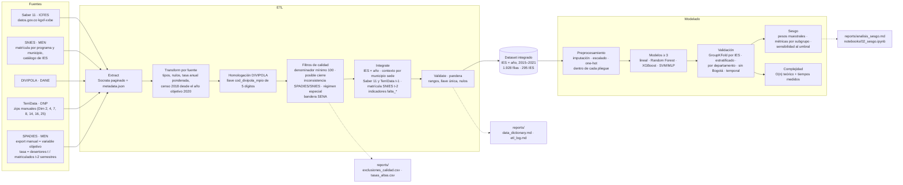

# Diagrama del pipeline ETL + modelado

GitHub dibuja el bloque de abajo directamente. Para la diapositiva de "solución propuesta": pegarlo en <https://mermaid.live> y exportar a PNG/SVG.

**Alcance:** el modelo predice riesgo de deserción a nivel institucional (IES × año); no existen datos abiertos de deserción por estudiante. Los pasos de modelado (modelos, complejidad) son el plan del proyecto; en el repositorio están implementados la partición, el preprocesador, el objetivo con logit opcional y las utilidades de sesgo (`src/modelado/`).
