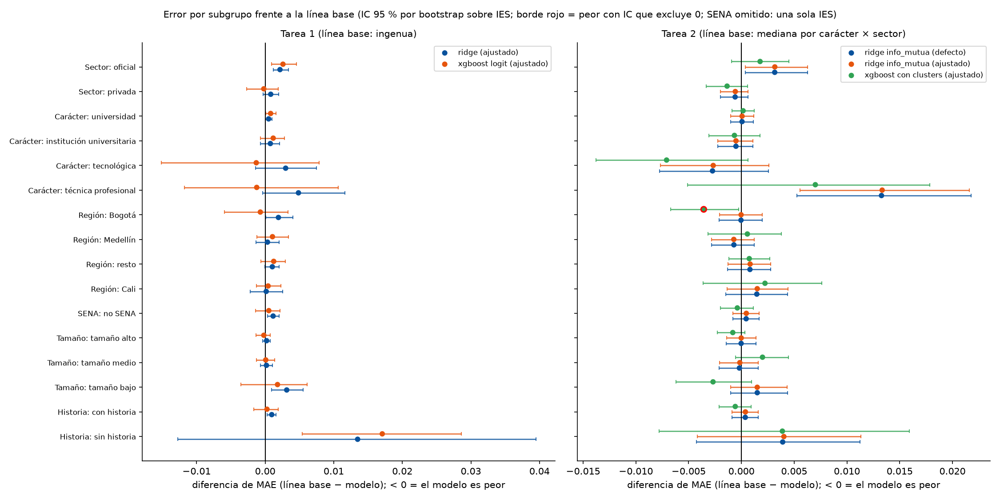
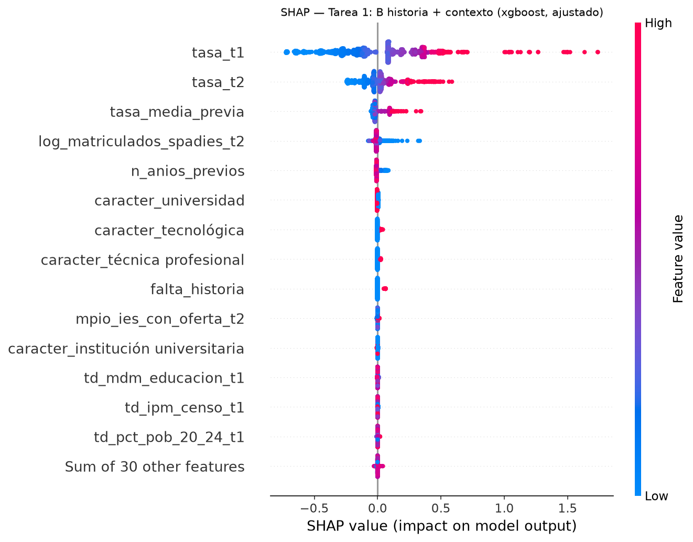
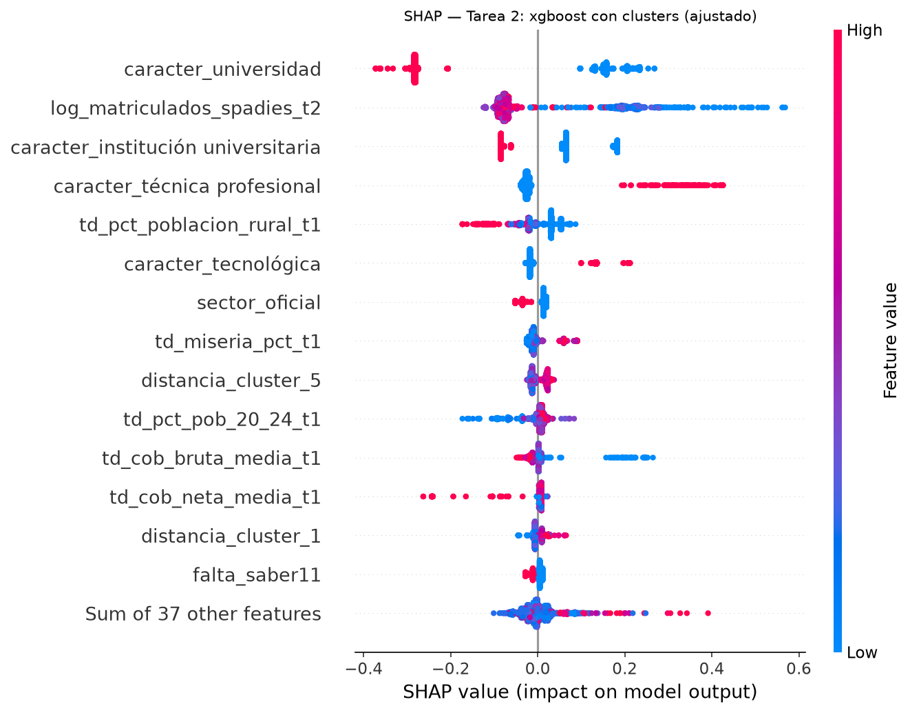
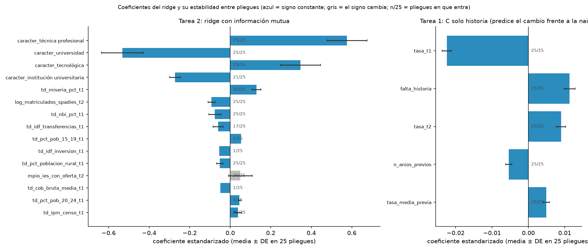

# Sesgo medido en los modelos finales, sensibilidad e interpretabilidad

Generado por `python run_sesgo_sensibilidad.py` (módulos `src/modelado/evaluacion_final.py`, `subgrupos.py`, `sensibilidad.py`, `diagnostico_colapso.py` e `interpretabilidad.py`). Todas las cifras salen de la corrida; no se editan a mano. Continúa `reports/analisis_sesgo.md` (donde se declararon los sesgos), `reports/resultados_v3.md`, `reports/resultados_tarea2.md` y `reports/resultados_ajuste_temporal.md`.

## Diseño

- **Modelos finales.** Tarea 1: naive (tasa de t-1), C solo historia con ridge (ajustado) y B historia + contexto con xgboost (ajustado). Tarea 2: mediana por carácter × sector, ridge con información mutua (por defecto y ajustado) y xgboost con clusters (ajustado).
- **Hiperparámetros finales.** En el ajuste anidado cada pliegue externo eligió los suyos; los finales son el consenso de los 25 pliegues (valor más frecuente; mediana en los continuos). Esa combinación no se validó como tal en el ajuste, y como salió de los mismos datos el resultado es algo optimista (igual en todos los escenarios).

| Modelo final | Variante | Hiperparámetros |
|---|---|---|
| T1 C solo historia \| ridge (ajustado) | ajustado | `alpha` = 157,4 |
| T1 B historia+contexto \| xgboost logit (ajustado) | ajustado | `colsample_bytree` = 0,8, `learning_rate` = 0,01606, `max_depth` = 2, `min_child_weight` = 1, `n_estimators` = 200, `reg_lambda` = 3,244, `subsample` = 0,7 |
| T2 ridge info_mutua (defecto) | defecto | por defecto de la v1 (`RidgeCV`, k = 15) |
| T2 ridge info_mutua (ajustado) | ajustado | `alpha` = 4,043, `k` = 15 |
| T2 xgboost con clusters (ajustado) | ajustado | `colsample_bytree` = 1, `learning_rate` = 0,01803, `max_depth` = 2, `min_child_weight` = 10, `n_estimators` = 500, `reg_lambda` = 0,1754, `subsample` = 1 |

- **Validación.** GroupKFold por IES, 5 pliegues × las semillas 301–305 (como en el ajuste); predicciones recortadas a [0, 1]. El error de cada fila es el promedio de sus 5 predicciones fuera de muestra (una por repetición).
- **Subgrupos.** Sector, carácter, región (Bogotá, Medellín, Cali y resto), SENA, tamaño (terciles de `log_matriculados_spadies_t2`; cortes en 1547 y 5233 matriculados (t-2)) y `falta_historia`. IC 95 % por bootstrap sobre IES (1.000 réplicas, semilla 2026; el mismo remuestreo para el modelo y su línea base, de modo que la diferencia es pareada). Los subgrupos de menos de 30 filas se marcan «n pequeño».
- **Sensibilidad.** Se re-entrena todo con el mismo protocolo en el dataset ya construido (no se re-corre el ETL): sin Bogotá (entrenamiento y prueba), denominador mínimo 200, sin SENA y solo 2017–2021. Los hiperparámetros finales **no se vuelven a ajustar** en cada escenario. «Cambia la conclusión» = cambia la clase frente a la línea base (`supera`, `empeora` o `sin diferencia firme`, exigiendo significancia en Wilcoxon y t corregida de Nadeau y Bengio).
- **Tiempo de la corrida:** 117 s (1,9 min).

## Conclusión

**1. ¿Qué subgrupos quedan peor servidos?** Con IC 95 % por bootstrap sobre IES; «peor» = el modelo tiene más error que su línea base.
  - `T1 C solo historia | ridge (ajustado)`: peor que su línea base con IC que excluye 0 en ningún subgrupo; peor sin firmeza (n ≥ 30) en ningún subgrupo.
  - `T1 B historia+contexto | xgboost logit (ajustado)`: peor que su línea base con IC que excluye 0 en ningún subgrupo; peor sin firmeza (n ≥ 30) en sector: privada (-0,0002), caracter: tecnológica (-0,0013), caracter: técnica profesional (-0,0012), region: Bogotá (-0,0007), tamano: tamaño alto (-0,0002).
  - `T2 ridge info_mutua (defecto)`: peor que su línea base con IC que excluye 0 en ningún subgrupo; peor sin firmeza (n ≥ 30) en sector: privada (-0,0006), caracter: institución universitaria (-0,0005), caracter: tecnológica (-0,0027), region: Bogotá (-0,0000), region: Medellín (-0,0007), tamano: tamaño alto (-0,0000), tamano: tamaño medio (-0,0002).
  - `T2 ridge info_mutua (ajustado)`: peor que su línea base con IC que excluye 0 en ningún subgrupo; peor sin firmeza (n ≥ 30) en sector: privada (-0,0006), caracter: institución universitaria (-0,0005), caracter: tecnológica (-0,0027), region: Bogotá (-0,0000), region: Medellín (-0,0007), tamano: tamaño alto (-0,0000), tamano: tamaño medio (-0,0002).
  - `T2 xgboost con clusters (ajustado)`: peor que su línea base con IC que excluye 0 en region: Bogotá (-0,0036 [-0,0067; -0,0002], 597 filas); peor sin firmeza (n ≥ 30) en sector: privada (-0,0014), caracter: institución universitaria (-0,0007), caracter: tecnológica (-0,0071), es_sena: no SENA (-0,0004), tamano: tamaño alto (-0,0008), tamano: tamaño bajo (-0,0027), falta_historia: con historia (-0,0006).
- Con más error absoluto (modelo con menos error de cada tarea): Tarea 1 `T1 C solo historia | ridge (ajustado)`: falta_historia: sin historia (MAE 0,1137; línea base 0,1271; 34 filas), caracter: técnica profesional (MAE 0,0548; línea base 0,0596; 132 filas), caracter: tecnológica (MAE 0,0541; línea base 0,0571; 218 filas). Tarea 2 `T2 ridge info_mutua (ajustado)`: falta_historia: sin historia (MAE 0,1072; línea base 0,1112; 34 filas), caracter: tecnológica (MAE 0,0781; línea base 0,0754; 218 filas), caracter: técnica profesional (MAE 0,0781; línea base 0,0914; 132 filas).

**2. ¿Alguna sensibilidad cambia la conclusión?** («Cambia» = cambia la clase frente a la línea base —`supera`, `empeora` o `sin diferencia firme`, con significancia en las dos pruebas— respecto del escenario base.)
- Escenario `sin_bogota`, `T1 C solo historia | ridge (ajustado)`: de «supera» a «sin diferencia firme» (mejora frente a la línea base +4,6 % en el dataset completo y +4,2 % en el escenario; p Wilcoxon < 0,001, p t corregida 0,097).
- Escenario `umbral_200`, `T1 B historia+contexto | xgboost logit (ajustado)`: de «sin diferencia firme» a «supera» (mejora frente a la línea base +2,2 % en el dataset completo y +5,3 % en el escenario; p Wilcoxon < 0,001, p t corregida 0,036).
- Escenario `umbral_200`, `T2 ridge info_mutua (defecto)`: de «sin diferencia firme» a «supera» (mejora frente a la línea base +1,1 % en el dataset completo y +4,1 % en el escenario; p Wilcoxon < 0,001, p t corregida 0,039).
- Escenario `umbral_200`, `T2 ridge info_mutua (ajustado)`: de «sin diferencia firme» a «supera» (mejora frente a la línea base +1,1 % en el dataset completo y +4,2 % en el escenario; p Wilcoxon < 0,001, p t corregida 0,039).
- Escenario `desde_2017`, `T1 C solo historia | ridge (ajustado)`: de «supera» a «sin diferencia firme» (mejora frente a la línea base +4,6 % en el dataset completo y +4,3 % en el escenario; p Wilcoxon < 0,001, p t corregida 0,117).
- **Hipótesis del SNIES imputado en 2015–2016** (escenario 2017–2021, solo con matrícula SNIES observada): mejora de los modelos de la Tarea 2 frente a la mediana por carácter × sector, dataset completo → 2017–2021: `T2 ridge info_mutua (defecto)`: +1,1 % → +1,8 %; `T2 ridge info_mutua (ajustado)`: +1,1 % → +1,9 %; `T2 xgboost con clusters (ajustado)`: -1,2 % → -2,4 %.

**3. ¿Se confirma la causa del colapso?** (ridge ajustado de la Tarea 2, partición prepandemia; «exceso» = MAE de la referencia − MAE de la configuración por defecto)
- Se reproduce el colapso: MAE 0,0642 frente a 0,0360 por defecto (exceso 0,0282); por año, 2018: 0,0368 y 2019: 0,0918. 39 de las 40 filas de mayor error son de Bogotá (MAE en Bogotá 0,1367 frente a 0,0318 en el resto).
- **(i) Quitar `mpio_matriculados_t2`:** MAE 0,0407, elimina 83 % del exceso. Esa variable explica la mayor parte del colapso.
- **(ii) Alfa por defecto:** con `RidgeCV` y el mismo k, MAE 0,0554 (elimina 31 %); con la configuración por defecto completa (k = 15) el coeficiente de la variable es -0,019 frente a 0,445 en la referencia: con poca regularización y k = 20 el modelo le da un peso grande.
- **(iii) Recortar las variables escaladas a [-3, 3]:** MAE 0,0728 (-30 % del exceso). El recorte no corrige el colapso: no se debe a valores extremos (|z| > 3).
- **(iv, adicional) Entrenar solo con 2017** (único año con SNIES observado): MAE 0,0507 (48 % del exceso; 274 filas de entrenamiento). Con SNIES observado el colapso persiste: la hipótesis del SNIES imputado no se sostiene como causa principal.
- **Respuesta:** se confirma una causa **específica de una variable** (`mpio_matriculados_t2` con un coeficiente grande), no una extrapolación a valores extremos ni, por sí sola, la imputación del SNIES; el detalle de z por variable y las filas de mayor error está en las tablas de abajo y en `colapso_ridge_z.csv` y `colapso_ridge_peores.csv`.

**4. ¿Qué variables usan los modelos y coinciden los métodos?**
- **Tarea 1, B xgboost.** Top 5 por |SHAP|: `tasa_t1` (0,268), `tasa_t2` (0,091), `tasa_media_previa` (0,040), `log_matriculados_spadies_t2` (0,015), `n_anios_previos` (0,013). Frente a la importancia por permutación: Spearman entre los órdenes 0,63 (40 variables originales), 4 de 5 variables en común en el top 5.
- **Tarea 2, xgboost con clusters.** Top 5 por |SHAP|: `caracter_universidad` (0,221), `log_matriculados_spadies_t2` (0,115), `caracter_institución universitaria` (0,092), `caracter_técnica profesional` (0,047), `td_pct_poblacion_rural_t1` (0,038). Frente a la importancia por permutación: Spearman entre los órdenes 0,47 (35 variables originales), 4 de 5 variables en común en el top 5.
- **Ridge de la Tarea 2:** 10 de 27 variables que entran en al menos un pliegue lo hacen en la mitad o más con signo constante; las mayores: `caracter_técnica profesional` (0,576), `caracter_universidad` (-0,532), `caracter_tecnológica` (0,346), `caracter_institución universitaria` (-0,273).

## 1. Error por subgrupo

La diferencia es MAE de la línea base − MAE del modelo: **negativa = el modelo es peor** (en negrita cuando el IC excluye 0). La lectura «sin firmeza» significa que la diferencia puntual es negativa pero el IC incluye 0.

### Tarea 1 · C solo historia, ridge (ajustado) frente a la ingenua

| Variable | Subgrupo | Filas (IES) | MAE del modelo [IC 95 %] | MAE de la línea base [IC 95 %] | Diferencia (línea base − modelo) [IC 95 %] | Lectura |
|---|---|---|---|---|---|---|
| Sector | oficial | 526 (79) | 0,0205 [0,0170; 0,0245] | 0,0227 [0,0187; 0,0273] | 0,0022 [0,0012; 0,0034] | mejor (IC excluye 0) |
| Sector | privada | 1402 (216) | 0,0259 [0,0220; 0,0306] | 0,0267 [0,0222; 0,0316] | 0,0008 [-0,0003; 0,0020] | mejor (sin firmeza) |
| Carácter | universidad | 844 (124) | 0,0131 [0,0115; 0,0151] | 0,0136 [0,0116; 0,0160] | 0,0005 [0,0000; 0,0010] | mejor (IC excluye 0) |
| Carácter | institución universitaria | 734 (110) | 0,0231 [0,0195; 0,0277] | 0,0239 [0,0196; 0,0294] | 0,0008 [-0,0007; 0,0021] | mejor (sin firmeza) |
| Carácter | tecnológica | 218 (37) | 0,0541 [0,0385; 0,0767] | 0,0571 [0,0411; 0,0778] | 0,0030 [-0,0014; 0,0075] | mejor (sin firmeza) |
| Carácter | técnica profesional | 132 (24) | 0,0548 [0,0393; 0,0740] | 0,0596 [0,0417; 0,0816] | 0,0049 [-0,0003; 0,0116] | mejor (sin firmeza) |
| Región | Bogotá | 597 (93) | 0,0299 [0,0218; 0,0397] | 0,0319 [0,0232; 0,0420] | 0,0019 [0,0001; 0,0040] | mejor (IC excluye 0) |
| Región | Medellín | 208 (30) | 0,0179 [0,0122; 0,0269] | 0,0182 [0,0119; 0,0279] | 0,0003 [-0,0014; 0,0020] | mejor (sin firmeza) |
| Región | resto | 984 (150) | 0,0217 [0,0188; 0,0253] | 0,0228 [0,0195; 0,0267] | 0,0010 [-0,0000; 0,0020] | mejor (sin firmeza) |
| Región | Cali | 139 (22) | 0,0295 [0,0195; 0,0444] | 0,0296 [0,0192; 0,0456] | 0,0002 [-0,0022; 0,0025] | mejor (sin firmeza) |
| SENA | no SENA | 1921 (294) | 0,0244 [0,0214; 0,0281] | 0,0256 [0,0222; 0,0294] | 0,0012 [0,0004; 0,0020] | mejor (IC excluye 0) |
| SENA | SENA | 7 (1) | 0,0241 [sin IC] | 0,0302 [sin IC] | 0,0061 [sin IC] | no evaluable (menos de 5 IES) (n pequeño) |
| Tamaño (terciles de la matrícula t-2) | tamaño alto | 643 (107) | 0,0126 [0,0110; 0,0145] | 0,0128 [0,0110; 0,0148] | 0,0002 [-0,0004; 0,0007] | mejor (sin firmeza) |
| Tamaño (terciles de la matrícula t-2) | tamaño medio | 642 (121) | 0,0161 [0,0140; 0,0185] | 0,0163 [0,0139; 0,0192] | 0,0002 [-0,0007; 0,0011] | mejor (sin firmeza) |
| Tamaño (terciles de la matrícula t-2) | tamaño bajo | 643 (124) | 0,0445 [0,0367; 0,0540] | 0,0476 [0,0389; 0,0573] | 0,0031 [0,0009; 0,0055] | mejor (IC excluye 0) |
| Historia | con historia | 1894 (289) | 0,0228 [0,0198; 0,0265] | 0,0238 [0,0205; 0,0276] | 0,0010 [0,0003; 0,0016] | mejor (IC excluye 0) |
| Historia | sin historia | 34 (29) | 0,1137 [0,0787; 0,1541] | 0,1271 [0,0819; 0,1789] | 0,0135 [-0,0127; 0,0395] | mejor (sin firmeza) |

### Tarea 1 · B historia + contexto, xgboost (ajustado) frente a la ingenua

| Variable | Subgrupo | Filas (IES) | MAE del modelo [IC 95 %] | MAE de la línea base [IC 95 %] | Diferencia (línea base − modelo) [IC 95 %] | Lectura |
|---|---|---|---|---|---|---|
| Sector | oficial | 526 (79) | 0,0201 [0,0169; 0,0239] | 0,0227 [0,0187; 0,0273] | 0,0026 [0,0009; 0,0046] | mejor (IC excluye 0) |
| Sector | privada | 1402 (216) | 0,0269 [0,0221; 0,0327] | 0,0267 [0,0222; 0,0316] | **-0,0002 [-0,0027; 0,0019]** | **peor (sin firmeza)** |
| Carácter | universidad | 844 (124) | 0,0128 [0,0113; 0,0147] | 0,0136 [0,0116; 0,0160] | 0,0008 [0,0001; 0,0016] | mejor (IC excluye 0) |
| Carácter | institución universitaria | 734 (110) | 0,0227 [0,0188; 0,0280] | 0,0239 [0,0196; 0,0294] | 0,0012 [-0,0007; 0,0028] | mejor (sin firmeza) |
| Carácter | tecnológica | 218 (37) | 0,0584 [0,0389; 0,0915] | 0,0571 [0,0411; 0,0778] | **-0,0013 [-0,0152; 0,0079]** | **peor (sin firmeza)** |
| Carácter | técnica profesional | 132 (24) | 0,0609 [0,0441; 0,0798] | 0,0596 [0,0417; 0,0816] | **-0,0012 [-0,0118; 0,0107]** | **peor (sin firmeza)** |
| Región | Bogotá | 597 (93) | 0,0326 [0,0230; 0,0456] | 0,0319 [0,0232; 0,0420] | **-0,0007 [-0,0059; 0,0034]** | **peor (sin firmeza)** |
| Región | Medellín | 208 (30) | 0,0172 [0,0118; 0,0260] | 0,0182 [0,0119; 0,0279] | 0,0011 [-0,0012; 0,0034] | mejor (sin firmeza) |
| Región | resto | 984 (150) | 0,0215 [0,0181; 0,0252] | 0,0228 [0,0195; 0,0267] | 0,0012 [-0,0006; 0,0029] | mejor (sin firmeza) |
| Región | Cali | 139 (22) | 0,0292 [0,0191; 0,0448] | 0,0296 [0,0192; 0,0456] | 0,0004 [-0,0013; 0,0023] | mejor (sin firmeza) |
| SENA | no SENA | 1921 (294) | 0,0250 [0,0214; 0,0294] | 0,0256 [0,0222; 0,0294] | 0,0005 [-0,0014; 0,0021] | mejor (sin firmeza) |
| SENA | SENA | 7 (1) | 0,0204 [sin IC] | 0,0302 [sin IC] | 0,0098 [sin IC] | no evaluable (menos de 5 IES) (n pequeño) |
| Tamaño (terciles de la matrícula t-2) | tamaño alto | 643 (107) | 0,0130 [0,0113; 0,0150] | 0,0128 [0,0110; 0,0148] | **-0,0002 [-0,0014; 0,0007]** | **peor (sin firmeza)** |
| Tamaño (terciles de la matrícula t-2) | tamaño medio | 642 (121) | 0,0162 [0,0141; 0,0186] | 0,0163 [0,0139; 0,0192] | 0,0001 [-0,0012; 0,0014] | mejor (sin firmeza) |
| Tamaño (terciles de la matrícula t-2) | tamaño bajo | 643 (124) | 0,0458 [0,0366; 0,0581] | 0,0476 [0,0389; 0,0573] | 0,0018 [-0,0036; 0,0061] | mejor (sin firmeza) |
| Historia | con historia | 1894 (289) | 0,0235 [0,0200; 0,0279] | 0,0238 [0,0205; 0,0276] | 0,0003 [-0,0017; 0,0019] | mejor (sin firmeza) |
| Historia | sin historia | 34 (29) | 0,1101 [0,0681; 0,1582] | 0,1271 [0,0819; 0,1789] | 0,0171 [0,0054; 0,0286] | mejor (IC excluye 0) |

### Tarea 2 · ridge con información mutua (ajustado) frente a la mediana por carácter × sector

| Variable | Subgrupo | Filas (IES) | MAE del modelo [IC 95 %] | MAE de la línea base [IC 95 %] | Diferencia (línea base − modelo) [IC 95 %] | Lectura |
|---|---|---|---|---|---|---|
| Sector | oficial | 526 (79) | 0,0318 [0,0269; 0,0380] | 0,0349 [0,0289; 0,0419] | 0,0032 [0,0004; 0,0063] | mejor (IC excluye 0) |
| Sector | privada | 1402 (216) | 0,0424 [0,0365; 0,0501] | 0,0418 [0,0358; 0,0499] | **-0,0006 [-0,0020; 0,0006]** | **peor (sin firmeza)** |
| Carácter | universidad | 844 (124) | 0,0238 [0,0208; 0,0269] | 0,0238 [0,0207; 0,0271] | 0,0001 [-0,0010; 0,0012] | mejor (sin firmeza) |
| Carácter | institución universitaria | 734 (110) | 0,0392 [0,0334; 0,0470] | 0,0387 [0,0330; 0,0462] | **-0,0005 [-0,0023; 0,0011]** | **peor (sin firmeza)** |
| Carácter | tecnológica | 218 (37) | 0,0781 [0,0541; 0,1170] | 0,0754 [0,0512; 0,1156] | **-0,0027 [-0,0077; 0,0026]** | **peor (sin firmeza)** |
| Carácter | técnica profesional | 132 (24) | 0,0781 [0,0613; 0,0971] | 0,0914 [0,0725; 0,1108] | 0,0133 [0,0055; 0,0216] | mejor (IC excluye 0) |
| Región | Bogotá | 597 (93) | 0,0527 [0,0411; 0,0683] | 0,0527 [0,0404; 0,0697] | **-0,0000 [-0,0021; 0,0020]** | **peor (sin firmeza)** |
| Región | Medellín | 208 (30) | 0,0280 [0,0209; 0,0373] | 0,0272 [0,0204; 0,0356] | **-0,0007 [-0,0028; 0,0012]** | **peor (sin firmeza)** |
| Región | resto | 984 (150) | 0,0342 [0,0296; 0,0396] | 0,0350 [0,0302; 0,0409] | 0,0008 [-0,0013; 0,0028] | mejor (sin firmeza) |
| Región | Cali | 139 (22) | 0,0377 [0,0276; 0,0507] | 0,0392 [0,0282; 0,0529] | 0,0015 [-0,0014; 0,0044] | mejor (sin firmeza) |
| SENA | no SENA | 1921 (294) | 0,0396 [0,0350; 0,0455] | 0,0400 [0,0352; 0,0460] | 0,0005 [-0,0008; 0,0017] | mejor (sin firmeza) |
| SENA | SENA | 7 (1) | 0,0286 [sin IC] | 0,0233 [sin IC] | -0,0053 [sin IC] | no evaluable (menos de 5 IES) (n pequeño) |
| Tamaño (terciles de la matrícula t-2) | tamaño alto | 643 (107) | 0,0252 [0,0218; 0,0292] | 0,0252 [0,0218; 0,0294] | **-0,0000 [-0,0014; 0,0014]** | **peor (sin firmeza)** |
| Tamaño (terciles de la matrícula t-2) | tamaño medio | 642 (121) | 0,0320 [0,0274; 0,0371] | 0,0318 [0,0273; 0,0368] | **-0,0002 [-0,0021; 0,0016]** | **peor (sin firmeza)** |
| Tamaño (terciles de la matrícula t-2) | tamaño bajo | 643 (124) | 0,0613 [0,0502; 0,0771] | 0,0628 [0,0514; 0,0794] | 0,0015 [-0,0010; 0,0043] | mejor (sin firmeza) |
| Historia | con historia | 1894 (289) | 0,0383 [0,0337; 0,0443] | 0,0387 [0,0339; 0,0448] | 0,0004 [-0,0009; 0,0016] | mejor (sin firmeza) |
| Historia | sin historia | 34 (29) | 0,1072 [0,0700; 0,1527] | 0,1112 [0,0717; 0,1578] | 0,0040 [-0,0042; 0,0113] | mejor (sin firmeza) |

### Tarea 2 · ridge con información mutua (por defecto) frente a la mediana por carácter × sector

| Variable | Subgrupo | Filas (IES) | MAE del modelo [IC 95 %] | MAE de la línea base [IC 95 %] | Diferencia (línea base − modelo) [IC 95 %] | Lectura |
|---|---|---|---|---|---|---|
| Sector | oficial | 526 (79) | 0,0318 [0,0269; 0,0380] | 0,0349 [0,0289; 0,0419] | 0,0032 [0,0004; 0,0063] | mejor (IC excluye 0) |
| Sector | privada | 1402 (216) | 0,0424 [0,0365; 0,0501] | 0,0418 [0,0358; 0,0499] | **-0,0006 [-0,0020; 0,0006]** | **peor (sin firmeza)** |
| Carácter | universidad | 844 (124) | 0,0238 [0,0208; 0,0269] | 0,0238 [0,0207; 0,0271] | 0,0001 [-0,0010; 0,0011] | mejor (sin firmeza) |
| Carácter | institución universitaria | 734 (110) | 0,0392 [0,0334; 0,0471] | 0,0387 [0,0330; 0,0462] | **-0,0005 [-0,0023; 0,0011]** | **peor (sin firmeza)** |
| Carácter | tecnológica | 218 (37) | 0,0782 [0,0541; 0,1170] | 0,0754 [0,0512; 0,1156] | **-0,0027 [-0,0078; 0,0026]** | **peor (sin firmeza)** |
| Carácter | técnica profesional | 132 (24) | 0,0782 [0,0616; 0,0972] | 0,0914 [0,0725; 0,1108] | 0,0133 [0,0052; 0,0218] | mejor (IC excluye 0) |
| Región | Bogotá | 597 (93) | 0,0527 [0,0411; 0,0683] | 0,0527 [0,0404; 0,0697] | **-0,0000 [-0,0021; 0,0020]** | **peor (sin firmeza)** |
| Región | Medellín | 208 (30) | 0,0280 [0,0209; 0,0373] | 0,0272 [0,0204; 0,0356] | **-0,0007 [-0,0028; 0,0012]** | **peor (sin firmeza)** |
| Región | resto | 984 (150) | 0,0342 [0,0296; 0,0396] | 0,0350 [0,0302; 0,0409] | 0,0008 [-0,0013; 0,0028] | mejor (sin firmeza) |
| Región | Cali | 139 (22) | 0,0378 [0,0277; 0,0507] | 0,0392 [0,0282; 0,0529] | 0,0015 [-0,0015; 0,0044] | mejor (sin firmeza) |
| SENA | no SENA | 1921 (294) | 0,0396 [0,0350; 0,0455] | 0,0400 [0,0352; 0,0460] | 0,0004 [-0,0008; 0,0017] | mejor (sin firmeza) |
| SENA | SENA | 7 (1) | 0,0289 [sin IC] | 0,0233 [sin IC] | -0,0057 [sin IC] | no evaluable (menos de 5 IES) (n pequeño) |
| Tamaño (terciles de la matrícula t-2) | tamaño alto | 643 (107) | 0,0253 [0,0218; 0,0292] | 0,0252 [0,0218; 0,0294] | **-0,0000 [-0,0014; 0,0014]** | **peor (sin firmeza)** |
| Tamaño (terciles de la matrícula t-2) | tamaño medio | 642 (121) | 0,0320 [0,0275; 0,0371] | 0,0318 [0,0273; 0,0368] | **-0,0002 [-0,0021; 0,0016]** | **peor (sin firmeza)** |
| Tamaño (terciles de la matrícula t-2) | tamaño bajo | 643 (124) | 0,0613 [0,0502; 0,0771] | 0,0628 [0,0514; 0,0794] | 0,0015 [-0,0010; 0,0044] | mejor (sin firmeza) |
| Historia | con historia | 1894 (289) | 0,0383 [0,0337; 0,0443] | 0,0387 [0,0339; 0,0448] | 0,0004 [-0,0009; 0,0016] | mejor (sin firmeza) |
| Historia | sin historia | 34 (29) | 0,1073 [0,0701; 0,1528] | 0,1112 [0,0717; 0,1578] | 0,0039 [-0,0043; 0,0112] | mejor (sin firmeza) |

### Tarea 2 · xgboost con clusters (ajustado) frente a la mediana por carácter × sector

| Variable | Subgrupo | Filas (IES) | MAE del modelo [IC 95 %] | MAE de la línea base [IC 95 %] | Diferencia (línea base − modelo) [IC 95 %] | Lectura |
|---|---|---|---|---|---|---|
| Sector | oficial | 526 (79) | 0,0332 [0,0269; 0,0399] | 0,0349 [0,0289; 0,0419] | 0,0018 [-0,0009; 0,0045] | mejor (sin firmeza) |
| Sector | privada | 1402 (216) | 0,0432 [0,0370; 0,0509] | 0,0418 [0,0358; 0,0499] | **-0,0014 [-0,0033; 0,0006]** | **peor (sin firmeza)** |
| Carácter | universidad | 844 (124) | 0,0237 [0,0207; 0,0270] | 0,0238 [0,0207; 0,0271] | 0,0002 [-0,0009; 0,0012] | mejor (sin firmeza) |
| Carácter | institución universitaria | 734 (110) | 0,0393 [0,0337; 0,0471] | 0,0387 [0,0330; 0,0462] | **-0,0007 [-0,0031; 0,0018]** | **peor (sin firmeza)** |
| Carácter | tecnológica | 218 (37) | 0,0825 [0,0587; 0,1218] | 0,0754 [0,0512; 0,1156] | **-0,0071 [-0,0138; 0,0006]** | **peor (sin firmeza)** |
| Carácter | técnica profesional | 132 (24) | 0,0844 [0,0658; 0,1044] | 0,0914 [0,0725; 0,1108] | 0,0070 [-0,0051; 0,0178] | mejor (sin firmeza) |
| Región | Bogotá | 597 (93) | 0,0563 [0,0443; 0,0716] | 0,0527 [0,0404; 0,0697] | **-0,0036 [-0,0067; -0,0002]** | **peor que la línea base (IC excluye 0)** |
| Región | Medellín | 208 (30) | 0,0267 [0,0189; 0,0359] | 0,0272 [0,0204; 0,0356] | 0,0006 [-0,0032; 0,0038] | mejor (sin firmeza) |
| Región | resto | 984 (150) | 0,0343 [0,0296; 0,0396] | 0,0350 [0,0302; 0,0409] | 0,0007 [-0,0012; 0,0027] | mejor (sin firmeza) |
| Región | Cali | 139 (22) | 0,0370 [0,0274; 0,0518] | 0,0392 [0,0282; 0,0529] | 0,0022 [-0,0036; 0,0076] | mejor (sin firmeza) |
| SENA | no SENA | 1921 (294) | 0,0404 [0,0355; 0,0463] | 0,0400 [0,0352; 0,0460] | **-0,0004 [-0,0020; 0,0011]** | **peor (sin firmeza)** |
| SENA | SENA | 7 (1) | 0,0561 [sin IC] | 0,0233 [sin IC] | -0,0329 [sin IC] | no evaluable (menos de 5 IES) (n pequeño) |
| Tamaño (terciles de la matrícula t-2) | tamaño alto | 643 (107) | 0,0260 [0,0224; 0,0303] | 0,0252 [0,0218; 0,0294] | **-0,0008 [-0,0023; 0,0003]** | **peor (sin firmeza)** |
| Tamaño (terciles de la matrícula t-2) | tamaño medio | 642 (121) | 0,0299 [0,0257; 0,0347] | 0,0318 [0,0273; 0,0368] | 0,0020 [-0,0006; 0,0045] | mejor (sin firmeza) |
| Tamaño (terciles de la matrícula t-2) | tamaño bajo | 643 (124) | 0,0655 [0,0540; 0,0814] | 0,0628 [0,0514; 0,0794] | **-0,0027 [-0,0062; 0,0010]** | **peor (sin firmeza)** |
| Historia | con historia | 1894 (289) | 0,0393 [0,0345; 0,0454] | 0,0387 [0,0339; 0,0448] | **-0,0006 [-0,0021; 0,0009]** | **peor (sin firmeza)** |
| Historia | sin historia | 34 (29) | 0,1073 [0,0714; 0,1498] | 0,1112 [0,0717; 0,1578] | 0,0039 [-0,0078; 0,0159] | mejor (sin firmeza) |

## 2. Sensibilidad

MAE de la línea base de la tarea con IC 95 % (Nadeau y Bengio), y de cada modelo con su mejora frente a la línea base y su clase en cada escenario.

### Tarea 1

| Escenario | Filas | IES | MAE base_ingenua | T1 C solo historia \| ridge (ajustado): MAE; mejora vs. línea base; clase | T1 B historia+contexto \| xgboost logit (ajustado): MAE; mejora vs. línea base; clase | ¿Cambia la conclusión? |
|---|---|---|---|---|---|---|
| base | 1.928 | 295 | 0,0256 [0,0225; 0,0288] | 0,0245; +4,6 %; supera | 0,0251; +2,2 %; sin diferencia firme | no |
| sin_bogota | 1.331 | 202 | 0,0229 [0,0192; 0,0265] | 0,0219; +4,2 %; sin diferencia firme | 0,0222; +2,9 %; sin diferencia firme | sí (ridge (ajustado): «supera» → «sin diferencia firme») |
| umbral_200 | 1.846 | 281 | 0,0229 [0,0195; 0,0263] | 0,0219; +4,6 %; supera | 0,0217; +5,3 %; supera | sí (xgboost logit (ajustado): «sin diferencia firme» → «supera») |
| sin_sena | 1.921 | 294 | 0,0256 [0,0207; 0,0306] | 0,0244; +4,7 %; supera | 0,0252; +1,8 %; sin diferencia firme | no |
| desde_2017 | 1.369 | 289 | 0,0245 [0,0204; 0,0286] | 0,0235; +4,3 %; sin diferencia firme | 0,0251; -2,3 %; sin diferencia firme | sí (ridge (ajustado): «supera» → «sin diferencia firme») |

### Tarea 2

| Escenario | Filas | IES | MAE base_mediana_grupo | T2 ridge info_mutua (defecto): MAE; mejora vs. línea base; clase | T2 ridge info_mutua (ajustado): MAE; mejora vs. línea base; clase | T2 xgboost con clusters (ajustado): MAE; mejora vs. línea base; clase | ¿Cambia la conclusión? |
|---|---|---|---|---|---|---|---|
| base | 1.928 | 295 | 0,0400 [0,0345; 0,0455] | 0,0396; +1,1 %; sin diferencia firme | 0,0395; +1,1 %; sin diferencia firme | 0,0405; -1,2 %; sin diferencia firme | no |
| sin_bogota | 1.331 | 202 | 0,0352 [0,0302; 0,0402] | 0,0339; +3,7 %; sin diferencia firme | 0,0338; +4,0 %; sin diferencia firme | 0,0336; +4,7 %; sin diferencia firme | no |
| umbral_200 | 1.846 | 281 | 0,0382 [0,0335; 0,0428] | 0,0366; +4,1 %; supera | 0,0365; +4,2 %; supera | 0,0367; +3,7 %; sin diferencia firme | sí (T2 ridge info_mutua (defecto): «sin diferencia firme» → «supera»; T2 ridge info_mutua (ajustado): «sin diferencia firme» → «supera») |
| sin_sena | 1.921 | 294 | 0,0405 [0,0327; 0,0482] | 0,0397; +1,9 %; sin diferencia firme | 0,0397; +1,9 %; sin diferencia firme | 0,0406; -0,4 %; sin diferencia firme | no |
| desde_2017 | 1.369 | 289 | 0,0396 [0,0331; 0,0460] | 0,0389; +1,8 %; sin diferencia firme | 0,0388; +1,9 %; sin diferencia firme | 0,0405; -2,4 %; sin diferencia firme | no |

## 3. Diagnóstico reproducible del colapso del ridge ajustado de la Tarea 2 (prepandemia)

Solo diagnóstico: no cambia los modelos finales. Se entrena con 2015–2017 y se prueba en 2018–2019 con los hiperparámetros que la búsqueda interna eligió en esa partición. «Exceso de error que elimina» = (MAE de la referencia − MAE de la variante) / (MAE de la referencia − MAE de la configuración por defecto completa).

| Variante | alfa | k | Filas de entrenamiento | ¿Selecciona `mpio_matriculados_t2`? (coeficiente) | MAE | MAE 2018 | MAE 2019 | MAE Bogotá | MAE resto | De las 40 peores filas, en Bogotá | Exceso de error que elimina |
|---|---|---|---|---|---|---|---|---|---|---|---|
| Referencia: ridge ajustado (alfa y k de la búsqueda de la partición) | 0,437 | 20 | 833 | sí (0,445) | 0,0642 | 0,0368 | 0,0918 | 0,1367 | 0,0318 | 39 de 40 | — |
| (i) sin `mpio_matriculados_t2` | 0,437 | 20 | 833 | no | 0,0407 | 0,0364 | 0,0450 | 0,0634 | 0,0305 | 31 de 40 | 83 % |
| (ii) alfa por defecto (RidgeCV), mismo k | 1,000 | 20 | 833 | sí (0,346) | 0,0554 | 0,0365 | 0,0746 | 0,1099 | 0,0311 | 37 de 40 | 31 % |
| (ii bis) configuración por defecto completa (RidgeCV, k de `tarea2`) | 3,162 | 15 | 833 | sí (-0,019) | 0,0360 | 0,0364 | 0,0355 | 0,0483 | 0,0305 | 20 de 40 | 100 % |
| (iii) variables escaladas recortadas a [-3, 3] | 0,437 | 20 | 833 | sí (0,524) | 0,0728 | 0,0360 | 0,1099 | 0,1638 | 0,0321 | 39 de 40 | -30 % |
| (iv, adicional) entrenando solo con 2017 (único año de entrenamiento con matrícula SNIES observada) | 0,437 | 20 | 274 | sí (0,206) | 0,0507 | 0,0480 | 0,0535 | 0,0740 | 0,0403 | 28 de 40 | 48 % |

### z de las variables de prueba respecto del entrenamiento 2015–2017 (las 10 con mayor |z| máximo)

z de cada variable ya imputada y escalada, calculado con la media y la desviación del entrenamiento; umbral 3. Tabla completa en `reports/resultados/colapso_ridge_z.csv`.

| Variable | ¿Seleccionada? | Coeficiente | z absoluto máximo | z absoluto máximo en Bogotá | % de filas con z absoluto mayor que el umbral | % de filas de Bogotá fuera del rango de entrenamiento |
|---|---|---|---|---|---|---|
| `td_idf_deuda_t1` | sí | -0,037 | 13,11 | 0,81 | 2,0 | 0,0 |
| `td_mdm_educacion_t1` | no | 0,000 | 9,81 | 0,25 | 11,1 | 0,0 |
| `td_cob_bruta_media_t1` | sí | -0,100 | 7,74 | 0,36 | 0,7 | 0,0 |
| `td_mdm_resultados_t1` | no | 0,000 | 7,62 | 4,27 | 49,4 | 0,0 |
| `td_pct_pob_20_24_t1` | no | 0,000 | 7,27 | 1,26 | 0,4 | 0,0 |
| `td_nbi_pct_t1` | sí | -0,084 | 6,68 | 0,60 | 1,8 | 0,0 |
| `td_pct_poblacion_rural_t1` | sí | -0,015 | 6,29 | 0,55 | 2,7 | 0,0 |
| `td_miseria_pct_t1` | sí | 0,153 | 6,27 | 0,52 | 2,5 | 0,0 |
| `td_mdm_t1` | no | 0,000 | 6,02 | 0,82 | 9,1 | 0,0 |
| `td_mdm_gestion_t1` | no | 0,000 | 5,95 | 0,30 | 8,5 | 0,0 |
| `mpio_matriculados_t2` | sí | 0,445 | 1,79 | 1,79 | 0,0 | 100,0 |

### Las 10 filas de mayor error (de 40; en `colapso_ridge_peores.csv`)

| # | IES | Municipio | Año | Carácter | Tasa real | Predicha | Error | Aporte de `mpio_matriculados_t2` (z; coeficiente × z) | Mayor aporte (z; coeficiente × z) |
|---|---|---|---|---|---|---|---|---|---|
| 1 | 9903 | 11001 | 2018 | tecnológica | 0,792 | 0,246 | 0,546 | 1,73; 0,77 | `caracter_tecnológica` (2,74; 1,56) |
| 2 | 9903 | 11001 | 2019 | tecnológica | 0,994 | 0,516 | 0,478 | 1,79; 0,80 | `caracter_tecnológica` (2,74; 1,56) |
| 3 | 3809 | 11001 | 2019 | tecnológica | 0,094 | 0,522 | 0,428 | 1,79; 0,80 | `caracter_tecnológica` (2,74; 1,56) |
| 4 | 4726 | 11001 | 2019 | técnica profesional | 0,172 | 0,543 | 0,371 | 1,79; 0,80 | `caracter_técnica profesional` (3,59; 3,06) |
| 5 | 4813 | 11001 | 2019 | técnica profesional | 0,150 | 0,519 | 0,369 | 1,79; 0,80 | `caracter_técnica profesional` (3,59; 3,06) |
| 6 | 3702 | 11001 | 2019 | tecnológica | 0,142 | 0,506 | 0,363 | 1,79; 0,80 | `caracter_tecnológica` (2,74; 1,56) |
| 7 | 3808 | 11001 | 2019 | tecnológica | 0,147 | 0,507 | 0,360 | 1,79; 0,80 | `caracter_tecnológica` (2,74; 1,56) |
| 8 | 3725 | 11001 | 2019 | tecnológica | 0,158 | 0,510 | 0,352 | 1,79; 0,80 | `caracter_tecnológica` (2,74; 1,56) |
| 9 | 9128 | 11001 | 2019 | tecnológica | 0,144 | 0,494 | 0,350 | 1,79; 0,80 | `caracter_tecnológica` (2,74; 1,56) |
| 10 | 3819 | 11001 | 2019 | tecnológica | 0,161 | 0,495 | 0,333 | 1,79; 0,80 | `caracter_tecnológica` (2,74; 1,56) |

## 4. Interpretabilidad

SHAP con `TreeExplainer`, ajustado con todo el dataset y los hiperparámetros finales. xgboost se entrena sobre el logit de la tasa: un SHAP positivo sube la deserción predicha. La dirección es el signo de la correlación de Spearman entre el valor de la variable y su SHAP.

### Tarea 1 · B historia + contexto (xgboost): top 10 por |SHAP| medio

| # | Variable | SHAP absoluto medio | Dirección (Spearman valor–SHAP) |
|---|---|---|---|
| 1 | `tasa_t1` (tasa de deserción del año anterior) | 0,268 | sube la deserción al aumentar (1,00) |
| 2 | `tasa_t2` (tasa de hace dos años) | 0,091 | sube la deserción al aumentar (0,98) |
| 3 | `tasa_media_previa` (media de las tasas anteriores) | 0,040 | sube la deserción al aumentar (0,86) |
| 4 | `log_matriculados_spadies_t2` (tamaño de la IES (log de la matrícula de hace 2 años)) | 0,015 | baja la deserción al aumentar (-0,49) |
| 5 | `n_anios_previos` (años con tasa anteriores) | 0,013 | baja la deserción al aumentar (-0,65) |
| 6 | `caracter_universidad` (carácter: universidad) | 0,004 | baja la deserción al aumentar (-0,90) |
| 7 | `caracter_tecnológica` (carácter: tecnológica) | 0,004 | sube la deserción al aumentar (0,56) |
| 8 | `caracter_técnica profesional` (carácter: técnica profesional) | 0,003 | sube la deserción al aumentar (0,46) |
| 9 | `falta_historia` (no tiene tasa del año anterior) | 0,002 | sube la deserción al aumentar (0,24) |
| 10 | `mpio_ies_con_oferta_t2` (IES con oferta en el municipio) | 0,001 | sube la deserción al aumentar (0,78) |

### Tarea 2 · xgboost con clusters: top 10 por |SHAP| medio

| # | Variable | SHAP absoluto medio | Dirección (Spearman valor–SHAP) |
|---|---|---|---|
| 1 | `caracter_universidad` (carácter: universidad) | 0,221 | baja la deserción al aumentar (-0,87) |
| 2 | `log_matriculados_spadies_t2` (tamaño de la IES (log de la matrícula de hace 2 años)) | 0,115 | baja la deserción al aumentar (-0,48) |
| 3 | `caracter_institución universitaria` (carácter: institución universitaria) | 0,092 | baja la deserción al aumentar (-0,88) |
| 4 | `caracter_técnica profesional` (carácter: técnica profesional) | 0,047 | sube la deserción al aumentar (0,44) |
| 5 | `td_pct_poblacion_rural_t1` (% de población rural del municipio) | 0,038 | baja la deserción al aumentar (-0,81) |
| 6 | `caracter_tecnológica` (carácter: tecnológica) | 0,031 | sube la deserción al aumentar (0,56) |
| 7 | `sector_oficial` (sector oficial) | 0,021 | baja la deserción al aumentar (-0,78) |
| 8 | `td_miseria_pct_t1` (% de miseria del municipio) | 0,019 | sube la deserción al aumentar (0,71) |
| 9 | `distancia_cluster_5` (distancia al centroide del cluster 5) | 0,016 | sube la deserción al aumentar (0,71) |
| 10 | `td_pct_pob_20_24_t1` (% de población de 20–24 años del municipio) | 0,014 | sube la deserción al aumentar (0,57) |

### Importancia por permutación en validación (GroupKFold por IES, 5 pliegues)

Aumento del MAE al permutar cada variable **original** en el pliegue de prueba (5 repeticiones por pliegue).

**Tarea 1 · B xgboost**

| # | Variable | Aumento del MAE al permutarla (media ± DE entre 5 pliegues) |
|---|---|---|
| 1 | `tasa_t1` (tasa de deserción del año anterior) | 0,0221 ± 0,0010 |
| 2 | `tasa_t2` (tasa de hace dos años) | 0,0057 ± 0,0007 |
| 3 | `tasa_media_previa` (media de las tasas anteriores) | 0,0014 ± 0,0005 |
| 4 | `caracter` (caracter) | 0,0003 ± 0,0002 |
| 5 | `log_matriculados_spadies_t2` (tamaño de la IES (log de la matrícula de hace 2 años)) | 0,0001 ± 0,0004 |
| 6 | `n_anios_previos` (años con tasa anteriores) | 0,0001 ± 0,0002 |
| 7 | `falta_historia` (no tiene tasa del año anterior) | 0,0000 ± 0,0000 |
| 8 | `mpio_matriculados_t2` (matrícula de educación superior del municipio) | 0,0000 ± 0,0000 |
| 9 | `td_desercion_escolar_t1` (td_desercion_escolar_t1) | 0,0000 ± 0,0000 |
| 10 | `pct_colegio_oficial_t1` (pct_colegio_oficial_t1) | 0,0000 ± 0,0000 |

**Tarea 2 · xgboost con clusters**

| # | Variable | Aumento del MAE al permutarla (media ± DE entre 5 pliegues) |
|---|---|---|
| 1 | `caracter` (caracter) | 0,0152 ± 0,0028 |
| 2 | `log_matriculados_spadies_t2` (tamaño de la IES (log de la matrícula de hace 2 años)) | 0,0021 ± 0,0018 |
| 3 | `td_pct_poblacion_rural_t1` (% de población rural del municipio) | 0,0002 ± 0,0006 |
| 4 | `td_miseria_pct_t1` (% de miseria del municipio) | 0,0002 ± 0,0002 |
| 5 | `td_cob_neta_media_t1` (cobertura neta del municipio) | 0,0001 ± 0,0004 |
| 6 | `td_pct_pob_20_24_t1` (% de población de 20–24 años del municipio) | 0,0001 ± 0,0002 |
| 7 | `sector` (sector) | 0,0001 ± 0,0002 |
| 8 | `falta_saber11` (falta_saber11) | 0,0000 ± 0,0000 |
| 9 | `td_mdm_resultados_t1` (td_mdm_resultados_t1) | 0,0000 ± 0,0000 |
| 10 | `td_idf_recursos_propios_t1` (td_idf_recursos_propios_t1) | 0,0000 ± 0,0003 |

### Coeficientes del ridge y su estabilidad (25 pliegues de entrenamiento)

Coeficientes sobre variables estandarizadas. Tarea 2: ridge con información mutua (k variables por pliegue); Tarea 1: C solo historia, que predice el **cambio** frente a la naive.

**Tarea 2 · ridge con información mutua (ajustado)**

| Variable | Entra en | Coeficiente (media ± DE) | ¿Signo constante? | Efecto |
|---|---|---|---|---|
| `caracter_técnica profesional` (carácter: técnica profesional) | 25 de 25 pliegues | 0,576 ± 0,099 | sí | sube la deserción al aumentar |
| `caracter_universidad` (carácter: universidad) | 25 de 25 pliegues | -0,532 ± 0,103 | sí | baja la deserción al aumentar |
| `caracter_tecnológica` (carácter: tecnológica) | 25 de 25 pliegues | 0,346 ± 0,099 | sí | sube la deserción al aumentar |
| `caracter_institución universitaria` (carácter: institución universitaria) | 21 de 25 pliegues | -0,273 ± 0,026 | sí | baja la deserción al aumentar |
| `td_miseria_pct_t1` (% de miseria del municipio) | 25 de 25 pliegues | 0,130 ± 0,022 | sí | sube la deserción al aumentar |
| `log_matriculados_spadies_t2` (tamaño de la IES (log de la matrícula de hace 2 años)) | 25 de 25 pliegues | -0,092 ± 0,017 | sí | baja la deserción al aumentar |
| `td_nbi_pct_t1` (NBI del municipio (%)) | 25 de 25 pliegues | -0,076 ± 0,030 | sí | baja la deserción al aumentar |
| `td_idf_transferencias_t1` (desempeño fiscal: transferencias) | 17 de 25 pliegues | -0,059 ± 0,025 | sí | baja la deserción al aumentar |
| `td_pct_pob_15_19_t1` (td_pct_pob_15_19_t1) | 1 de 25 pliegues | 0,054 ± nan | sí | sube la deserción al aumentar |
| `td_idf_inversion_t1` (td_idf_inversion_t1) | 1 de 25 pliegues | -0,053 ± nan | sí | baja la deserción al aumentar |
| `td_pct_poblacion_rural_t1` (% de población rural del municipio) | 25 de 25 pliegues | -0,051 ± 0,015 | sí | baja la deserción al aumentar |
| `mpio_ies_con_oferta_t2` (IES con oferta en el municipio) | 20 de 25 pliegues | 0,050 ± 0,058 | no | sube la deserción al aumentar |

**Tarea 1 · C solo historia, ridge (ajustado)**

| Variable | Entra en | Coeficiente (media ± DE) | ¿Signo constante? | Efecto |
|---|---|---|---|---|
| `tasa_t1` (tasa de deserción del año anterior) | 25 de 25 pliegues | -0,022 ± 0,001 | sí | baja la deserción al aumentar |
| `falta_historia` (no tiene tasa del año anterior) | 25 de 25 pliegues | 0,011 ± 0,001 | sí | sube la deserción al aumentar |
| `tasa_t2` (tasa de hace dos años) | 25 de 25 pliegues | 0,009 ± 0,001 | sí | sube la deserción al aumentar |
| `n_anios_previos` (años con tasa anteriores) | 25 de 25 pliegues | -0,005 ± 0,001 | sí | baja la deserción al aumentar |
| `tasa_media_previa` (media de las tasas anteriores) | 25 de 25 pliegues | 0,005 ± 0,001 | sí | sube la deserción al aumentar |

### En lenguaje simple: qué hace cada variable y si los métodos coinciden

«Consistente» = la variable está entre las 10 primeras por permutación y su dirección no contradice al ridge cuando éste la usa de forma estable; «parcial» = aparece en un solo método; «no» = el ridge la contradice.

**Tarea 1 · B historia + contexto (xgboost).** El ridge de la Tarea 1 predice el cambio frente a la naive (otro objetivo), así que no se usa para la dirección.

| Variable | Qué mide | Efecto sobre la deserción (SHAP) | SHAP absoluto medio | Importancia por permutación | Ridge | ¿Consistente entre métodos? |
|---|---|---|---|---|---|---|
| `tasa_t1` | tasa de deserción del año anterior | a más, más deserción | 0,268 | entre las 10 primeras y por encima de su variación | no aplica | **sí** |
| `tasa_t2` | tasa de hace dos años | a más, más deserción | 0,091 | entre las 10 primeras y por encima de su variación | no aplica | **sí** |
| `tasa_media_previa` | media de las tasas anteriores | a más, más deserción | 0,040 | entre las 10 primeras y por encima de su variación | no aplica | **sí** |
| `log_matriculados_spadies_t2` | tamaño de la IES (log de la matrícula de hace 2 años) | a más, menos deserción | 0,015 | no relevante | no aplica | **parcial** |
| `n_anios_previos` | años con tasa anteriores | a más, menos deserción | 0,013 | no relevante | no aplica | **parcial** |
| `caracter_universidad` | carácter: universidad | pertenecer a esta categoría: menos deserción | 0,004 | entre las 10 primeras y por encima de su variación | no aplica | **sí** |
| `caracter_tecnológica` | carácter: tecnológica | pertenecer a esta categoría: más deserción | 0,004 | entre las 10 primeras y por encima de su variación | no aplica | **sí** |
| `caracter_técnica profesional` | carácter: técnica profesional | pertenecer a esta categoría: más deserción | 0,003 | entre las 10 primeras y por encima de su variación | no aplica | **sí** |
| `falta_historia` | no tiene tasa del año anterior | a más, más deserción | 0,002 | entre las 10 primeras y por encima de su variación | no aplica | **sí** |
| `mpio_ies_con_oferta_t2` | IES con oferta en el municipio | a más, más deserción | 0,001 | no relevante | no aplica | **parcial** |

**Tarea 2 · xgboost con clusters (con el ridge de la Tarea 2 como tercer método).**

| Variable | Qué mide | Efecto sobre la deserción (SHAP) | SHAP absoluto medio | Importancia por permutación | Ridge | ¿Consistente entre métodos? |
|---|---|---|---|---|---|---|
| `caracter_universidad` | carácter: universidad | pertenecer a esta categoría: menos deserción | 0,221 | entre las 10 primeras y por encima de su variación | baja | **sí** |
| `log_matriculados_spadies_t2` | tamaño de la IES (log de la matrícula de hace 2 años) | a más, menos deserción | 0,115 | entre las 10 primeras y por encima de su variación | baja | **sí** |
| `caracter_institución universitaria` | carácter: institución universitaria | pertenecer a esta categoría: menos deserción | 0,092 | entre las 10 primeras y por encima de su variación | baja | **sí** |
| `caracter_técnica profesional` | carácter: técnica profesional | pertenecer a esta categoría: más deserción | 0,047 | entre las 10 primeras y por encima de su variación | sube | **sí** |
| `td_pct_poblacion_rural_t1` | % de población rural del municipio | a más, menos deserción | 0,038 | no relevante | baja | **parcial** |
| `caracter_tecnológica` | carácter: tecnológica | pertenecer a esta categoría: más deserción | 0,031 | entre las 10 primeras y por encima de su variación | sube | **sí** |
| `sector_oficial` | sector oficial | pertenecer a esta categoría: menos deserción | 0,021 | no relevante | sin uso estable | **parcial** |
| `td_miseria_pct_t1` | % de miseria del municipio | a más, más deserción | 0,019 | no relevante | sube | **parcial** |
| `distancia_cluster_5` | distancia al centroide del cluster 5 | a más, más deserción | 0,016 | no relevante | sin uso estable | **parcial** |
| `td_pct_pob_20_24_t1` | % de población de 20–24 años del municipio | a más, más deserción | 0,014 | no relevante | sin uso estable | **parcial** |

## Supuestos y limitaciones

- **Hiperparámetros finales por consenso:** no se validaron como combinación y salieron de los mismos datos; el resultado es algo optimista, igual en todos los escenarios. En la sensibilidad no se re-ajustan.
- **IC por bootstrap sobre IES:** recoge la variabilidad por la muestra de IES (la relevante para un subgrupo), no la de elegir otros pliegues; el error de cada fila es el promedio de sus 5 predicciones fuera de muestra. Con muchos subgrupos y modelos hay comparaciones múltiples: las marcas «peor» son una guía, no pruebas.
- **Subgrupos pequeños:** SENA, y varios de carácter o región, tienen pocas filas o IES; se marcan «n pequeño» y no deben leerse en detalle.
- **SHAP y permutación** describen lo que el modelo usa, no causas: con variables territoriales casi constantes dentro de una ciudad, el modelo puede estar identificando la ciudad. Las categorías de sector y carácter se suman por variable original; los clusters (derivados de todas las variables) se muestran aparte.
- **Dirección por Spearman:** resume una relación posiblemente no monótona; «sin dirección clara» significa |ρ| < 0,2.
- **El diagnóstico del colapso** usa una sola partición temporal; que quitar una variable lo corrija no prueba que esa variable sea la causa de fondo, solo que el modelo la usa mal en esa partición.
- El sesgo de selección, supervivencia y geografía de `reports/analisis_sesgo.md` aplica igual a estos resultados.
