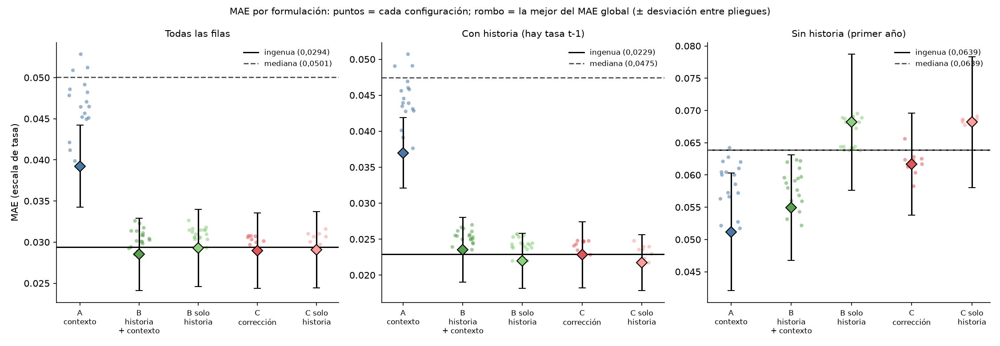

# Resultados v2: historia de la IES y corrección sobre la ingenua

Generado por `python run_formulaciones.py` (motor en `src/modelado/formulaciones.py`). Todas las cifras salen de la corrida; no se editan a mano. Continúa `reports/resultados_v1.md`.

## Diseño

- **Datos:** `data/processed/dataset_ies.csv`, 1.928 filas y 295 IES (ventana 2015–2021). Variables de historia (solo años anteriores a t, ver `src/integrate/historia.py`): `tasa_t1`, `tasa_t2`, `tasa_media_previa`, `n_anios_previos`, `falta_historia`.
- **Formulaciones** (todas con GroupKFold por `cod_ies`, 5 pliegues, **los mismos para todas las configuraciones, para las líneas base y para la v1**):
  - **A_contexto:** las variables de la v1 (35 variables), sin historia.
  - **B_historia_contexto:** historia + todas las de A (40 variables).
  - **B_solo_historia:** solo las 5 variables de historia (aísla el aporte del contexto).
  - **C_correccion:** el objetivo es `tasa_t − ingenua` (ingenua = `tasa_t1`, o la mediana del entrenamiento si no hay); el modelo lo predice con historia + contexto y la predicción final es ingenua + cambio predicho. Sin logit.
  - **C_correccion_solo_historia** (adición, para aislar el aporte del contexto dentro de la corrección): como C con solo las 5 variables de historia.
- **Grilla (72 configuraciones):** imputación mediana; selección (ninguna | información mutua k = 15 | PCA 90 %) × modelo (RidgeCV | Random Forest | XGBoost, hiperparámetros por defecto de la v1) × objetivo (ninguna | logit; en C solo ninguna). Semilla 42.
- **Métricas:** MAE, RMSE y R² por pliegue en escala de tasa, con las predicciones finales recortadas a [0, 1]; media ± desviación entre pliegues. «Con historia» son las filas que tienen `tasa_t1`; «sin historia», las que no (primer año de la IES en el dataset o sin fila del año anterior). La mejora es el cambio porcentual del MAE medio frente a la ingenua (positiva = menos error).
- **Tiempo total de la corrida:** 874 s (14,6 min).

## Líneas base

| Línea base | MAE (todas) | MAE con historia | MAE sin historia | Filas con historia | Filas sin historia |
|---|---|---|---|---|---|
| **base_ingenua** | 0,0294 ± 0,0046 | 0,0229 ± 0,0038 | 0,0639 ± 0,0125 | 1623 | 305 |
| **base_mediana** | 0,0501 ± 0,0085 | 0,0475 ± 0,0084 | 0,0639 ± 0,0125 | 1623 | 305 |

En las filas sin historia la ingenua no tiene tasa t-1 y usa la mediana del entrenamiento, así que su MAE ahí es el de la mediana: la comparación frente a la ingenua solo es una comparación de persistencia en las filas con historia.

## Conclusión principal

- **¿Alguna formulación supera a la ingenua?** Sí: 9 de 72 configuraciones tienen MAE medio menor que el de la ingenua (0,0294). La mejor es `B_historia_contexto | xgboost | logit | mediana | ninguna` con 0,0285 ± 0,0044 (+3,1 %; mejor que la ingenua en 4 de 5 pliegues).
  - Matiz: la diferencia de la mejor frente a la ingenua es 0,0009 de MAE; por pliegue (ingenua − mejor) vale 0,0009 ± 0,0011, y la mejor se eligió entre 72 configuraciones con esos mismos pliegues (la ingenua no se eligió), así que la ventaja está inflada por la selección. De esa diferencia, 0,0014 viene de las filas sin historia (305 de 1928) y -0,0005 de las filas con historia.
  - A_contexto: mejor `ridge | logit | mediana | info_mutua`, MAE 0,0392 (-33,4 % frente a la ingenua; 0 de 18 configuraciones la superan).
  - B_historia_contexto: mejor `xgboost | logit | mediana | ninguna`, MAE 0,0285 (+3,1 % frente a la ingenua; 4 de 18 configuraciones la superan).
  - B_solo_historia: mejor `ridge | ninguna | mediana | ninguna`, MAE 0,0293 (+0,4 % frente a la ingenua; 2 de 18 configuraciones la superan).
  - C_correccion: mejor `random_forest | ninguna | mediana | ninguna`, MAE 0,0290 (+1,5 % frente a la ingenua; 1 de 9 configuraciones la superan).
  - C_correccion_solo_historia: mejor `ridge | ninguna | mediana | ninguna`, MAE 0,0291 (+1,1 % frente a la ingenua; 2 de 9 configuraciones la superan).
- **Por subconjunto de filas** (mejor de las configuraciones en cada uno):

| Subconjunto | Ingenua | Mejor configuración en ese subconjunto | MAE | Mejora vs. ingenua | Pliegues mejores que la ingenua | Configuraciones que superan a la ingenua |
|---|---|---|---|---|---|---|
| todas las filas | 0,0294 | `B_historia_contexto \| xgboost \| logit \| mediana \| ninguna` | 0,0285 ± 0,0044 | +3,1 % | 4 de 5 | 9 de 72 |
| filas con historia | 0,0229 | `C_correccion_solo_historia \| ridge \| ninguna \| mediana \| ninguna` | 0,0217 ± 0,0039 | +5,2 % | 5 de 5 | 6 de 72 |
| filas sin historia | 0,0639 | `A_contexto \| ridge \| logit \| mediana \| info_mutua` | 0,0512 ± 0,0091 | +19,8 % | 5 de 5 | 45 de 72 |

- **Filas con y sin historia (para la mejor global):** con historia, la ingenua tiene MAE 0,0229; la mejor configuración global llega a 0,0235 (-2,6 %). Sin historia (primer año de la IES), la ingenua no tiene tasa t-1 y usa la mediana (MAE 0,0639); la mejor configuración global llega a 0,0550 (+13,9 %).
- **Aporte del contexto sobre la historia** (MAE de todas las filas; positivo = el contexto reduce el error):
  - **B (historia + contexto) frente a B solo historia:** mejor contra mejor (por MAE global), 0,0285 frente a 0,0293 (diferencia 0,0008 de MAE a favor de B (historia + contexto)); entre las dos mejores, B (historia + contexto) gana en 4 de 5 pliegues (diferencia media 0,0008 ± 0,0013): no es consistente en todos los pliegues; la diferencia media equivale a 0,61 desviaciones entre pliegues. Con la misma configuración, B (historia + contexto) tiene menor MAE en 13 de 18 pares (diferencia media 0,0004).
  - **C (corrección con contexto) frente a C solo historia:** mejor contra mejor (por MAE global), 0,0290 frente a 0,0291 (diferencia 0,0001 de MAE a favor de C (corrección con contexto)); entre las dos mejores, C (corrección con contexto) gana en 2 de 5 pliegues (diferencia media 0,0001 ± 0,0014): no es consistente en todos los pliegues; la diferencia media equivale a 0,09 desviaciones entre pliegues. Con la misma configuración, C (corrección con contexto) tiene menor MAE en 4 de 9 pares (diferencia media 0,0001).
- **Lo mismo, solo en filas con historia:**
  - **B frente a B solo historia:** mejor contra mejor (por MAE de las filas con historia), 0,0235 frente a 0,0220 (diferencia -0,0016 de MAE a favor de B solo historia); entre las dos mejores, B gana en 1 de 5 pliegues (diferencia media -0,0016 ± 0,0014): no es consistente en todos los pliegues; la diferencia media equivale a 1,10 desviaciones entre pliegues. Con la misma configuración, B tiene menor MAE en 2 de 18 pares (diferencia media -0,0011).
  - **C frente a C solo historia:** mejor contra mejor (por MAE de las filas con historia), 0,0228 frente a 0,0217 (diferencia -0,0011 de MAE a favor de C solo historia); entre las dos mejores, C gana en 1 de 5 pliegues (diferencia media -0,0011 ± 0,0012): no es consistente en todos los pliegues; la diferencia media equivale a 0,95 desviaciones entre pliegues. Con la misma configuración, C tiene menor MAE en 3 de 9 pares (diferencia media -0,0011).
- **Otras comparaciones:**
  - **C (corrección) frente a B (directa):** mejor contra mejor (por MAE global), 0,0290 frente a 0,0285 (diferencia -0,0005 de MAE a favor de B (directa)); entre las dos mejores, C (corrección) gana en 2 de 5 pliegues (diferencia media -0,0005 ± 0,0014): no es consistente en todos los pliegues; la diferencia media equivale a 0,32 desviaciones entre pliegues. Con la misma configuración, C (corrección) tiene menor MAE en 6 de 9 pares (diferencia media 0,0006).
  - **B (con historia) frente a A (solo contexto):** mejor contra mejor (por MAE global), 0,0285 frente a 0,0392 (diferencia 0,0107 de MAE a favor de B (con historia)); entre las dos mejores, B (con historia) gana en 5 de 5 pliegues (diferencia media 0,0107 ± 0,0014): el mismo signo en los 5 pliegues; la diferencia media equivale a 7,71 desviaciones entre pliegues. Con la misma configuración, B (con historia) tiene menor MAE en 18 de 18 pares (diferencia media 0,0157).

## Mejor configuración por formulación

| Formulación | Mejor configuración (por MAE) | MAE | Mejora vs. ingenua | Pliegues mejores que la ingenua | MAE con historia | MAE sin historia | Configuraciones que superan a la ingenua |
|---|---|---|---|---|---|---|---|
| A_contexto | ridge \| logit \| mediana \| info_mutua | 0,0392 ± 0,0050 | -33,4 % | 0 de 5 | 0,0370 (-61,3 %) | 0,0512 (+19,8 %) | 0 de 18 |
| B_historia_contexto | xgboost \| logit \| mediana \| ninguna | 0,0285 ± 0,0044 | +3,1 % | 4 de 5 | 0,0235 (-2,6 %) | 0,0550 (+13,9 %) | 4 de 18 |
| B_solo_historia | ridge \| ninguna \| mediana \| ninguna | 0,0293 ± 0,0047 | +0,4 % | 3 de 5 | 0,0220 (+4,1 %) | 0,0682 (-6,8 %) | 2 de 18 |
| C_correccion | random_forest \| ninguna \| mediana \| ninguna | 0,0290 ± 0,0046 | +1,5 % | 4 de 5 | 0,0228 (+0,5 %) | 0,0617 (+3,4 %) | 1 de 9 |
| C_correccion_solo_historia | ridge \| ninguna \| mediana \| ninguna | 0,0291 ± 0,0047 | +1,1 % | 3 de 5 | 0,0217 (+5,2 %) | 0,0682 (-6,8 %) | 2 de 9 |

## Tablas por formulación (ordenadas por MAE)

### A_contexto

| Configuración (modelo \| objetivo \| imputación \| selección) | MAE | RMSE | R² | Mejora vs. ingenua | MAE con historia | MAE sin historia | Pliegues mejores que la ingenua |
|---|---|---|---|---|---|---|---|
| ridge \| logit \| mediana \| info_mutua | 0,0392 ± 0,0050 | 0,0690 ± 0,0198 | 0,332 ± 0,065 | -33,4 % | 0,0370 (-61,3 %) | 0,0512 (+19,8 %) | 0 de 5 |
| ridge \| logit \| mediana \| ninguna | 0,0399 ± 0,0048 | 0,0694 ± 0,0198 | 0,324 ± 0,075 | -35,5 % | 0,0376 (-64,1 %) | 0,0517 (+19,0 %) | 0 de 5 |
| ridge \| ninguna \| mediana \| info_mutua | 0,0412 ± 0,0039 | 0,0694 ± 0,0180 | 0,317 ± 0,038 | -40,0 % | 0,0391 (-70,6 %) | 0,0521 (+18,4 %) | 0 de 5 |
| ridge \| ninguna \| mediana \| ninguna | 0,0421 ± 0,0032 | 0,0698 ± 0,0176 | 0,308 ± 0,043 | -43,2 % | 0,0401 (-74,9 %) | 0,0527 (+17,4 %) | 0 de 5 |
| xgboost \| logit \| mediana \| ninguna | 0,0449 ± 0,0049 | 0,0827 ± 0,0156 | -0,066 ± 0,473 | -52,8 % | 0,0428 (-86,5 %) | 0,0566 (+11,3 %) | 0 de 5 |
| xgboost \| logit \| mediana \| info_mutua | 0,0451 ± 0,0045 | 0,0827 ± 0,0145 | -0,083 ± 0,521 | -53,3 % | 0,0428 (-86,8 %) | 0,0572 (+10,4 %) | 0 de 5 |
| ridge \| logit \| mediana \| pca | 0,0452 ± 0,0049 | 0,0785 ± 0,0202 | 0,120 ± 0,085 | -53,7 % | 0,0431 (-88,0 %) | 0,0563 (+11,8 %) | 0 de 5 |
| xgboost \| ninguna \| mediana \| info_mutua | 0,0457 ± 0,0055 | 0,0787 ± 0,0136 | 0,055 ± 0,333 | -55,2 % | 0,0435 (-89,6 %) | 0,0572 (+10,4 %) | 0 de 5 |
| xgboost \| ninguna \| mediana \| ninguna | 0,0464 ± 0,0048 | 0,0798 ± 0,0142 | 0,031 ± 0,334 | -57,9 % | 0,0439 (-91,4 %) | 0,0600 (+6,0 %) | 0 de 5 |
| random_forest \| logit \| mediana \| ninguna | 0,0465 ± 0,0074 | 0,0815 ± 0,0220 | 0,019 ± 0,398 | -58,0 % | 0,0439 (-91,6 %) | 0,0600 (+6,0 %) | 0 de 5 |
| random_forest \| logit \| mediana \| info_mutua | 0,0471 ± 0,0081 | 0,0808 ± 0,0238 | 0,041 ± 0,425 | -60,0 % | 0,0445 (-94,3 %) | 0,0604 (+5,4 %) | 0 de 5 |
| ridge \| ninguna \| mediana \| pca | 0,0478 ± 0,0039 | 0,0781 ± 0,0183 | 0,117 ± 0,137 | -62,6 % | 0,0458 (-99,8 %) | 0,0586 (+8,3 %) | 0 de 5 |
| random_forest \| ninguna \| mediana \| ninguna | 0,0482 ± 0,0075 | 0,0809 ± 0,0198 | 0,040 ± 0,301 | -63,9 % | 0,0456 (-98,9 %) | 0,0620 (+2,9 %) | 0 de 5 |
| random_forest \| ninguna \| mediana \| info_mutua | 0,0486 ± 0,0071 | 0,0807 ± 0,0193 | 0,039 ± 0,319 | -65,1 % | 0,0460 (-100,8 %) | 0,0621 (+2,8 %) | 0 de 5 |
| xgboost \| logit \| mediana \| pca | 0,0491 ± 0,0055 | 0,0868 ± 0,0188 | -0,125 ± 0,352 | -67,1 % | 0,0469 (-104,6 %) | 0,0610 (+4,5 %) | 0 de 5 |
| xgboost \| ninguna \| mediana \| pca | 0,0509 ± 0,0050 | 0,0854 ± 0,0174 | -0,091 ± 0,331 | -73,0 % | 0,0491 (-114,1 %) | 0,0604 (+5,4 %) | 0 de 5 |
| random_forest \| logit \| mediana \| pca | 0,0512 ± 0,0055 | 0,0882 ± 0,0179 | -0,169 ± 0,374 | -74,1 % | 0,0490 (-113,9 %) | 0,0628 (+1,7 %) | 0 de 5 |
| random_forest \| ninguna \| mediana \| pca | 0,0528 ± 0,0040 | 0,0865 ± 0,0166 | -0,123 ± 0,338 | -79,6 % | 0,0507 (-121,1 %) | 0,0642 (-0,5 %) | 0 de 5 |

### B_historia_contexto

| Configuración (modelo \| objetivo \| imputación \| selección) | MAE | RMSE | R² | Mejora vs. ingenua | MAE con historia | MAE sin historia | Pliegues mejores que la ingenua |
|---|---|---|---|---|---|---|---|
| xgboost \| logit \| mediana \| ninguna | 0,0285 ± 0,0044 | 0,0572 ± 0,0131 | 0,528 ± 0,071 | +3,1 % | 0,0235 (-2,6 %) | 0,0550 (+13,9 %) | 4 de 5 |
| xgboost \| logit \| mediana \| info_mutua | 0,0289 ± 0,0047 | 0,0569 ± 0,0131 | 0,535 ± 0,067 | +1,8 % | 0,0245 (-6,8 %) | 0,0522 (+18,3 %) | 3 de 5 |
| random_forest \| logit \| mediana \| ninguna | 0,0293 ± 0,0059 | 0,0587 ± 0,0164 | 0,515 ± 0,063 | +0,5 % | 0,0239 (-4,3 %) | 0,0577 (+9,7 %) | 2 de 5 |
| ridge \| ninguna \| mediana \| info_mutua | 0,0294 ± 0,0043 | 0,0563 ± 0,0131 | 0,547 ± 0,060 | +0,0 % | 0,0249 (-8,8 %) | 0,0531 (+16,8 %) | 2 de 5 |
| ridge \| ninguna \| mediana \| ninguna | 0,0298 ± 0,0040 | 0,0553 ± 0,0129 | 0,561 ± 0,065 | -1,4 % | 0,0244 (-6,3 %) | 0,0587 (+8,0 %) | 2 de 5 |
| random_forest \| logit \| mediana \| info_mutua | 0,0300 ± 0,0061 | 0,0598 ± 0,0159 | 0,487 ± 0,127 | -2,1 % | 0,0250 (-9,1 %) | 0,0568 (+11,0 %) | 3 de 5 |
| ridge \| logit \| mediana \| ninguna | 0,0301 ± 0,0047 | 0,0571 ± 0,0129 | 0,528 ± 0,100 | -2,2 % | 0,0255 (-11,2 %) | 0,0543 (+15,0 %) | 1 de 5 |
| xgboost \| ninguna \| mediana \| info_mutua | 0,0301 ± 0,0053 | 0,0575 ± 0,0136 | 0,524 ± 0,089 | -2,5 % | 0,0253 (-10,3 %) | 0,0560 (+12,3 %) | 2 de 5 |
| xgboost \| ninguna \| mediana \| ninguna | 0,0303 ± 0,0055 | 0,0590 ± 0,0141 | 0,499 ± 0,081 | -2,9 % | 0,0250 (-9,3 %) | 0,0580 (+9,2 %) | 1 de 5 |
| ridge \| logit \| mediana \| info_mutua | 0,0304 ± 0,0044 | 0,0587 ± 0,0126 | 0,500 ± 0,093 | -3,4 % | 0,0256 (-11,7 %) | 0,0559 (+12,4 %) | 0 de 5 |
| random_forest \| ninguna \| mediana \| ninguna | 0,0308 ± 0,0057 | 0,0594 ± 0,0145 | 0,494 ± 0,095 | -4,8 % | 0,0250 (-8,9 %) | 0,0620 (+2,9 %) | 2 de 5 |
| random_forest \| ninguna \| mediana \| info_mutua | 0,0308 ± 0,0059 | 0,0598 ± 0,0149 | 0,481 ± 0,148 | -4,8 % | 0,0254 (-10,9 %) | 0,0596 (+6,7 %) | 3 de 5 |
| ridge \| ninguna \| mediana \| pca | 0,0311 ± 0,0042 | 0,0574 ± 0,0134 | 0,528 ± 0,068 | -5,7 % | 0,0255 (-11,0 %) | 0,0610 (+4,4 %) | 0 de 5 |
| ridge \| logit \| mediana \| pca | 0,0314 ± 0,0043 | 0,0593 ± 0,0134 | 0,491 ± 0,103 | -6,6 % | 0,0261 (-13,7 %) | 0,0594 (+6,9 %) | 0 de 5 |
| xgboost \| logit \| mediana \| pca | 0,0314 ± 0,0054 | 0,0602 ± 0,0165 | 0,490 ± 0,034 | -6,6 % | 0,0261 (-14,0 %) | 0,0591 (+7,5 %) | 0 de 5 |
| random_forest \| logit \| mediana \| pca | 0,0317 ± 0,0050 | 0,0609 ± 0,0147 | 0,472 ± 0,049 | -7,9 % | 0,0265 (-15,5 %) | 0,0597 (+6,5 %) | 0 de 5 |
| random_forest \| ninguna \| mediana \| pca | 0,0323 ± 0,0041 | 0,0596 ± 0,0127 | 0,488 ± 0,050 | -9,7 % | 0,0266 (-16,2 %) | 0,0622 (+2,6 %) | 0 de 5 |
| xgboost \| ninguna \| mediana \| pca | 0,0326 ± 0,0051 | 0,0607 ± 0,0150 | 0,475 ± 0,025 | -10,8 % | 0,0270 (-17,7 %) | 0,0623 (+2,4 %) | 0 de 5 |

### B_solo_historia

| Configuración (modelo \| objetivo \| imputación \| selección) | MAE | RMSE | R² | Mejora vs. ingenua | MAE con historia | MAE sin historia | Pliegues mejores que la ingenua |
|---|---|---|---|---|---|---|---|
| ridge \| ninguna \| mediana \| ninguna | 0,0293 ± 0,0047 | 0,0576 ± 0,0133 | 0,524 ± 0,076 | +0,4 % | 0,0220 (+4,1 %) | 0,0682 (-6,8 %) | 3 de 5 |
| ridge \| ninguna \| mediana \| info_mutua | 0,0293 ± 0,0047 | 0,0576 ± 0,0133 | 0,524 ± 0,076 | +0,4 % | 0,0220 (+4,1 %) | 0,0682 (-6,8 %) | 3 de 5 |
| xgboost \| logit \| mediana \| ninguna | 0,0303 ± 0,0055 | 0,0630 ± 0,0172 | 0,440 ± 0,045 | -3,1 % | 0,0239 (-4,4 %) | 0,0644 (-0,8 %) | 1 de 5 |
| xgboost \| logit \| mediana \| info_mutua | 0,0303 ± 0,0055 | 0,0630 ± 0,0172 | 0,440 ± 0,045 | -3,1 % | 0,0239 (-4,4 %) | 0,0644 (-0,8 %) | 1 de 5 |
| ridge \| ninguna \| mediana \| pca | 0,0305 ± 0,0046 | 0,0585 ± 0,0136 | 0,508 ± 0,084 | -3,7 % | 0,0236 (-2,8 %) | 0,0672 (-5,3 %) | 0 de 5 |
| xgboost \| logit \| mediana \| pca | 0,0306 ± 0,0058 | 0,0641 ± 0,0174 | 0,409 ± 0,168 | -3,9 % | 0,0243 (-5,9 %) | 0,0639 (-0,0 %) | 1 de 5 |
| random_forest \| logit \| mediana \| ninguna | 0,0306 ± 0,0054 | 0,0611 ± 0,0158 | 0,470 ± 0,053 | -4,0 % | 0,0243 (-6,2 %) | 0,0638 (+0,1 %) | 1 de 5 |
| random_forest \| logit \| mediana \| info_mutua | 0,0306 ± 0,0054 | 0,0611 ± 0,0158 | 0,470 ± 0,053 | -4,0 % | 0,0243 (-6,2 %) | 0,0638 (+0,1 %) | 1 de 5 |
| xgboost \| ninguna \| mediana \| ninguna | 0,0310 ± 0,0053 | 0,0611 ± 0,0175 | 0,475 ± 0,056 | -5,2 % | 0,0238 (-3,8 %) | 0,0690 (-8,1 %) | 0 de 5 |
| xgboost \| ninguna \| mediana \| info_mutua | 0,0310 ± 0,0053 | 0,0611 ± 0,0175 | 0,475 ± 0,056 | -5,2 % | 0,0238 (-3,8 %) | 0,0690 (-8,1 %) | 0 de 5 |
| xgboost \| ninguna \| mediana \| pca | 0,0312 ± 0,0055 | 0,0628 ± 0,0176 | 0,444 ± 0,086 | -6,2 % | 0,0242 (-5,5 %) | 0,0687 (-7,6 %) | 0 de 5 |
| ridge \| logit \| mediana \| ninguna | 0,0315 ± 0,0055 | 0,0612 ± 0,0139 | 0,457 ± 0,120 | -6,9 % | 0,0253 (-10,3 %) | 0,0642 (-0,5 %) | 1 de 5 |
| ridge \| logit \| mediana \| info_mutua | 0,0315 ± 0,0055 | 0,0612 ± 0,0139 | 0,457 ± 0,120 | -6,9 % | 0,0253 (-10,3 %) | 0,0642 (-0,5 %) | 1 de 5 |
| random_forest \| ninguna \| mediana \| ninguna | 0,0315 ± 0,0051 | 0,0601 ± 0,0151 | 0,485 ± 0,062 | -7,0 % | 0,0244 (-6,6 %) | 0,0689 (-7,8 %) | 0 de 5 |
| random_forest \| ninguna \| mediana \| info_mutua | 0,0315 ± 0,0051 | 0,0601 ± 0,0151 | 0,485 ± 0,062 | -7,0 % | 0,0244 (-6,6 %) | 0,0689 (-7,8 %) | 0 de 5 |
| ridge \| logit \| mediana \| pca | 0,0316 ± 0,0057 | 0,0614 ± 0,0144 | 0,454 ± 0,127 | -7,5 % | 0,0255 (-11,3 %) | 0,0641 (-0,4 %) | 1 de 5 |
| random_forest \| logit \| mediana \| pca | 0,0318 ± 0,0053 | 0,0645 ± 0,0180 | 0,413 ± 0,079 | -8,1 % | 0,0257 (-11,9 %) | 0,0644 (-0,8 %) | 0 de 5 |
| random_forest \| ninguna \| mediana \| pca | 0,0326 ± 0,0045 | 0,0641 ± 0,0163 | 0,417 ± 0,067 | -10,9 % | 0,0257 (-12,1 %) | 0,0695 (-8,9 %) | 0 de 5 |

### C_correccion

| Configuración (modelo \| objetivo \| imputación \| selección) | MAE | RMSE | R² | Mejora vs. ingenua | MAE con historia | MAE sin historia | Pliegues mejores que la ingenua |
|---|---|---|---|---|---|---|---|
| random_forest \| ninguna \| mediana \| ninguna | 0,0290 ± 0,0046 | 0,0574 ± 0,0122 | 0,522 ± 0,076 | +1,5 % | 0,0228 (+0,5 %) | 0,0617 (+3,4 %) | 4 de 5 |
| ridge \| ninguna \| mediana \| ninguna | 0,0297 ± 0,0040 | 0,0553 ± 0,0127 | 0,562 ± 0,065 | -0,9 % | 0,0243 (-6,0 %) | 0,0583 (+8,8 %) | 2 de 5 |
| ridge \| ninguna \| mediana \| info_mutua | 0,0300 ± 0,0037 | 0,0568 ± 0,0125 | 0,535 ± 0,070 | -1,9 % | 0,0241 (-5,0 %) | 0,0613 (+4,1 %) | 1 de 5 |
| random_forest \| ninguna \| mediana \| info_mutua | 0,0301 ± 0,0045 | 0,0588 ± 0,0121 | 0,498 ± 0,066 | -2,4 % | 0,0235 (-2,3 %) | 0,0656 (-2,7 %) | 1 de 5 |
| xgboost \| ninguna \| mediana \| ninguna | 0,0303 ± 0,0053 | 0,0605 ± 0,0124 | 0,466 ± 0,099 | -3,1 % | 0,0247 (-7,7 %) | 0,0603 (+5,5 %) | 1 de 5 |
| random_forest \| ninguna \| mediana \| pca | 0,0306 ± 0,0039 | 0,0598 ± 0,0113 | 0,477 ± 0,074 | -3,9 % | 0,0246 (-7,3 %) | 0,0624 (+2,4 %) | 1 de 5 |
| xgboost \| ninguna \| mediana \| pca | 0,0307 ± 0,0029 | 0,0601 ± 0,0095 | 0,465 ± 0,099 | -4,4 % | 0,0248 (-8,0 %) | 0,0623 (+2,4 %) | 1 de 5 |
| xgboost \| ninguna \| mediana \| info_mutua | 0,0308 ± 0,0039 | 0,0598 ± 0,0108 | 0,475 ± 0,081 | -4,6 % | 0,0247 (-7,9 %) | 0,0628 (+1,7 %) | 0 de 5 |
| ridge \| ninguna \| mediana \| pca | 0,0308 ± 0,0035 | 0,0582 ± 0,0121 | 0,509 ± 0,066 | -4,6 % | 0,0248 (-8,1 %) | 0,0625 (+2,1 %) | 0 de 5 |

### C_correccion_solo_historia

| Configuración (modelo \| objetivo \| imputación \| selección) | MAE | RMSE | R² | Mejora vs. ingenua | MAE con historia | MAE sin historia | Pliegues mejores que la ingenua |
|---|---|---|---|---|---|---|---|
| ridge \| ninguna \| mediana \| ninguna | 0,0291 ± 0,0047 | 0,0576 ± 0,0131 | 0,524 ± 0,075 | +1,1 % | 0,0217 (+5,2 %) | 0,0682 (-6,8 %) | 3 de 5 |
| ridge \| ninguna \| mediana \| info_mutua | 0,0291 ± 0,0047 | 0,0576 ± 0,0131 | 0,524 ± 0,075 | +1,1 % | 0,0217 (+5,2 %) | 0,0682 (-6,8 %) | 3 de 5 |
| ridge \| ninguna \| mediana \| pca | 0,0297 ± 0,0044 | 0,0583 ± 0,0128 | 0,508 ± 0,077 | -1,0 % | 0,0223 (+2,7 %) | 0,0691 (-8,2 %) | 3 de 5 |
| xgboost \| ninguna \| mediana \| pca | 0,0300 ± 0,0049 | 0,0591 ± 0,0137 | 0,496 ± 0,101 | -2,1 % | 0,0229 (-0,1 %) | 0,0677 (-6,0 %) | 2 de 5 |
| xgboost \| ninguna \| mediana \| ninguna | 0,0307 ± 0,0043 | 0,0605 ± 0,0124 | 0,469 ± 0,078 | -4,2 % | 0,0235 (-2,7 %) | 0,0685 (-7,3 %) | 0 de 5 |
| xgboost \| ninguna \| mediana \| info_mutua | 0,0307 ± 0,0043 | 0,0605 ± 0,0124 | 0,469 ± 0,078 | -4,2 % | 0,0235 (-2,7 %) | 0,0685 (-7,3 %) | 0 de 5 |
| random_forest \| ninguna \| mediana \| ninguna | 0,0310 ± 0,0045 | 0,0588 ± 0,0133 | 0,503 ± 0,073 | -5,4 % | 0,0239 (-4,4 %) | 0,0686 (-7,4 %) | 0 de 5 |
| random_forest \| ninguna \| mediana \| info_mutua | 0,0310 ± 0,0045 | 0,0588 ± 0,0133 | 0,503 ± 0,073 | -5,4 % | 0,0239 (-4,4 %) | 0,0686 (-7,4 %) | 0 de 5 |
| random_forest \| ninguna \| mediana \| pca | 0,0316 ± 0,0046 | 0,0605 ± 0,0141 | 0,474 ± 0,080 | -7,4 % | 0,0248 (-8,0 %) | 0,0679 (-6,3 %) | 0 de 5 |

## Supuestos y limitaciones

- **Disponibilidad de `tasa_t1`:** se asume que la tasa anual de t-1 está disponible al inicio del año t. La fórmula (desertores de t / matriculados t-2 semestres) y la definición de desertor (dos o más períodos consecutivos sin matrícula) son del glosario de SPADIES; el glosario y las preguntas frecuentes **no dicen cuándo se publican los datos** (ver la bitácora). Si en la práctica el último año completo estuviera disponible con más rezago, las formulaciones B y C (y la propia línea base ingenua) estarían usando información que no se tendría al predecir.
- **Primer año sin historia:** el dataset empieza en 2015, así que las filas de 2015 no tienen `tasa_t1` por construcción (la mayor parte de las filas «sin historia»). SPADIES trae la serie desde 1998: ampliar la historia hacia atrás con años previos a 2015 es posible y no se hizo aquí.
- **Persistencia:** no se analizó cuánto de la persistencia de la tasa entre años es mecánica por cómo SPADIES clasifica a los desertores (dos o más períodos sin matrícula).
- **Solo historia con información mutua:** con 5 variables, `k = 15` se reduce a 5 (conserva todas), de modo que `info_mutua` equivale a `ninguna` en `B_solo_historia` y `C_correccion_solo_historia`.
- **Hiperparámetros por defecto** (no es el modelo final); `RidgeCV` elige su alfa con validación interna sin agrupar por IES dentro del entrenamiento (sin fuga hacia el pliegue de prueba).
- **Una sola partición agrupada** (5 pliegues): diferencias menores que la desviación entre pliegues no son concluyentes. Las comparaciones por pliegue de arriba usan los mismos pliegues para todas las configuraciones.
- El sesgo de selección, supervivencia y geografía de `reports/analisis_sesgo.md` aplica igual a estos resultados.
