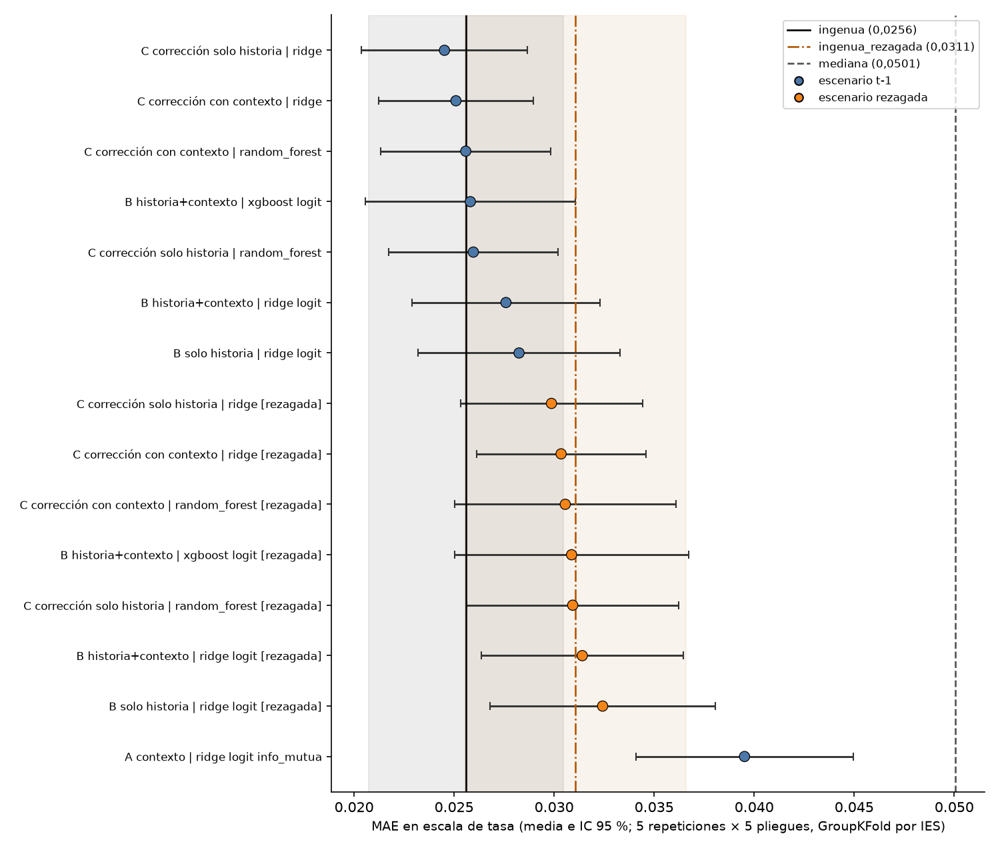

# Resultados v3: protocolo de evaluación riguroso

Generado por `python run_protocolo_v3.py` (motor en `src/modelado/protocolo.py`). Todas las cifras salen de la corrida; no se editan a mano. Continúa `reports/resultados_v2.md`.

**Importante:** la v2 se calculó con la historia que empieza en 2015; en esta v3 la historia (`tasa_t1`, `tasa_t2`, `tasa_media_previa`, `n_anios_previos`) usa también las tasas anuales de SPADIES de 1999 a 2014 (misma definición y filtros), así que las cifras de la v2 y las de esta v3 no son comparables una a una.

## Protocolo

- **Datos:** `data/processed/dataset_ies.csv`, 1.928 filas y 295 IES (objetivos 2015–2021; las filas no cambian respecto a la v2).
- **Validación:** GroupKFold por `cod_ies` con mezcla, 5 pliegues, repetido con las semillas [101, 102, 103, 104, 105]: **25 ajustes por configuración**. Cada repetición se genera una sola vez y se usa en todas las configuraciones y líneas base (`hash_prueba` en el CSV).
- **Configuraciones:** las 15 del conjunto **fijado en `config.yaml` antes de correr** (no se eligieron mirando resultados): A contexto (ridge logit info_mutua); B historia + contexto (xgboost logit; ridge logit); B solo historia (ridge logit); C corrección con y sin contexto (ridge y random_forest); y las mismas B y C en versión «historia rezagada» (sin usar la tasa de t-1). Imputación mediana, hiperparámetros por defecto de la v1, predicciones recortadas a [0, 1]. B solo historia usa logit para que la comparación con B solo cambie el contexto.
- **Líneas base:** `base_ingenua` (tasa t-1 de la misma IES, o la mediana del entrenamiento si no hay), `base_ingenua_rezagada` (tasa t-2) y `base_mediana`. Cada configuración «rezagada» se compara con la ingenua rezagada, que tiene la misma información; las demás, con la ingenua.
- **Intervalo de confianza y pruebas:** los 25 MAE por pliegue no son independientes (los entrenamientos se traslapan y las repeticiones reutilizan las mismas IES). El IC 95 % de la media y la «p t corregida» usan la varianza corregida de Nadeau y Bengio, `(1/J + n_prueba/n_entrenamiento) · s²` con `n_prueba/n_entrenamiento` = 0,250 y J = 25. La prueba de Wilcoxon de rangos con signo se aplica a las 25 diferencias pareadas (ingenua − configuración) y **no** corrige la dependencia, por lo que es más optimista; se reporta porque se pidió, y se considera evidencia solo cuando coincide con la t corregida. «Gana en» es la proporción de pliegues con error estrictamente menor que el de la referencia. «Mejora» y «Diferencia» son positivas cuando la configuración tiene menos error.
- **Subconjuntos:** «con historia» son las filas que tienen `tasa_t1`; «sin historia», las que no (34 filas distintas; ver `reports/sin_historia.csv`). Se usa esa misma definición para todas las configuraciones, incluidas las rezagadas.
- **Tiempo total de la corrida:** 671 s (11,2 min). scikit-learn 1.9.0, xgboost 3.4.1.

## Conclusión

- **¿Alguna configuración supera a la ingenua con la tasa de t-1 disponible?** Entre las 8 configuraciones fijadas: 1 con menor error y significancia en las dos pruebas (p de Wilcoxon y p de la t corregida < 0,05), 2 con menor error medio sin esa significancia y 5 sin mejora. La de menor MAE es `C corrección solo historia | ridge`: 0,0245 [0,0204; 0,0287] frente a 0,0256 [0,0207; 0,0305] de la referencia (+4,3 %; p Wilcoxon < 0,001, p t corregida 0,044, gana en 88 % de los pliegues). Sin ajustar por comparaciones múltiples; con Bonferroni (8 comparaciones) la p t corregida de esa configuración sería 0,349. Las que superan a la ingenua en las dos pruebas: `C corrección solo historia | ridge`.
- **¿Alguna configuración supera a la ingenua en el escenario conservador (sin t-1)?** Entre las 7 configuraciones fijadas: 0 con menor error y significancia en las dos pruebas (p de Wilcoxon y p de la t corregida < 0,05), 5 con menor error medio sin esa significancia y 2 sin mejora. La de menor MAE es `C corrección solo historia | ridge [rezagada]`: 0,0299 [0,0253; 0,0344] frente a 0,0311 [0,0255; 0,0366] de la referencia (+3,8 %; p Wilcoxon < 0,001, p t corregida 0,136, gana en 84 % de los pliegues). Sin ajustar por comparaciones múltiples; con Bonferroni (7 comparaciones) la p t corregida de esa configuración sería 0,952.
- **Líneas base:** ingenua 0,0256 [0,0207; 0,0305], ingenua rezagada 0,0311 [0,0255; 0,0366], mediana 0,0501 [0,0409; 0,0592]. No tener la tasa de t-1 cuesta 0,0055 de MAE en la ingenua (-21,3 % de mejora de la rezagada frente a la normal; p Wilcoxon < 0,001).
- **Aporte del contexto sobre la historia** (diferencia = MAE sin contexto − MAE con contexto; positiva = el contexto ayuda):
  - `B historia+contexto | ridge logit` frente a `B solo historia | ridge logit`: 0,0007 de MAE en todas las filas (mejora; significativa solo en Wilcoxon, que no corrige la dependencia; p Wilcoxon < 0,001, p t corregida 0,116); en filas con historia 0,0006 (p 0,003).
  - `C corrección con contexto | ridge` frente a `C corrección solo historia | ridge`: -0,0006 de MAE en todas las filas (no mejora; significativa solo en Wilcoxon, que no corrige la dependencia; p Wilcoxon < 0,001, p t corregida 0,136); en filas con historia -0,0006 (p < 0,001).
  - `C corrección con contexto | random_forest` frente a `C corrección solo historia | random_forest`: 0,0004 de MAE en todas las filas (mejora, sin significancia; p Wilcoxon 0,141, p t corregida 0,504); en filas con historia 0,0003 (p 0,055).
  - `B historia+contexto | ridge logit [rezagada]` frente a `B solo historia | ridge logit [rezagada]`: 0,0010 de MAE en todas las filas (mejora; significativa solo en Wilcoxon, que no corrige la dependencia; p Wilcoxon < 0,001, p t corregida 0,087); en filas con historia 0,0009 (p 0,001).
  - `C corrección con contexto | ridge [rezagada]` frente a `C corrección solo historia | ridge [rezagada]`: -0,0005 de MAE en todas las filas (no mejora; significativa solo en Wilcoxon, que no corrige la dependencia; p Wilcoxon 0,024, p t corregida 0,393); en filas con historia -0,0006 (p 0,012).
  - `C corrección con contexto | random_forest [rezagada]` frente a `C corrección solo historia | random_forest [rezagada]`: 0,0004 de MAE en todas las filas (mejora, sin significancia; p Wilcoxon 0,353, p t corregida 0,665); en filas con historia 0,0005 (p 0,173).
- **Corrección sobre la ingenua frente a predicción directa** (diferencia = MAE de la directa − MAE de la corrección; positiva = la corrección es mejor):
  - `C corrección con contexto | ridge` frente a `B historia+contexto | ridge logit`: 0,0025 (mejora, significativa en ambas pruebas; p Wilcoxon < 0,001, p t corregida 0,013).
  - `C corrección solo historia | ridge` frente a `B solo historia | ridge logit`: 0,0037 (mejora, significativa en ambas pruebas; p Wilcoxon < 0,001, p t corregida < 0,001).
  - `C corrección con contexto | ridge [rezagada]` frente a `B historia+contexto | ridge logit [rezagada]`: 0,0011 (mejora; significativa solo en Wilcoxon, que no corrige la dependencia; p Wilcoxon 0,009, p t corregida 0,270).
  - `C corrección solo historia | ridge [rezagada]` frente a `B solo historia | ridge logit [rezagada]`: 0,0026 (mejora, significativa en ambas pruebas; p Wilcoxon < 0,001, p t corregida 0,010).
  - `C corrección con contexto | random_forest` frente a `B historia+contexto | xgboost logit`: 0,0002 (mejora, sin significancia; p Wilcoxon 0,791, p t corregida 0,781).
- **Filas sin historia:** son 34 de 1928 (cada fila se evalúa una vez por repetición), en promedio 6,8 por pliegue; el MAE de ese subconjunto tiene mucho más ruido y debe leerse con cautela (tabla por subconjunto).

### ¿Se sostienen las conclusiones de la v2?

- **v2: «la mejor configuración global (B con xgboost y logit) supera a la ingenua por poco (+3,1 %)».**
  - v3, `B historia+contexto | xgboost logit` frente a la ingenua (que ahora usa t-1 también en 2015): -0,8 % (no mejora, sin significancia; p Wilcoxon 0,634, p t corregida 0,812).
  - v3, `B historia+contexto | ridge logit` frente a la ingenua (que ahora usa t-1 también en 2015): -7,8 % (empeora, significativa en ambas pruebas; p Wilcoxon < 0,001, p t corregida 0,019).
  - La ventaja de la v2 venía de las filas sin historia: con la historia desde 1999 esas filas pasan de 305 a 34; la ingenua deja de usar la mediana en 2015 y la ventaja desaparece (ninguna de las dos B mejora a la ingenua).
- **v2: «el contexto casi no aporta sobre la historia; sí en las filas sin historia».** v3, B con contexto frente a B solo historia (ridge logit): 0,0007 de MAE (mejora; significativa solo en Wilcoxon, que no corrige la dependencia); en filas con historia 0,0006 (p 0,003); en filas sin historia 0,0061 (p 0,001, con solo 34 filas).
- **v2: «la corrección (C) no mejora a la predicción directa (B)».**
  - v3, `C corrección con contexto | ridge` frente a `B historia+contexto | ridge logit`: 0,0025 (mejora, significativa en ambas pruebas; p Wilcoxon < 0,001, p t corregida 0,013).
  - v3, `C corrección con contexto | random_forest` frente a `B historia+contexto | xgboost logit`: 0,0002 (mejora, sin significancia; p Wilcoxon 0,791, p t corregida 0,781).

## Tabla principal: escenario con la tasa de t-1 disponible (referencia: ingenua)

| Configuración | MAE media [IC 95 %] | Diferencia vs. base_ingenua [IC 95 %] | Mejora | p Wilcoxon | p t corregida | Gana en |
|---|---|---|---|---|---|---|
| **base_ingenua** | 0,0256 [0,0207; 0,0305] | — | — | — | — | — |
| **base_mediana** | 0,0501 [0,0409; 0,0592] | -0,0244 [-0,0295; -0,0194] | -95,5 % | < 0,001 | < 0,001 | 0 % |
| **base_ingenua_rezagada** | 0,0311 [0,0255; 0,0366] | -0,0055 [-0,0072; -0,0037] | -21,3 % | < 0,001 | < 0,001 | 0 % |
| A contexto \| ridge logit info_mutua | 0,0395 [0,0341; 0,0450] | -0,0139 [-0,0171; -0,0107] | -54,3 % | < 0,001 | < 0,001 | 0 % |
| B historia+contexto \| xgboost logit | 0,0258 [0,0206; 0,0311] | -0,0002 [-0,0020; 0,0016] | -0,8 % | 0,634 | 0,812 | 44 % |
| B historia+contexto \| ridge logit | 0,0276 [0,0229; 0,0323] | -0,0020 [-0,0036; -0,0004] | -7,8 % | < 0,001 | 0,019 | 12 % |
| B solo historia \| ridge logit | 0,0282 [0,0232; 0,0333] | -0,0026 [-0,0043; -0,0010] | -10,3 % | < 0,001 | 0,003 | 4 % |
| C corrección con contexto \| ridge | 0,0251 [0,0212; 0,0290] | 0,0005 [-0,0010; 0,0020] | +2,0 % | 0,075 | 0,488 | 60 % |
| C corrección con contexto \| random_forest | 0,0256 [0,0213; 0,0298] | 0,0000 [-0,0014; 0,0015] | +0,1 % | 0,895 | 0,972 | 44 % |
| C corrección solo historia \| ridge | 0,0245 [0,0204; 0,0287] | 0,0011 [0,0000; 0,0021] | +4,3 % | < 0,001 | 0,044 | 88 % |
| C corrección solo historia \| random_forest | 0,0260 [0,0217; 0,0302] | -0,0004 [-0,0019; 0,0012] | -1,4 % | 0,156 | 0,644 | 36 % |

## Tabla principal: escenario conservador, historia rezagada (referencia: ingenua rezagada)

Las dos últimas columnas comparan además con la ingenua que sí usa t-1 (lo que se pierde por no tenerla).

| Configuración | MAE media [IC 95 %] | Diferencia vs. base_ingenua_rezagada [IC 95 %] | Mejora | p Wilcoxon | p t corregida | Gana en | Mejora vs. ingenua t-1 | p Wilcoxon vs. ingenua t-1 |
|---|---|---|---|---|---|---|---|---|
| **base_ingenua_rezagada** | 0,0311 [0,0255; 0,0366] | — | — | — | — | — | -21,3 % | < 0,001 |
| B historia+contexto \| xgboost logit [rezagada] | 0,0309 [0,0250; 0,0367] | 0,0002 [-0,0027; 0,0030] | +0,6 % | 0,615 | 0,893 | 52 % | -20,6 % | < 0,001 |
| B historia+contexto \| ridge logit [rezagada] | 0,0314 [0,0264; 0,0365] | -0,0003 [-0,0022; 0,0015] | -1,1 % | 0,325 | 0,702 | 36 % | -22,7 % | < 0,001 |
| B solo historia \| ridge logit [rezagada] | 0,0324 [0,0268; 0,0381] | -0,0014 [-0,0031; 0,0003] | -4,4 % | < 0,001 | 0,109 | 16 % | -26,6 % | < 0,001 |
| C corrección con contexto \| ridge [rezagada] | 0,0303 [0,0261; 0,0346] | 0,0007 [-0,0013; 0,0028] | +2,3 % | 0,075 | 0,481 | 68 % | -18,5 % | < 0,001 |
| C corrección con contexto \| random_forest [rezagada] | 0,0306 [0,0250; 0,0361] | 0,0005 [-0,0019; 0,0029] | +1,6 % | 0,300 | 0,672 | 60 % | -19,3 % | < 0,001 |
| C corrección solo historia \| ridge [rezagada] | 0,0299 [0,0253; 0,0344] | 0,0012 [-0,0004; 0,0028] | +3,8 % | < 0,001 | 0,136 | 84 % | -16,6 % | < 0,001 |
| C corrección solo historia \| random_forest [rezagada] | 0,0309 [0,0256; 0,0362] | 0,0001 [-0,0022; 0,0025] | +0,4 % | 0,731 | 0,909 | 52 % | -20,8 % | < 0,001 |

## MAE por subconjunto de filas

La mejora de cada subconjunto es frente a la referencia que corresponde (ingenua, o ingenua rezagada para las rezagadas) en ese mismo subconjunto; entre paréntesis, el p de Wilcoxon. Con pocas filas sin historia, el IC de ese subconjunto es ancho.

| Configuración | MAE todas las filas | MAE con historia | Mejora (con historia) | MAE sin historia | Mejora (sin historia) |
|---|---|---|---|---|---|
| base_ingenua | 0,0256 | 0,0238 [0,0189; 0,0286] | — | 0,1261 [0,0679; 0,1843] | — |
| base_ingenua_rezagada | 0,0311 | 0,0293 [0,0236; 0,0349] | — | 0,1284 [0,0662; 0,1905] | — |
| base_mediana | 0,0501 | 0,0486 [0,0394; 0,0579] | — | 0,1261 [0,0679; 0,1843] | — |
| A contexto \| ridge logit info_mutua | 0,0395 | 0,0383 [0,0326; 0,0440] | -61,0 % (p < 0,001) | 0,1059 [0,0522; 0,1595] | +16,0 % (p < 0,001) |
| B historia+contexto \| xgboost logit | 0,0258 | 0,0241 [0,0189; 0,0294] | -1,5 % (p 0,300) | 0,1170 [0,0615; 0,1725] | +7,2 % (p 0,080) |
| B historia+contexto \| ridge logit | 0,0276 | 0,0262 [0,0213; 0,0310] | -10,1 % (p < 0,001) | 0,1043 [0,0515; 0,1571] | +17,3 % (p < 0,001) |
| B solo historia \| ridge logit | 0,0282 | 0,0267 [0,0216; 0,0319] | -12,5 % (p < 0,001) | 0,1104 [0,0575; 0,1632] | +12,5 % (p 0,005) |
| C corrección con contexto \| ridge | 0,0251 | 0,0235 [0,0194; 0,0276] | +1,2 % (p 0,148) | 0,1122 [0,0648; 0,1596] | +11,0 % (p 0,048) |
| C corrección con contexto \| random_forest | 0,0256 | 0,0235 [0,0191; 0,0279] | +1,1 % (p 0,300) | 0,1385 [0,0881; 0,1890] | -9,9 % (p 0,085) |
| C corrección solo historia \| ridge | 0,0245 | 0,0228 [0,0184; 0,0272] | +3,9 % (p < 0,001) | 0,1144 [0,0655; 0,1633] | +9,3 % (p 0,063) |
| C corrección solo historia \| random_forest | 0,0260 | 0,0238 [0,0194; 0,0283] | -0,3 % (p 0,442) | 0,1419 [0,0998; 0,1840] | -12,6 % (p 0,113) |
| B historia+contexto \| xgboost logit [rezagada] | 0,0309 | 0,0292 [0,0232; 0,0351] | +0,3 % (p 0,771) | 0,1207 [0,0720; 0,1693] | +6,0 % (p 0,275) |
| B historia+contexto \| ridge logit [rezagada] | 0,0314 | 0,0300 [0,0248; 0,0352] | -2,5 % (p 0,067) | 0,1071 [0,0507; 0,1636] | +16,5 % (p < 0,001) |
| B solo historia \| ridge logit [rezagada] | 0,0324 | 0,0309 [0,0251; 0,0366] | -5,5 % (p < 0,001) | 0,1160 [0,0596; 0,1725] | +9,6 % (p 0,011) |
| C corrección con contexto \| ridge [rezagada] | 0,0303 | 0,0288 [0,0243; 0,0333] | +1,5 % (p 0,339) | 0,1109 [0,0575; 0,1643] | +13,6 % (p 0,010) |
| C corrección con contexto \| random_forest [rezagada] | 0,0306 | 0,0289 [0,0232; 0,0346] | +1,2 % (p 0,596) | 0,1183 [0,0723; 0,1643] | +7,9 % (p 0,134) |
| C corrección solo historia \| ridge [rezagada] | 0,0299 | 0,0283 [0,0234; 0,0331] | +3,5 % (p 0,002) | 0,1158 [0,0588; 0,1728] | +9,8 % (p 0,048) |
| C corrección solo historia \| random_forest [rezagada] | 0,0309 | 0,0294 [0,0239; 0,0350] | -0,6 % (p 0,711) | 0,1093 [0,0632; 0,1554] | +14,9 % (p 0,027) |

## Aporte del contexto y de la corrección

| con contexto frente a sin contexto | Todas: diferencia [IC 95 %] | p Wilcoxon | p t corregida | Gana en | Con historia: diferencia (p Wilcoxon) | Sin historia: diferencia (p Wilcoxon) |
|---|---|---|---|---|---|---|
| B historia+contexto \| ridge logit frente a B solo historia \| ridge logit | 0,0007 [-0,0002; 0,0015] | < 0,001 | 0,116 | 80 % | 0,0006 (0,003) | 0,0061 (0,001) |
| C corrección con contexto \| ridge frente a C corrección solo historia \| ridge | -0,0006 [-0,0013; 0,0002] | < 0,001 | 0,136 | 20 % | -0,0006 (< 0,001) | 0,0022 (0,075) |
| C corrección con contexto \| random_forest frente a C corrección solo historia \| random_forest | 0,0004 [-0,0008; 0,0015] | 0,141 | 0,504 | 52 % | 0,0003 (0,055) | 0,0034 (0,791) |
| B historia+contexto \| ridge logit [rezagada] frente a B solo historia \| ridge logit [rezagada] | 0,0010 [-0,0002; 0,0022] | < 0,001 | 0,087 | 80 % | 0,0009 (0,001) | 0,0089 (< 0,001) |
| C corrección con contexto \| ridge [rezagada] frente a C corrección solo historia \| ridge [rezagada] | -0,0005 [-0,0016; 0,0007] | 0,024 | 0,393 | 24 % | -0,0006 (0,012) | 0,0049 (0,002) |
| C corrección con contexto \| random_forest [rezagada] frente a C corrección solo historia \| random_forest [rezagada] | 0,0004 [-0,0014; 0,0021] | 0,353 | 0,665 | 52 % | 0,0005 (0,173) | -0,0090 (0,059) |

| corrección frente a directa | Todas: diferencia [IC 95 %] | p Wilcoxon | p t corregida | Gana en | Con historia: diferencia (p Wilcoxon) | Sin historia: diferencia (p Wilcoxon) |
|---|---|---|---|---|---|---|
| C corrección con contexto \| ridge frente a B historia+contexto \| ridge logit | 0,0025 [0,0006; 0,0044] | < 0,001 | 0,013 | 84 % | 0,0027 (< 0,001) | -0,0079 (0,009) |
| C corrección solo historia \| ridge frente a B solo historia \| ridge logit | 0,0037 [0,0019; 0,0055] | < 0,001 | < 0,001 | 100 % | 0,0039 (< 0,001) | -0,0040 (0,164) |
| C corrección con contexto \| ridge [rezagada] frente a B historia+contexto \| ridge logit [rezagada] | 0,0011 [-0,0009; 0,0030] | 0,009 | 0,270 | 76 % | 0,0012 (0,003) | -0,0038 (0,071) |
| C corrección solo historia \| ridge [rezagada] frente a B solo historia \| ridge logit [rezagada] | 0,0026 [0,0007; 0,0044] | < 0,001 | 0,010 | 96 % | 0,0026 (< 0,001) | 0,0002 (0,833) |
| C corrección con contexto \| random_forest frente a B historia+contexto \| xgboost logit | 0,0002 [-0,0015; 0,0019] | 0,791 | 0,781 | 52 % | 0,0006 (0,039) | -0,0215 (< 0,001) |

## Supuestos y limitaciones

- **Disponibilidad de `tasa_t1`:** se asume que la tasa anual de t-1 está disponible al inicio de t; no está verificado (ver `reports/etl_log.md`). El escenario «historia rezagada» es el conservador: si esa tasa no estuviera publicada, solo valen las configuraciones rezagadas y su ingenua rezagada.
- **Historia desde 1999:** la media de las tasas anteriores (`tasa_media_previa`, `tasa_media_rezagada`) usa toda la serie de SPADIES de la IES desde 1999, incluidos años muy anteriores a la ventana y sin los filtros de inconsistencia entre fuentes (SNIES por programa empieza en 2015).
- **Conjunto fijado, pero sobre los mismos datos:** el conjunto de configuraciones no se eligió con estos pliegues, pero sí con la información de las v1 y v2 sobre el mismo dataset.
- **Hiperparámetros por defecto;** `RidgeCV` elige su alfa con validación interna sin agrupar por IES dentro del entrenamiento de cada pliegue (sin fuga hacia la prueba).
- **Dependencia entre pliegues:** la corrección de Nadeau y Bengio es una aproximación; con 5 × 5 pliegues los p de Wilcoxon sobre pares dependientes son optimistas.
- El sesgo de selección, supervivencia y geografía de `reports/analisis_sesgo.md` aplica igual a estos resultados.
